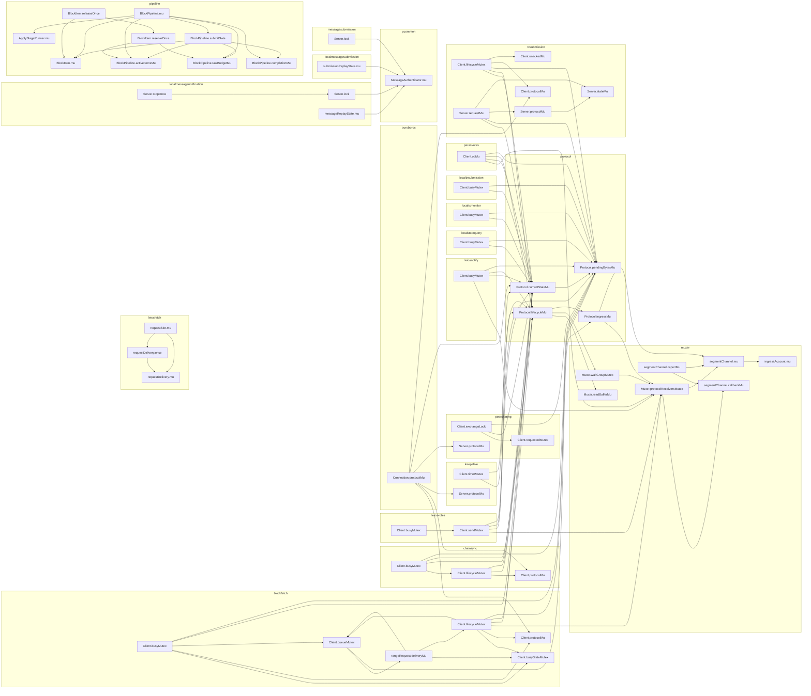

# gOuroboros concurrency inventory

This is a list of every lock, goroutine, channel, atomic and timer in
gOuroboros, the places where they can go wrong, and a plan for the TLA+ models
that would check them. It is written for someone who knows Go but has not
worked much with Go concurrency.

- **Source:** gOuroboros `origin/main` at
  `d8f5bc2ae2f4a576681d294b1f5e6496cbc7105f`, non-test code only (`*_test.go`
  and `internal/test/` are excluded). Every `file:line` is relative to the
  gOuroboros repository root and was read at that commit. Inside a package
  section, a bare `:123` means a line in the file named most recently.
- **Method:** a grep for every `sync.Mutex`/`sync.RWMutex`, `go` statement,
  `sync.WaitGroup`, `sync.Once`, `sync.Cond`, `sync.Map`, `errgroup`,
  `atomic.*`, timer, ticker, `time.AfterFunc`, `runtime.AddCleanup` and
  channel, followed by reading each package's code around every hit. Which
  fields a lock protects comes from what the code reads and writes while
  holding it, not from comments; where a comment disagrees, the row says so.
  Nothing was built or run.
- **Not covered:** concurrency in callers such as Dingo, and the race
  detector. Several hazards below are data races that a `go test -race` test
  would find faster than a model; the [model plan](#7-model-plan) says which.

## Contents

1. [Terms used here](#1-terms-used-here)
2. [Counts](#2-counts)
3. [Components](#3-components): connection, muxer, protocol engine,
   each mini-protocol, pipeline, ledger, consensus, CBOR
4. [Atomics and the hash cache's spin-wait](#4-atomics-and-the-hash-caches-spin-wait)
5. [Lock-order graph](#5-lock-order-graph)
6. [Hazard list](#6-hazard-list)
7. [Model plan](#7-model-plan)

## 1. Terms used here

- **Goroutine:** a function running concurrently with the rest of the
  program, started with `go f()`. A goroutine that nothing ever stops or
  waits for is **leaked**.
- **Join:** waiting until a goroutine has finished, usually through a
  `sync.WaitGroup` or a "done" channel that the goroutine closes as it exits.
  A goroutine is **unjoined** when no code waits for it, so whoever stopped it
  cannot know when it has actually finished, including any callback it is
  still running.
- **Mutex (`sync.Mutex`):** a lock. `Lock` blocks until no other goroutine
  holds it; `Unlock` releases it. Go mutexes are **not reentrant**: a
  goroutine that calls `Lock` on a mutex it already holds blocks forever.
- **RWMutex (`sync.RWMutex`):** a lock with two modes. Many readers
  (`RLock`) may hold it at once; a writer (`Lock`) holds it alone.
- **Held across X:** the lock is still held while X happens. Holding a lock
  across something that can wait a long time (a channel operation, network
  I/O, a callback into user code) makes every other goroutine that wants the
  lock wait as long.
- **User callback:** a function the library's caller supplies, usually a
  `*Func` field of a protocol's `Config` (`RangeDoneFunc`, `VoteFunc`,
  `MessageHandlerFunc`). The library cannot know what it does; if it calls
  back into the library and needs a lock the library is holding, it
  deadlocks.
- **Deadlock:** goroutines each waiting for something another of them
  holds, so none can continue.
- **Lock order:** if one goroutine takes lock A and then lock B while still
  holding A, that is an edge A -> B. If another path takes B then A, two
  goroutines can each hold one and wait for the other: a deadlock. A program
  with no cycle in its graph of edges cannot deadlock on locks alone.
- **Channel:** a typed pipe between goroutines. An **unbuffered** channel
  (`make(chan T)`) makes the sender wait until a receiver takes the value. A
  **buffered** channel (`make(chan T, n)`) holds up to n values; a send
  blocks only when it is full. Sending on a `nil` channel blocks forever.
- **Close:** `close(ch)` marks a channel finished. Every receiver then gets
  the zero value at once, which makes closing the standard way to broadcast
  "stop" to many goroutines. Closing twice, or **sending on a closed
  channel, panics.** So a send must never race a close: something (a lock,
  or the fact that only the sender closes) has to order them.
- **`select`:** waits on several channel operations and takes whichever is
  ready first; with a `default` case it never blocks. When several are ready
  it picks one at random.
- **`sync.WaitGroup`:** a counter. `Add`/`Go` increments it, `Done`
  decrements it, `Wait` blocks until it is zero. Go requires that an `Add` on
  a zero counter happens before `Wait` starts.
- **`sync.Once`:** runs a function exactly once; concurrent callers of `Do`
  wait until that first run returns. Because of that wait it behaves like a
  lock in the lock-order graph.
- **`sync.Cond`:** lets goroutines sleep until another signals that a
  condition may have changed. `Wait` releases the associated lock while
  sleeping and retakes it on wake.
- **Lost wakeup:** a goroutine goes to sleep waiting for a signal that was
  already sent (or never will be), so it sleeps forever.
- **Atomic, CompareAndSwap, spin-wait:** see
  [section 4](#4-atomics-and-the-hash-caches-spin-wait).
- **Timer, ticker, `time.AfterFunc`:** a timer delivers one value on its
  channel after a delay; a ticker delivers one every period;
  `time.AfterFunc(d, f)` runs `f` on a **new goroutine** after `d`.
  `Stop` on a timer does not wait for an `AfterFunc` callback that has
  already started.
- **Context (`context.Context`):** a value that carries a cancellation
  signal (`ctx.Done()`) through calls. Code that blocks without watching a
  context cannot be cancelled.
- **The engine:** `protocol.Protocol` in `protocol/protocol.go`, which every
  mini-protocol embeds. It runs four goroutines per protocol (readLoop,
  recvLoop, sendLoop, stateLoop) and owns the per-state timeouts.
- **Promoted method:** a method of an embedded struct called through the
  outer one. Mini-protocol servers embed `*protocol.Protocol`, so
  `server.DoneChan()` reads the embedded pointer, with no lock, even when a
  restart replaces it.

## 2. Counts

| Kind | Total | Where |
| --- | --- | --- |
| Lock declarations (`sync.Mutex`, `sync.RWMutex`) | 78 | connection 1, muxer 9, engine 4, `protocol/common` 1, keepalive 3, blockfetch 7, chainsync 4, txsubmission 6, peersharing 3, localtxsubmission 1, localtxmonitor 1, localstatequery 1, pipeline 9, leiosfetch 3, leiosvotes 3, perasvotes 1, leiosnotify 2, messagesubmission 2, localmessagenotification 3, localmessagesubmission 2, `ledger/common` 8, `ledger/leios` 1, consensus 2, cbor 1. `peersharing`'s `exchangeLock` is a `*sync.Mutex`; pipeline also uses a 1-slot channel, `submitGate`, as a lock. |
| `go` statements | 35 | connection 1, muxer 2, engine 5, keepalive 1, blockfetch 4, chainsync 4, localstatequery 1, localtxsubmission 1, pipeline 5, leiosfetch 1, perasvotes 2, leiosvotes 1, leiosnotify 6, localmessagenotification 1 |
| Goroutine sources in all | 40 | the 35 above, plus `WaitGroup.Go` in connection and muxer and keepalive's `time.AfterFunc` callback (see each table); `runtime.AddCleanup` in `ledger/common` runs on a runtime goroutine |
| Goroutines nothing joins | 24 | connection/muxer/engine/keepalive 6, client protocols 8, pipeline and Leios/Peras/DMQ 10 |
| Channels | about 98 | connection/muxer/engine about 30, client protocols 37, pipeline and Leios/Peras/DMQ 30, `ledger/common` 1 |
| `CompareAndSwap` sites | 3 | `ledger/common/hash_cache.go:46` and `:61`, `pipeline/metrics.go:41` |
| Atomic fields | 28 | 26 typed (`atomic.Bool`, `atomic.Int64`, `atomic.Uint64`, `atomic.Uint32`, `atomic.Pointer`: pipeline 16, muxer 2, cbor 2, engine 1, blockfetch 1, chainsync 1, localtxmonitor 1, leiosnotify 1, `ledger/common` 1) plus the hash cache's two raw words |
| `sync.WaitGroup` | 5 | `connection.go:83`, `muxer/muxer.go:134`, `pipeline/pipeline.go:308`, `pipeline/worker_pool.go:49`, `protocol/chainsync/client.go:59` |
| `sync.Cond` | 1 | `muxer/muxer.go:588` |
| `sync.Once` | 44 | listed per component |
| `sync.Map` | 1 | `ledger/common/plutus_machine_pool.go:241` |
| `errgroup` | 0 | |
| Lock-order edges | 98 distinct (120 edge lines with call sites) | [section 5](#5-lock-order-graph) |
| Lock-order cycles | 1 | blockfetch; not reachable from library code alone, closable by a reentrant user callback (X1) |
| Hazards | 59 | 10 already known, 49 new ([section 6](#6-hazard-list)) |

## 3. Components

Each package section has the same parts: **Locks** (where declared, what it
protects, who takes it, what it is held across), **Goroutines** (who starts
and stops each, and whether anything joins it), **Channels** (buffer size,
senders, receivers, closer, and whether a send can race the close), **Other
primitives**, **Lock-order edges** (written `A -> B @ file:line`: B is taken
while A is held), and **Hazards** (numbered within the package; the global
IDs in [section 6](#6-hazard-list) point back to them). A **Ruled out** list
records suspicions that the code disproves.

### Engine calls that the mini-protocols make

These are the `protocol/protocol.go` locks that a mini-protocol reaches when it
calls into the engine. The lock-order edges below name them.

| Engine call | What it takes or waits on |
|---|---|
| `SendMessage` / `SendMessageContext` (`enqueueMessage`, protocol.go:844) | `Protocol.currentStateMu` RLock (`getCurrentState`, protocol.go:657), then `Protocol.pendingBytesMu` (protocol.go:887, released before the next step); then a **channel send** on `sendQueueChan` (buffer 80, protocol.go:439) that blocks when the queue is full, until stop/done/muxer-done (protocol.go:901-912). Over the per-state byte limit it calls `SendError` (protocol.go:890). |
| `SendMessageAndWait` / `SendMessageContextAndWait` | as above, then waits on the delivery channel until the segment is written or stop/done (protocol.go:815-829). |
| `SendError` (protocol.go:926) | non-blocking send to `ErrorChan`, then `Stop`. |
| `Stop` / `StopForRestart` (`stop`, protocol.go:496) | `Protocol.lifecycleMu` (protocol.go:498, released at 501), closes `stopChan`, then `muxer.Muxer.protocolReceiversMutex` in `UnregisterProtocol` (muxer.go:1238) or `SuspendProtocol` (muxer.go:1295). `StopForRestart` also waits on `readDoneChan` (protocol.go:521). |
| `RunLoop(where, loop)` (protocol.go:1190) | runs `loop` **in the calling goroutine** with `recoverLoop` (protocol.go:1170) as a deferred panic handler, which reports the panic and calls `p.Stop()`. Callers start it with `go`. Nothing in the engine tracks these goroutines: `Stop` neither signals nor waits for them, so every `go x.RunLoop(...)` below is joined by nothing. |

`Protocol.DoneChan()` closes only after `recvLoop` and `sendLoop` have both exited
(protocol.go:448-452), or directly when the protocol is stopped before it started.

### `.` (root package: `connection.go`)

`connection_options.go` and `networks.go` contain no locks, goroutines, channels or timers (grep).

**Locks**

| decl | lock | protects | taken by | held across |
| --- | --- | --- | --- | --- |
| connection.go:94 | `Connection.protocolMu` (RWMutex) | `protocolsReady` and the mini-protocol pointer fields set in `setupConnection` (`chainSync`, `blockFetch`, `txSubmission`, `keepAlive`, `peerSharing`, `leios*`, `perasVotes`, `localStateQuery`, `localTxMonitor`, `localTxSubmission`, `localMessage*`). **Not** `c.handshake`, written at connection.go:803 without the lock but read under RLock by `protocolInstancesLocked` (connection.go:503). The public getters (connection.go:279-357) read the same fields without the lock. | `lockProtocolSetup` (connection.go:489, Lock; released at :912, :1003, :1035), `allProtocolsIdle` (:414 RLock), `stopProtocols` (:431 RLock) | Lock: the `*.New` mini-protocol constructors (grep of the `New` bodies found no lock, goroutine or registration). RLock: other locks, `protocolMu` -> each server/client's `protocolMu` through `ProtocolInstance()` (:513-619) and -> `Protocol.currentStateMu` through `IsInTerminalOrIdleState` (:423). Channel ops, callbacks, I/O, waits: none. |

**Goroutines**

| `go` site | owner | started by | stops on | joined by |
| --- | --- | --- | --- | --- |
| connection.go:679 | shutdown driver | `setupConnection` | runs once `doneChan` closes, calls `shutdown()` and returns | `Close` waits on `connClosedChan` (:265), which this goroutine closes as its last act (:394) |
| connection.go:698 (`waitGroup.Go`) | muxer-error forwarder | `setupConnection` | `doneChan` closed, or one muxer error (then `requestClose`), or muxer `errorChan` closed | `waitGroup.Wait` in `shutdown` (:386) |
| connection.go:838 (`waitGroup.Go`) | protocol-error forwarder | `setupConnection`, after the handshake | `doneChan` closed or one protocol error | `waitGroup.Wait` (:386), but see hazard 2: it can be added while that Wait runs |

**Channels**

| channel, `make` | buffer | senders | receivers | closer | send can race close? |
| --- | --- | --- | --- | --- | --- |
| `errorChan` :153 (or caller's, `WithErrorChan`) | 10 | `forwardError` :402 (non-blocking select with `doneChan` and `default`) | consumer | `shutdown` :390, only when owned, after `waitGroup.Wait` | No: both senders are in `waitGroup`, and Wait finishes before the close (covered by ConnectionShutdown.tla). The hazard-2 late goroutine returns on the closed `doneChan` before it can send. |
| `protoErrorChan` :136 | 10 | every protocol's `SendError` (protocol/protocol.go:937) and `recoverLoop` (:1178), all non-blocking | `setupConnection` select :817, forwarder :843 | never | n/a (never closed) |
| `handshakeFinishedChan` :137 | 0 | none; signalled by close | `setupConnection` :821 | handshake `FinishedFunc` :792 on the handshake recvLoop | No double close: the handshake reaches `Done` (AgencyNone) after one terminal message, so `FinishedFunc` runs at most once |
| `doneChan` :678 | 0 | none | :680, :700, :814, :840, :491, :403; also passed to protocols as `ConnectionDoneChan` | `requestClose` :274 under `onceClose` | n/a |
| `connClosedChan` :139 | 0 | none | `Close` :265 | `shutdown` :394 under `onceShutdown` | n/a |

**Other primitives**

- connection.go:83 `waitGroup` (sync.WaitGroup): joins the two forwarders; waited in `shutdown` :386.
- connection.go:84 `onceClose`: makes the close of `doneChan` idempotent.
- connection.go:85 `onceShutdown`: runs the `shutdown` body once (the comment cites a past double-close panic).
- connection.go:811 `handshakeTimer` (`time.NewTimer`, stopped by defer :812): bounds the handshake wait; on expiry it calls `c.Close()` (:824).

**Lock-order edges**

- `ouroboros.Connection.protocolMu`(R) -> `protocol.Protocol.currentStateMu`(R) @ connection.go:423 (allProtocolsIdle -> IsInTerminalOrIdleState -> getCurrentState, protocol/protocol.go:657)
- `ouroboros.Connection.protocolMu`(R) -> `keepalive.Server.protocolMu`(R) @ connection.go:552 (protocolInstancesLocked -> ProtocolInstance, protocol/keepalive/server.go:78; reached from allProtocolsIdle :421 and stopProtocols :432)
- `ouroboros.Connection.protocolMu`(R) -> `chainsync.Client.protocolMu`(R) @ connection.go:513 and `chainsync.Server.protocolMu`(R) @ connection.go:516 (protocolInstancesLocked)
- `ouroboros.Connection.protocolMu`(R) -> `blockfetch.Client.protocolMu`(R) @ connection.go:523 and `blockfetch.Server.protocolMu`(R) @ connection.go:529 (protocolInstancesLocked)
- `ouroboros.Connection.protocolMu`(R) -> `txsubmission.Client.protocolMu`(R) @ connection.go:537 and `txsubmission.Server.protocolMu`(R) @ connection.go:543 (protocolInstancesLocked)
- `ouroboros.Connection.protocolMu`(R) -> `peersharing.Server.protocolMu`(R) @ connection.go:586, `leiosnotify.Server.protocolMu`(R) @ :597, `leiosfetch.Server.protocolMu`(R) @ :608, `leiosvotes.Server.protocolMu`(R) @ :619 (protocolInstancesLocked; each `ProtocolInstance` takes RLock, by grep)

**Hazards**

1. connection.go:259/:678/:695/:382, **unjoined goroutine** (a leak). `Close` running concurrently with `Dial`/`setupConnection`: G1 (Dial) makes `doneChan` at :678 and starts the shutdown goroutine; G2 (`Close`) closes it; `shutdown` runs `stopProtocols` (`c.handshake` is still nil) and reads `c.muxer == nil` at :382, so it never stops a muxer, then closes `connClosedChan`; G1 then creates the muxer (:695), starts the handshake and calls `StartOnce` (:809), and returns at :814. Nobody ever calls `muxer.Stop`, so `conn` stays open, and the muxer read loop handles one segment and then blocks at muxer/muxer.go:1424 for good, along with the handshake protocol's goroutines. Precondition: `doneChan`, `muxer` and `handshake` are written without synchronization while `Close` reads them, which is a data race in its own right.
2. connection.go:838 vs :386, **other** (WaitGroup misuse). If `doneChan` closes between :821 and :838 (because of a concurrent `Close`, or a muxer write error that goes through `sendError` to `muxer.Stop`, then the forwarder at :698 and `requestClose`), `shutdown` can be inside `waitGroup.Wait` with a zero counter while G1 calls `waitGroup.Go`. Go requires that an Add with a positive delta on a zero counter happen before Wait. The result is a race-detector report or a "WaitGroup misuse" panic. The late goroutine returns at once on the closed `doneChan`.
3. connection.go:263-265/:372-396, **unjoined goroutine**. `Close` returns once `shutdown` finishes, and `shutdown` joins only the two forwarders. `stopProtocols` (:430) calls `Protocol.Stop`, which waits for none of the four loops (see `protocol`), and `muxer.Stop` (:383) only closes a channel. So `MessageHandlerFunc`, `MessageReceivedFunc`, `TimeoutFunc`, the muxer `Metrics` callbacks and the keep-alive callbacks can all run after `Close` returns. The comment at :263 says "all connection-owned goroutines have stopped". That holds only for the forwarders. It is still true that `errorChan` is safe to close at that point, because protocol goroutines send only on `protoErrorChan`.
4. connection.go:785-786/:792 vs :823, **other** (data race, low). When the handshake timer fires, `setupConnection` returns at :825, but the `FinishedFunc` on the handshake recvLoop can still run and write `c.handshakeVersion` and `c.handshakeVersionData` with no synchronization against a caller's `ProtocolVersion()` (:360).

Ruled out:
- Double close of `errorChan`/`connClosedChan`: `onceShutdown` (:379).
- `forwardError` blocking shutdown: its select has a `default`.
- Protocol `Start` after `stopProtocols`: `lockProtocolSetup` checks `doneChan` under `protocolMu`. A protocol constructed before the close is seen by `stopProtocols` and stopped; the `Start`/`EnsureRegistered` calls after the unlock (:914-984) then do nothing, because `Protocol.stopped` is checked under `lifecycleMu` (protocol/protocol.go:323, :424).
- `muxer.Start()` (:1080) after `muxer.Stop()`: a non-blocking send to a loop that has already exited.

### `muxer`

**Locks**

| decl | lock | protects | taken by | held across |
| --- | --- | --- | --- | --- |
| muxer/egress.go:75 | `egress.mu` | `busy`, `praos`, `leios`, `praosRun` | `acquire` (:87, :116), `release` (:143); `remove` requires it | `close(granted)` at :163 (non-blocking); otherwise none |
| muxer/muxer.go:135 | `Muxer.waitGroupMutex` | orders `waitGroup.Go` in `RegisterProtocol` before `waitGroup.Wait` in cleanup (`fenceRegistrations`) | `RegisterProtocol` :1144, `fenceRegistrations` :1341 | other locks: -> `protocolReceiversMutex` (:1157). Also `registerHook` (test only, :1153) and `waitGroup.Go` (no wait). Not held across `waitGroup.Wait` (it is released at :1342 before :1072). |
| muxer/muxer.go:139 | `Muxer.protocolReceiversMutex` | `protocolSenders`, `protocolReceivers`, `protocolTombstones` | `SetIngressBudgetExtension` :275, `SetIngressLimit` :299, `SetIngressBackpressure` :326, `IngressBackpressure` :343, `IngressLimit` :357, `RegisterProtocol` :1157, `UnregisterProtocol` :1238, `SuspendProtocol` :1295, `TakeCarriedIngress` :1324, `readLoop` :1495 and its deferred sweep :1398 | other locks: -> `segmentChannel.mu`, `segmentChannel.callbackMu` (edges below). Wait: the readLoop sweep holds it across `segmentChannel.stop`, which blocks on `<-forwarderDone` (:995). No channel sends, callbacks or I/O. |
| muxer/muxer.go:150 | `Muxer.readBufferMu` | `readBufferBudget`, `readBufferUsed` | `RaiseReadBufferBudget` :382, `ReserveReadBuffer` :398, `ReleaseReadBuffer` :415, `ReadBufferBudget` :426, `ReadBufferInUse` :434 | none |
| muxer/muxer.go:443 | `ingressAccount.mu` | `budget`, `room`, `extended`, `limit`, `used`, `payload` | `extend` :469, `setBudget` :500, `getBudget` :508, `inUse` :514, `retainedInUse` :520, `reserve` :534, `release` :548 | `close(a.room)` :484 (non-blocking); otherwise none |
| muxer/muxer.go:580 | `segmentChannel.mu` | `limit`, `extension`, `backpressure`, `room`, `queue`, `pendingBytes`, `pendingCost`, `depthReports`, `closed`, `suspended`, `carry`, and `ch` set to nil at :856. The comment at :578 says the channels are written "only at construction and in stop", but `ch` is closed and cleared in `forward`'s defer (:854-856), not in `stop`. | `setLimit` :641, `setBudgetExtension` :650, `setBackpressure` :661, `reportDepths` :693, `enqueue` :765, `forward` :845/:862, `stop` :990, `suspend` :942, `resume` :951, `takeCarry` :961; `IngressBackpressure` :349, `IngressLimit` :363 | -> `ingressAccount.mu` (edges); `cond.Wait` (:864, which releases it); `close(sc.room)` :671 and `close(sc.ch)` :855 (both non-blocking) |
| muxer/muxer.go:604 | `segmentChannel.reportMu` | serializes delivery of `depthReports` | `reportDepths` :690 | **user callback**: `Metrics.IngressQueueDepth` (:704) through `callMetrics`. Other locks: -> `segmentChannel.mu` (:693), -> `callbackMu` (:721/:729). |
| muxer/muxer.go:609 | `segmentChannel.callbackMu` | `callbacks`, `callbacksDone`, `stopping` | `callMetrics` :721/:729, `forward` defer :839, `stop` :974 | `close(callbacksDone)` :733 (non-blocking); otherwise none |
| muxer/muxer.go:916 | `segmentSender.mu` | orders the sender goroutine's `done` check against `stop`'s close and drain | `segmentSender.stop` :921, sender goroutine :1213 | `stop` holds it while draining `ch` and calling `reportDelivery` (a non-blocking send, muxer/segment.go:58-61); none of the others |

**Goroutines**

| `go` site | owner | started by | stops on | joined by |
| --- | --- | --- | --- | --- |
| muxer/muxer.go:1060 | `Muxer.readLoop` | `NewWithSegmentReadTimeout` | `doneChan`; any read, deadline or protocol error (`sendError` -> `Stop`); `errMuxerStopping` | `waitGroup` (Add :1059, Done :1396) waited by the cleanup goroutine :1072 |
| muxer/muxer.go:1062 | cleanup | `NewWithSegmentReadTimeout` | after `doneChan`: `conn.Close`, fence, `waitGroup.Wait`, `close(errorChan)` | **UNJOINED** (its only signal is closing `errorChan`; `Connection` does not wait for it) |
| muxer/muxer.go:1182 (`waitGroup.Go`) | `segmentChannel.forward` | `RegisterProtocol` (new receiver) | `stop` sets `closed` and closes `done` | `waitGroup` (:1072); `stop` also waits on `forwarderDone` unless a metrics callback is running |
| muxer/muxer.go:1199 (`waitGroup.Go`) | per-role sender | `RegisterProtocol` | `doneChan`, `sender.done`, `senderChan` closed, or a `Send` error | `waitGroup` (:1072) |

Cleanup at :1062 is joined transitively by nothing outside the muxer, so the other three are joined only from inside it.

**Channels**

| channel, `make` | buffer | senders | receivers | closer | send can race close? |
| --- | --- | --- | --- | --- | --- |
| `startChan` :1049 | 1 | `Start` :1086, `StartOnce` :1095 (non-blocking) | `readLoop` :1424 | never | n/a; see hazard 1 |
| `doneChan` :1050 | 0 | none | many; also returned to protocols as `muxerDoneChan` | `Stop` :1104 under `onceStop` | n/a |
| `errorChan` :1051 | 10 | `sendError` :1130 (non-blocking) | `Connection` (connection.go:702) | cleanup :1074, after `fenceRegistrations` and `waitGroup.Wait` | No: every `sendError` caller (readLoop, sender goroutines) is in `waitGroup` |
| `senderChan` :1155 | 10 | `Protocol.sendLoop` (protocol/protocol.go:1496) | sender goroutine :1209; `segmentSender.stop` drain :926 | `Protocol.sendLoop` defer (protocol/protocol.go:1200), its only sender | No: the closer is the sole sender |
| `segmentSender.done` :1156 | 0 | none | sender goroutine :1207, :1215 | `segmentSender.stop` :923 under `onceStop` | n/a |
| `segmentChannel.ch` :632 | 10 | `forward` :887, :895 | `Protocol.readLoop` (protocol/protocol.go:1939, :1965) | `forward` defer :855, the sole sender | No |
| `segmentChannel.done` :633 | 0 | none | `enqueue` :827, `forward` :889, :896 | `stop` :989, once only because of `stopping` under `callbackMu` | n/a |
| `segmentChannel.forwarderDone` :634 | 0 | none | `stop` :979, :995 | `forward` defer :859 | n/a |
| `segmentChannel.callbacksDone` :986 | 0 | none | `forward` defer :843 | `callMetrics` :733, when `stopping && callbacks == 0` | n/a (closed once: `callbacks` only falls after `stopping`) |
| `segmentChannel.room` :817 | 0 | none | `enqueue` :825 | `wakeEnqueueLocked` :671 under `mu` | n/a |
| `ingressAccount.room` :538 | 0 | none | `enqueue` :826 (as `accountRoom`) | `wakeLocked` :484 under `a.mu` | n/a |
| egress `granted` egress.go:86 | 0 | none | `acquire` :106, :121 | `release` egress.go:163 under `e.mu` | n/a |
| `Segment.deliveryChan` (caller's, set by `SetDeliveryChan` segment.go:50) | caller (protocol uses 1) | `reportDelivery` segment.go:59 (non-blocking) | protocol `SendMessageAndWait` | never by the muxer | n/a |

**Other primitives**

- muxer/muxer.go:134 `waitGroup`: joins readLoop, forwarders and senders; waited only by cleanup :1072.
- muxer/muxer.go:140 `diffusionMode` (`atomic.Int64`): set by `SetDiffusionMode` :1115, read by readLoop :1471, :1481.
- muxer/muxer.go:141 `onceStop`: closes `doneChan` once.
- muxer/muxer.go:164 `metrics` (`atomic.Pointer[Metrics]`): swapped by `SetMetrics`.
- muxer/muxer.go:588 `segmentChannel.cond` (`sync.Cond` on `mu`, built at :636). Wait at :864 sits inside `for len(sc.queue) == 0 && !sc.closed` with `mu` held. Two state changes can make the predicate true: the append at :786 is followed by `Broadcast` at :790 under `mu`, and `closed = true` at :991 is followed by `Broadcast` at :992 under `mu`. The other writes to `queue` (:853, :876, :879) are made by the waiter itself. **No lost wakeup.**
- muxer/muxer.go:915 `segmentSender.onceStop`.
- Deadlines rather than timers: `SetReadDeadline` :1440 (`segmentReadTimeout`, 120 s by default), `SetWriteDeadline` :1382 (2 min).

**Lock-order edges**

- `muxer.Muxer.waitGroupMutex` -> `muxer.Muxer.protocolReceiversMutex` @ muxer/muxer.go:1157 (RegisterProtocol)
- `muxer.Muxer.protocolReceiversMutex` -> `muxer.segmentChannel.mu` @ muxer/muxer.go:1174 (RegisterProtocol -> resume :951)
- `muxer.Muxer.protocolReceiversMutex` -> `muxer.segmentChannel.mu` @ muxer/muxer.go:281 (SetIngressBudgetExtension -> setBudgetExtension :650)
- `muxer.Muxer.protocolReceiversMutex` -> `muxer.segmentChannel.mu` @ muxer/muxer.go:308 (SetIngressLimit -> setLimit :641)
- `muxer.Muxer.protocolReceiversMutex` -> `muxer.segmentChannel.mu` @ muxer/muxer.go:332 (SetIngressBackpressure -> setBackpressure :661)
- `muxer.Muxer.protocolReceiversMutex` -> `muxer.segmentChannel.mu` @ muxer/muxer.go:349 (IngressBackpressure)
- `muxer.Muxer.protocolReceiversMutex` -> `muxer.segmentChannel.mu` @ muxer/muxer.go:363 (IngressLimit)
- `muxer.Muxer.protocolReceiversMutex` -> `muxer.segmentChannel.mu` @ muxer/muxer.go:1301 (SuspendProtocol -> suspend :942)
- `muxer.Muxer.protocolReceiversMutex` -> `muxer.segmentChannel.callbackMu` @ muxer/muxer.go:1402 (readLoop deferred sweep -> stop :974)
- `muxer.Muxer.protocolReceiversMutex` -> `muxer.segmentChannel.mu` @ muxer/muxer.go:1402 (readLoop deferred sweep -> stop :990)
- `muxer.segmentChannel.mu` -> `muxer.ingressAccount.mu` @ muxer/muxer.go:779 (enqueue -> reserve :534)
- `muxer.segmentChannel.mu` -> `muxer.ingressAccount.mu` @ muxer/muxer.go:874 (forward -> release :548)
- `muxer.segmentChannel.mu` -> `muxer.ingressAccount.mu` @ muxer/muxer.go:848 and :851 (forward defer -> release, extend)
- `muxer.segmentChannel.mu` -> `muxer.ingressAccount.mu` @ muxer/muxer.go:655 (setBudgetExtension -> extend :469)
- `muxer.segmentChannel.reportMu` -> `muxer.segmentChannel.mu` @ muxer/muxer.go:693 (reportDepths)
- `muxer.segmentChannel.reportMu` -> `muxer.segmentChannel.callbackMu` @ muxer/muxer.go:703 (reportDepths -> callMetrics :721, :729)
- `muxer.segmentChannel.reportMu` -> any muxer lock taken by a user `Metrics.IngressQueueDepth` callback @ muxer/muxer.go:704 (the `Metrics` doc at :179-181 allows Register/UnregisterProtocol there, which take `waitGroupMutex`/`protocolReceiversMutex`)

No cycle found: no path takes `reportMu` or `protocolReceiversMutex` while holding `segmentChannel.mu` or `ingressAccount.mu`.

**Hazards**

1. muxer/muxer.go:1084-1098 with :1419-1427, **lost wakeup**. `Start` and `StartOnce` both do a non-blocking send into the capacity-1 `startChan`. If `StartOnce`'s `false` is still buffered when `Start()` is called, `Start`'s `true` is dropped. readLoop then takes `false`, reads one segment, and blocks at :1424 until `doneChan` closes. This cannot happen through `Connection`: `Start` (connection.go:1080) runs only after the handshake reply was read, and that read required readLoop to consume the `false`. It is a trap for direct users of the muxer API.
2. muxer/muxer.go:1062-1075 and :1101-1106, **unjoined goroutine**. `Stop` only closes `doneChan`. Teardown (closing the conn, waiting for readLoop, forwarders and senders, closing `errorChan`) happens on the unjoined cleanup goroutine. **Muxer Stop never blocks on a goroutine stuck in conn Read/Write.** It does not wait at all, and the `conn.Close` at :1067 unblocks a pending Read or Write for a standard `net.Conn`. With a `net.Conn` whose `Close` does not unblock I/O, readLoop or a sender stays blocked, `errorChan` is never closed, and the goroutines leak. Nothing deadlocks, because `Connection`'s forwarder returns on its own `doneChan`.

3. muxer/muxer.go `readLoop` deferred function, **unjoined goroutine**
   (found by `specs/muxer/MuxReceiverStop.tla`, `MuxReceiverStopJoinBug.cfg`).
   It calls `waitGroup.Done()` before its sweep of the receivers, so the
   cleanup goroutine's `Wait`, and `Stop` with it, can return while the read
   loop is still sweeping under `protocolReceiversMutex`.
4. muxer/muxer.go `RegisterProtocol`, **unjoined goroutine** (found by
   `MuxReceiverStopReplaceBug.cfg`). Registering a role that is still
   registered and not suspended makes a new receiver and overwrites the map
   entry; nothing stops the old receiver or sender. The old `forward` parks on
   the `Cond` for good, `waitGroup` never reaches zero, `ErrorChan` is never
   closed and `Stop` never returns.

Hazard 2 is out of date at `7cd17437`: `Stop` now waits for the cleanup
goroutine (`cleanupDone`) unless called with `CallbackContext`.

Ruled out:
- Lock held across a wait: readLoop's sweep holds `protocolReceiversMutex` (:1398) across `stop` -> `<-forwarderDone` (:995). It cannot deadlock. `forward` never takes `protocolReceiversMutex`. `done` is already closed, so `forward` leaves both its selects (:889, :896). `stop` skips the wait when a metrics callback is running (:984-996), so a callback blocked in `RegisterProtocol`/`SetIngress*` on that mutex is not waited for. The cost is latency only: `Protocol.Start` and `EnsureRegistered` (under `lifecycleMu`) stall during the sweep.
- Lost wakeup in backpressured `enqueue`: `sc.room` and `account.room` are fetched under the lock that their closers (`wakeEnqueueLocked` :671, `wakeLocked` :484) hold, so a wake after the check closes the channel that was fetched.
- egress: a waiter woken at the same moment as `done` (:105-123) re-checks `remove` under `e.mu` and passes on a turn it was already granted (:119-122). No turn is lost and there is never a second holder.
- `segmentSender` stop window (:1213-1222): after `sender.stop()` returns, a segment that passed the `done` check can still be written. In a MsgDone restart the old instance has nothing in flight, because the client only gets agency to send MsgDone after the server's last reply was written. For a plain unregister, a late write is harmless.
- A second `segmentChannel.stop` returns without waiting while callbacks are running (:975-981). This is documented in the `Metrics` comment (:179-181).

### `protocol` (engine: `protocol.go`; `message_scanner.go`, `state.go`, `versions.go`, `versiondata.go`, `error.go`, `message.go`, `panic.go` have no concurrency primitives, by grep)

**Locks**

| decl | lock | protects | taken by | held across |
| --- | --- | --- | --- | --- |
| protocol/protocol.go:96 | `Protocol.ingressMu` | `registered`, `muxerRole`, `ingressAllowance`, `ingressBackpressure` (the comment at :94). The code also writes `handoverIngress` under it (:352), and readLoop reads that without it (:1918); the `go` at :455 orders them. | `ensureRegistered` :346, `SetIngressAllowance` :370, `SetIngressBackpressure` :386 | other locks: -> muxer `protocolReceiversMutex` (:400, :408, :413, :352) -> `segmentChannel.mu` -> `ingressAccount.mu`. No channel ops, callbacks or I/O. |
| protocol/protocol.go:104 | `Protocol.lifecycleMu` | `started`, `stopped` | `EnsureRegistered` :321, `Start` :423, `stop` :498, `IsStopping` :596 | other locks: -> muxer `readBufferMu` (:338), -> muxer `waitGroupMutex` (:339, `RegisterProtocol`), -> `ingressMu` (:346). No waits: `Start` releases it before `SendError` (:432-433). |
| protocol/protocol.go:107 | `Protocol.pendingBytesMu` | `pendingSendBytes`, `pendingRecvBytes`, `pendingPipelinedRequests`, `pendingPipelinedReplies` | `WaitSendQueueDrained` :639, `enqueueMessage` :887/:914, `sendLoop` :1412, `addPendingPipelinedRequest` :1547, `reservePipelinedReply` :1631, `currentInboundSnapshot` :1646, `releasePipelinedReplyAdmission` :1677, `readLoop` :1899/:2160/:2167, `recvLoop` :2269, `setState` :2303 | **user callback**: `p.Logger().Warn` at :1415 (an application slog handler) inside the :1412 section. Otherwise none. |
| protocol/protocol.go:112 | `Protocol.currentStateMu` (RWMutex) | `currentState`, `currentStateGeneration`, `peerAgencyReserved`, `pipelinedTypeGenerations` | `getCurrentState` :658 (R), `observeStateAndDrainSendReady` :678, `takeAgencyToken` :765, `reserveInboundAdmission` :1570, `currentInboundSnapshot` :1644 (R), `setState` :2298 | channel ops: non-blocking send on `sendReadyChan` :2331 and non-blocking receives :681, :773. Other locks: -> `pendingBytesMu` (:2303, :1617->:1631, :1646). Not held across `TimeoutFunc` (:2358) or `MatchFunc` (:2431). |

**Goroutines**

| `go` site | owner | started by | stops on | joined by |
| --- | --- | --- | --- | --- |
| protocol/protocol.go:448 | done watcher | `Start` | after `recvDoneChan` and `sendDoneChan` close: `closeDone` | **UNJOINED** (it signals `doneChan`) |
| protocol/protocol.go:454 | `stateLoop` | `Start` | `stopChan` or `doneChan` | **UNJOINED** (nothing waits for it; `doneChan` can close while it runs) |
| protocol/protocol.go:455 | `readLoop` | `Start` | `stopChan`, `sendDoneChan`, `muxerDoneChan`, a closed `muxerRecvChan`, an error, or `carryOnExit` | `readDoneChan`, waited only by `stop(true)` (:521); **UNJOINED** for `Stop` |
| protocol/protocol.go:456 | `recvLoop` | `Start` | `stopChan`, `sendDoneChan`, `muxerDoneChan`, an error | `recvDoneChan` -> done watcher -> `doneChan` (users and keep-alive wait on it; `Connection` does not) |
| protocol/protocol.go:457 | `sendLoop` | `Start` | `stopChan`, `recvDoneChan`, an error | `sendDoneChan` -> done watcher -> `doneChan` |

`RunLoop` (:1190) runs a mini-protocol's own loop with the same panic containment. No caller in this section's scope.

**Channels**

| channel, `make` | buffer | senders | receivers | closer | send can race close? |
| --- | --- | --- | --- | --- | --- |
| `doneChan` :310 | 0 | none | many | `closeDone` :540 under `doneOnce` (from the watcher :451, `Start` failure :434, or `stop` before start :506) | n/a |
| `stopChan` :311 | 0 | none | every loop, `enqueueMessage`, `SendError` | `stop` :504 under `onceStop` | n/a |
| `readDoneChan` :312 | 0 | none | `stop(true)` :521 | readLoop defer :1854 | n/a |
| `recvDoneChan` :313 | 0 | none | sendLoop, watcher, `enqueueMessage` | recvLoop defer :2209 | n/a |
| `sendDoneChan` :314 | 0 | none | readLoop, recvLoop, watcher, `enqueueMessage` | sendLoop defer :1201 | n/a |
| `sendQueueChan` :439 | 80 | `enqueueMessage` :902 | sendLoop :1251, :1348 | never | n/a; nil before `Start` (hazard 4) |
| `recvQueueChan` :440 | `RecvQueueSize` (55) | readLoop :2184 | recvLoop :2222 | never | n/a |
| `recvStateChangedChan` :441 | 1 | `setState` :2340 (non-blocking, after the state write) | recvLoop :2237 | never | n/a. No lost wakeup: recvLoop re-checks `peerHasAgency` in a loop, and the token is sent after every state write. |
| `sendReadyChan` :442 | 1 | `setState` :2331 (non-blocking, under `currentStateMu`) | sendLoop :1237, :1248, :1293; drains :681, :773, :1086 | never | n/a (token accounting is modelled by EnginePipelining.tla) |
| `stateTransitionChan` :444 | 0 | `requestStateTransition` :2477 | stateLoop :2383 | never | n/a; senders also select on `stopChan`/`doneChan` |
| per-request `errorChan` :2471 | 1 | stateLoop :2386, :2403 | `requestStateTransition` :2486 | never | n/a; the buffer means stateLoop never blocks on it |
| `deliveryChan` :804 | 1 | muxer `reportDelivery` | `waitForMessageDeliveryContext` :820 | never | n/a |
| `muxerSendChan` / `muxerRecvChan` / `muxerDoneChan` | from muxer (see muxer table) | sendLoop :1496 | readLoop :1939, :1965 | `muxerSendChan` closed by sendLoop :1200 | No: sendLoop is its only sender |

**Other primitives**

- protocol/protocol.go:93 `onceRegister`, :101 `onceStart`, :102 `onceStop`, :103 `doneOnce`.
- protocol/protocol.go:155 `restarting` (`atomic.Bool`): stored at :503 before `close(stopChan)` at :504, read in the readLoop defer at :1864. The close orders them.
- protocol/protocol.go:2361 `transitionTimer` (`time.NewTimer`), owned only by stateLoop. It is armed in `setState` and stopped at :2290, :2379, :2418; the `!Stop() { <-C }` drains run only when the value was not received, and the receive at :2405 sets it to nil, so no drain can block (go.mod `go 1.26.11`, synchronous timer channels).
- protocol/protocol.go:1690 and :2015 `time.NewTicker(time.Millisecond)`: 1 ms polling for admission and snapshot waits (by design; no wakeup channel).
- protocol/protocol.go:1914 `time.After(time.Millisecond)`: 1 ms polling in `waitForPendingBudget`; allocates a timer per iteration.
- protocol/protocol.go:652 `time.Sleep(2ms)` polling in `WaitSendQueueDrained`.

**Lock-order edges**

- `protocol.Protocol.lifecycleMu` -> `muxer.Muxer.readBufferMu` @ protocol/protocol.go:338 (ensureRegistered, from EnsureRegistered :326 / Start :429)
- `protocol.Protocol.lifecycleMu` -> `muxer.Muxer.waitGroupMutex` @ protocol/protocol.go:339 (ensureRegistered -> RegisterProtocol muxer/muxer.go:1144, then -> protocolReceiversMutex -> segmentChannel.mu)
- `protocol.Protocol.lifecycleMu` -> `protocol.Protocol.ingressMu` @ protocol/protocol.go:346 (ensureRegistered)
- `protocol.Protocol.ingressMu` -> `muxer.Muxer.protocolReceiversMutex` @ protocol/protocol.go:400 (applyIngressLimitLocked -> SetIngressLimit, then -> segmentChannel.mu)
- `protocol.Protocol.ingressMu` -> `muxer.Muxer.protocolReceiversMutex` @ protocol/protocol.go:408 (applyIngressLimitLocked -> SetIngressBudgetExtension, then -> segmentChannel.mu -> ingressAccount.mu)
- `protocol.Protocol.ingressMu` -> `muxer.Muxer.protocolReceiversMutex` @ protocol/protocol.go:413 (applyIngressLimitLocked -> SetIngressBackpressure)
- `protocol.Protocol.ingressMu` -> `muxer.Muxer.protocolReceiversMutex` @ protocol/protocol.go:352 (ensureRegistered -> TakeCarriedIngress :1324)
- `protocol.Protocol.ingressMu` -> `muxer.segmentChannel.mu` @ protocol/protocol.go:352 (TakeCarriedIngress -> takeCarry muxer/muxer.go:961)
- `protocol.Protocol.currentStateMu` -> `protocol.Protocol.pendingBytesMu` @ protocol/protocol.go:2303 (stateLoop setState)
- `protocol.Protocol.currentStateMu` -> `protocol.Protocol.pendingBytesMu` @ protocol/protocol.go:1617 (reserveInboundAdmission -> reservePipelinedReply :1631)
- `protocol.Protocol.currentStateMu`(R) -> `protocol.Protocol.pendingBytesMu` @ protocol/protocol.go:1646 (currentInboundSnapshot)

`SendMessage` and `SendError` take no lock that can be held by their caller's protocol lock. `Stop` holds no protocol lock while it calls `UnregisterProtocol`/`SuspendProtocol`.

**Hazards**

1. **(known)** protocol/protocol.go:2240 -> :2398/:2361 -> :2260, **other** (timeout armed before the handler runs). recvLoop applies the inbound transition first: `transitionInboundState` at :2240 makes stateLoop run `setState`, which arms the new state's timer at :2361. Only after that does recvLoop call `MessageHandlerFunc` at :2260. So time spent in the handler counts against the new state's timeout. (a) G_recv moves to a local-agency state S' with timeout T and enters the handler. The handler is slow (an application callback, for example a server computing its reply) and takes longer than T. G_state's timer fires (:2405) and `SendError` reports "timeout waiting on transition from S'" even though the reply is still being built. The handshake server is an instance: the `Confirm` timer (protocol/handshake/handshake.go:81-85, 10 s on N2N) runs through `handleProposeVersions`, including `SendMessageAndWait` (protocol/handshake/server.go:229). (b) Because recvLoop is still inside handler(M1), the peer's reply M2 sits admitted in `recvQueueChan` (or in the :2229 wait). The current state's timer is stopped only when stateLoop handles M2's transition, so it can fire although M2 arrived in time. When the timer and the transition on `ch` are ready at the same moment, the select at :2376 picks one at random.
2. protocol/protocol.go:521 with :2171-2172, **other** (Stop waits on a user callback). `StopForRestart` -> `stop(true)` waits on `<-p.readDoneChan` with no other case. If readLoop is inside `MessageReceivedFunc` (:2172) or `MessageFromCborFunc` (:2136), both of which run before any `stopChan` check, a blocking callback blocks the restart, which runs on recvLoop inside the server's MsgDone handler (for example protocol/keepalive/server.go:145). A `MessageReceivedFunc` that reaches `StopForRestart` itself deadlocks on its own `readDoneChan`.
3. protocol/protocol.go:448-457 and :465-536, **unjoined goroutine**. `Stop` closes `stopChan` and unregisters, but waits for no loop. `doneChan` closes after recvLoop and sendLoop exit, yet stateLoop (`TimeoutFunc` :2358, `MatchFunc` :2431, timeout `SendError` :2408) and readLoop (`MessageReceivedFunc`, `SendError`, the deferred `ReleaseReadBuffer` :1881) can still be running after `DoneChan` closes. The `StopChan` doc (:567-569) partly acknowledges this.
4. protocol/protocol.go:844-911 vs :439/:339, **other** (unsynchronized channel publication; a block before Start). `enqueueMessage` and `WaitSendQueueDrained` (:643) read `sendQueueChan` and `muxerDoneChan` without `lifecycleMu`, while `Start` writes them (:439) and `ensureRegistered` writes them (:339). A `SendMessage` racing `Start` on another goroutine (possible with `WithDelayProtocolStart`) is a data race. A `SendMessage(ctx=Background)` before `Start` blocks on a nil `sendQueueChan` until `Stop`, because `muxerDoneChan` is also nil unless registered.
5. protocol/protocol.go:1412-1419, **lock across user callback** (low). `pendingBytesMu` is held across `p.Logger().Warn`. A slog handler that calls back into the protocol (`WaitSendQueueDrained`, `SendMessage`) would deadlock.

Ruled out:
- recvLoop wakeup: `recvStateChangedChan` is sent after every state write and recvLoop re-checks in a loop (:2229).
- sendLoop blocked on `muxerSendChan` after the muxer stops: recvLoop leaves on `muxerDoneChan`, and `recvDoneChan` releases the send at :1494.
- stateLoop blocked on `t.errorChan`: it has a buffer of 1.
- Timer drain deadlock at :2290, :2379, :2418: see the timer entry above.
- `carriedIngress` race: the readLoop defers run in the order carry (:1863), then close `readDoneChan` (:1854), and `stop(true)` reads `carriedIngress` only after `<-readDoneChan`.

### `protocol/common`

**Locks**

| decl | lock | protects | taken by | held across |
| --- | --- | --- | --- | --- |
| protocol/common/authentication.go:113 | `MessageAuthenticator.mu` | `kesOpCertCache` | `PrepareMessages` snapshot :246, commit closure :278, `verifyKESPeriodRotation` :654, `RemoveKESOpCertCacheEntry` :681 | none (`stakeAuthority` and `currentSlot` callbacks run outside it) |

Goroutines: none. Channels: none. Other primitives: none (`dmq.go`, `leios.go`, `types.go`: grep found nothing).
Lock-order edges: none.
Hazards: none.
Ruled out: a time-of-check race between the `PrepareMessages` snapshot (:246-251) and the commit (:277-299). The commit re-checks every touched pool against the live cache before writing anything, under one critical section.

### `protocol/handshake`

Locks: none. Channels: none (the engine's). Goroutines: none of its own; the `Protocol` loops come from `Protocol.Start` (protocol/handshake/client.go:87).
Other primitives: protocol/handshake/client.go:30 `onceStart`. State timeouts are `ProposeTimeout` and `ConfirmTimeout` (protocol/handshake/handshake.go:34-35), run by the engine's `transitionTimer`.
Lock-order edges: none.
Hazards: the `Confirm` timer is an instance of `protocol` hazard 1 **(known)**.
Ruled out: `FinishedFunc` running twice (the state reaches `Done`/AgencyNone after one terminal message, protocol/handshake/handshake.go:50-64), so connection.go:792 closes `handshakeFinishedChan` at most once. `Client.Start` calls `c.Stop()` after a failed send; that is `Protocol.Stop`, which is idempotent through `onceStop`.

### `protocol/keepalive`

**Locks**

| decl | lock | protects | taken by | held across |
| --- | --- | --- | --- | --- |
| protocol/keepalive/client.go:31 | `Client.cookieMutex` | `cookie`, `inFlight` | `Start` :81, `sendKeepAlive` :107/:118, `handleKeepAliveResponse` :185 | none |
| protocol/keepalive/client.go:34 | `Client.timerMutex` | `timer` | done watcher :95, `startTimer` :135, `Stop` :150 | other locks: -> `Protocol.lifecycleMu` and `Protocol.currentStateMu`(R) (:137, `IsStopping`/`IsDone`). `timer.Stop` and `time.AfterFunc` (non-blocking). No callbacks or I/O. |
| protocol/keepalive/server.go:27 | `Server.protocolMu` (RWMutex) | `Protocol` (the current instance), `stopped` | `ProtocolInstance` :78 (R), `handleDone` :149, `Stop` :165 | `newProtocol` (:155; no locks); none of the others. `p.Start()` and `p.Stop()` run after unlock. |

**Goroutines**

| `go` site | owner | started by | stops on | joined by |
| --- | --- | --- | --- | --- |
| protocol/keepalive/client.go:92 | done watcher | `Client.Start` | `DoneChan()` closes, then stops `timer` | **UNJOINED** |
| protocol/keepalive/client.go:145 (`time.AfterFunc` callback `sendKeepAlive`) | keep-alive tick | `startTimer` | `timer.Stop` before it fires; otherwise it runs once and re-arms unless `IsStopping`/`IsDone` | **UNJOINED** (`timer.Stop` does not wait for a running callback) |
| (indirect) protocol/keepalive/server.go:159 `p.Start()` | the new server instance's five engine goroutines | `handleDone`, on the old instance's recvLoop | as `protocol` | as `protocol` |

Channels: none of its own.
Other primitives: protocol/keepalive/client.go:35 `onceStart`; :145 `time.AfterFunc(c.config.Period, ...)`.

**Lock-order edges**

- `keepalive.Client.timerMutex` -> `protocol.Protocol.lifecycleMu` @ protocol/keepalive/client.go:137 (startTimer -> IsStopping, protocol/protocol.go:596)
- `keepalive.Client.timerMutex` -> `protocol.Protocol.currentStateMu`(R) @ protocol/keepalive/client.go:137 (startTimer -> IsDone -> getCurrentState, protocol/protocol.go:657)

**Hazards**

1. protocol/keepalive/client.go:149-156 vs :106-145, **unjoined goroutine** (bounded). `Client.Stop` clears the timer (:150-155) before `Protocol.Stop` sets `stopped` (:156). An AfterFunc callback already running `sendKeepAlive` passes both `IsStopping` checks in `startTimer` (:132, :137) in that window and arms a new timer after `Stop` cleared it. That timer fires once more, `SendMessage` fails with `ErrProtocolShuttingDown` (`SendError` does nothing once stopped), `startTimer` sees `IsStopping`, and the chain ends. The done watcher at :92 also stops it. `scheduleHook` (:37) exists for this race.

Ruled out:
- Server restart racing `Stop`: `stopped` is checked under `protocolMu` (server.go:149-154) and `Start` on a stopped instance does nothing. Modelled by KeepAliveLifecycle.tla.
- Timer leak after `SendError` (which stops the `Protocol`, not the `Client`): the done watcher at :92 stops the timer when `DoneChan` closes.

### Engine behaviour the client protocols rely on

- **The engine.** Every client and server embeds `*protocol.Protocol`. Its locks are `ingressMu`
  (protocol/protocol.go:96), `lifecycleMu` (:104), `pendingBytesMu` (:107) and `currentStateMu`
  (:112, RW). What the calls below take:
  - `SendMessage`/`SendMessageContext` (:780/:786 -> `enqueueMessage` :844): `currentStateMu`
    read lock (:657), then `pendingBytesMu` (:887, :914). The two are not nested. It blocks
    only on a full `sendQueueChan` (80 slots), and gives up when the protocol stops.
  - `SendMessageContextAndWait` (:800) does the same, then waits until the bytes are written
    to the connection.
  - `Start` (:421) takes `lifecycleMu`, then `ingressMu` inside it (:346), then the muxer
    (`muxer.Muxer.protocolReceiversMutex`, reached from `applyIngressLimitLocked` :395).
  - `Stop` (:465 -> :496) takes `lifecycleMu`, releases it, then calls
    `Muxer.UnregisterProtocol` (muxer/muxer.go:1234, `protocolReceiversMutex`).
  - `SendError` stops the protocol.
  - `IsDone` and `IsInTerminalOrIdleState` take a `currentStateMu` read lock.
- **Handlers run on the engine's `recvLoop` goroutine** (protocol/protocol.go:2260) with no
  engine lock held.
- **`DoneChan()` cannot close while a handler is running.** It closes only after
  `recvDoneChan` and `sendDoneChan` close (protocol/protocol.go:448-452), and `recvDoneChan`
  closes when `recvLoop` exits (:2209). The other `closeDone` calls (:434, :506) happen only
  for a protocol whose loops never started. So `case <-c.DoneChan()` inside a handler never
  fires; a handler that must stop waiting has to watch `StopChan()` instead.
- **Servers restart after the peer's `MsgDone`.** They swap their embedded `*Protocol` under
  `protocolMu` (`StopForRestart`, then `initProtocol`, then `Start`). Promoted methods
  (`s.DoneChan()`, `s.IsDone()`, ...) read that embedded pointer without the lock.

---

### protocol/blockfetch

#### Locks

`busyMutex` is a one-at-a-time token for `GetBlockRange`/`GetBlock`. It is often unlocked by
a different goroutine from the one that locked it (`releaseBusy` :321, which the handler
reaches through `resolve`, the watcher at :606, or `Stop` through `releaseCurrentBusy` :337).

| decl | lock | protects | taken by | held across |
|---|---|---|---|---|
| protocol/blockfetch/client.go:158 | `Client.protocolMu` (RW) | the embedded `Protocol` pointer | `initProtocol` :254 (write), `ProtocolInstance` :305 (read) | none. **Comment/code mismatch:** `GetBlockRange`/`GetBlock` read `c.Protocol` without it (:572, :586, :613, :622); see hazard 5 |
| protocol/blockfetch/client.go:161 | `Client.busyMutex` | that one sync call is outstanding; owned from `acquireBusy` until `releaseBusy` | `acquireBusy` :311; unlocked at :333, :349 | **peer reply wait** (`waitForBatchStart` :602/:638, `awaitBlock` :642, then the whole batch until `resolve`); muxer send (:1044); -> `busyStateMutex` :313; -> `queueMutex` :1001 |
| protocol/blockfetch/client.go:162 | `Client.busyStateMutex` | `busyLocked`, `busyToken`, `busyDoneChan` | `acquireBusy` :313, `releaseBusy` :323, `releaseCurrentBusy` :339 | none (it closes `busyDoneChan` and unlocks `busyMutex` after releasing it) |
| protocol/blockfetch/client.go:166 | `Client.lifecycleMutex` | `lifecycleState`, `startingDone`, `protoStarted`, `pipelineCtx`/`pipelineCancel`; writes of `Protocol` (through `initProtocol`) | `Start` :368/:410, `Stop` :474/:543, `pipelineContext` :553 | `Start`: `initProtocol` (-> `protocolMu`) :423, `Protocol.Start` :433. `Stop`: `IsDone` :515, `SendMessageContextAndWait` :521 (**waits for the network write, up to 250 ms**), `Protocol.Stop` :531 (muxer unregister); in the New/Stopped/Starting branches `failOutstanding` (:481, :486, :498) -> `queueMutex` and **user callback** `RangeDoneFunc`/`BatchDoneFunc` (:1238, :1250), and `releaseCurrentBusy` -> `busyStateMutex` |
| protocol/blockfetch/client.go:175 | `Client.queueMutex` | `queue`, `nextRequestId`, `inFlightBytes`, `bytesFreed`, and the per-request `started`/`blockDelivered`/`blocksReceived`/`bytesReceived`/`lastPoint` | `waitForInFlightCapacity` :924, `sendRequestRange` :1001/:1051, `watchRangeDeadline` :1082, `failOutstanding` :1260, `failOutstandingForProtocol` :1285, handlers :1361/:1385/:1417/:1542/:1715/:1747, `failRequest` :1692 | close of `bytesFreed` (:1164, :1206; a broadcast); `updateIngressAllowanceLocked` -> engine `ingressMu` -> muxer (:911-912); -> `deliveryMu` :1443 |
| protocol/blockfetch/client.go:115 | `rangeRequest.deliveryMu` (one per request) | orders a request's terminal report after a block handler that has already claimed it | `handleBlock` :1443 (until return), `watchRangeDeadline` :1108 | `handleBlock`: **user callbacks** `BlockRawFunc`/`BlockFunc` :1577/:1581, `Pipeline.Submit` :1554 (blocking; ends when `pipelineCtx` is cancelled), `pipelineContext` -> `lifecycleMutex` :553, `queueMutex` :1542/:1692, `resolve` -> `RangeDoneFunc` and `busyStateMutex`. `watchRangeDeadline`: `resolve` -> **user callback** `RangeDoneFunc`/`BatchDoneFunc`, -> `busyStateMutex` |
| protocol/blockfetch/server.go:29 | `Server.protocolMu` (RW) | `Protocol`, `stopped` | `initProtocol` :73, `ProtocolInstance` :105, `Stop` :113 | none |

#### Goroutines

| go stmt | owner | started by | stops when | joined by |
|---|---|---|---|---|
| protocol/blockfetch/client.go:263 | pipeline stop watcher | `Start` :434 (only with `Config.Pipeline`) | `p.StopChan()` (then it cancels `pipelineCtx`) or `pipelineCtx.Done()` (cancelled by `initProtocol` :227, `Stop` :480/:485/:492/:504) | **UNJOINED** |
| protocol/blockfetch/client.go:460 | shutdown watcher, run through `proto.RunLoop` | `Start` :439 | after `proto.DoneChan()` closes and `failOutstandingForProtocol` (and the `RangeDoneFunc` callbacks inside it) returns | **UNJOINED** (the `done` channel it returns is discarded at :439) |
| protocol/blockfetch/client.go:606 | `releaseBusyOnProtocolDone` | `GetBlockRange` after the batch starts | `protocolDone` (it releases busy) or `busyDone` | **UNJOINED** |
| protocol/blockfetch/client.go:1056 | `watchRangeDeadline`, one per sent request | `sendRequestRange` | timer (:1072) fires, `req.retired` closes, or `req.protocol.DoneChan()` closes | **UNJOINED** |

#### Channels

| channel / make | buffer | senders | receivers | closer | send can race close? |
|---|---|---|---|---|---|
| `rangeSendToken` :214 (filled :216) | 1 (used as a token) | :1007, :1042 (deferred) | :995 | never | n/a |
| `bytesFreed` :213, replaced :1166/:1207 | 0 (closing it is the signal) | none | `waitForInFlightCapacity` :935 | `releaseBytesLocked` :1164, `drainLocked` :1206, under `queueMutex` | no: nothing sends on it |
| `busyDoneChan` :317 | 0 | none | :361 (`releaseBusyOnProtocolDone`) | `releaseBusy` :332, `releaseCurrentBusy` :348, outside the lock after the token check | no |
| `startingDone` (`ch` made in `Start`) | 0 | none | `Start` :380 | `Start` :414/:441, `Stop` :495/:546, under `lifecycleMutex` | no |
| `req.startChan` :1027 | 1 | `handleStartBatch` :1370 (non-blocking), `resolve` :1226 (non-blocking) | `waitForBatchStart` :1124/:1135 | never | no |
| `req.blockChan` :1028 | 1 | `handleBlock` :1595 (non-blocking) | `awaitBlock` :649/:654, :711 | never | no |
| `req.doneChan` :1029 | 1 | `resolve` :1231 (non-blocking, once) | :651, :687, :1135 | never | no |
| `req.retired` :1031 | 0 | none | `watchRangeDeadline` :1112 | `resolve` :1221 inside `resolveOnce` | no |
| watcher `done` :459 | 0 | none | nobody (discarded) | :461 | no |

#### Other primitives

- protocol/blockfetch/client.go:124 `resolveOnce sync.Once`: resolves each request exactly
  once, whichever of the handler, the deadline watcher, `Stop` and the shutdown watcher gets
  there first.
- protocol/blockfetch/client.go:127 `batchDoneReported atomic.Bool`: stops `resolve` calling
  `BatchDoneFunc` a second time (set :1750, read :1246).
- protocol/blockfetch/client.go:1072 `time.NewTimer`: the range deadline in
  `watchRangeDeadline`, stopped by a defer at :1073.
- protocol/blockfetch/client.go:964 `context.WithDeadline`: the deadline for admission and
  for queueing the send. :517 `context.WithTimeout(250ms)`: `Stop`'s `MsgClientDone`
  delivery.

#### Lock-order edges

- `blockfetch.Client.busyMutex` -> `blockfetch.Client.busyStateMutex` @ protocol/blockfetch/client.go:313 (acquireBusy)
- `blockfetch.Client.busyMutex` -> `blockfetch.Client.protocolMu` @ protocol/blockfetch/client.go:981 (sendRequestRange via GetBlockRange/GetBlock)
- `blockfetch.Client.busyMutex` -> `blockfetch.Client.queueMutex` @ protocol/blockfetch/client.go:1001 (sendRequestRange via GetBlockRange/GetBlock)
- `blockfetch.Client.busyMutex` -> `protocol.Protocol.currentStateMu` @ protocol/blockfetch/client.go:1044 (sendRequestRange -> SendMessageContext -> getCurrentState)
- `blockfetch.Client.busyMutex` -> `protocol.Protocol.pendingBytesMu` @ protocol/blockfetch/client.go:1044 (sendRequestRange -> enqueueMessage)
- `blockfetch.Client.queueMutex` -> `protocol.Protocol.ingressMu` @ protocol/blockfetch/client.go:911 (updateIngressAllowanceLocked, from :1035, :1149, :1209, :1297)
- `protocol.Protocol.ingressMu` -> `muxer.Muxer.protocolReceiversMutex` @ protocol/protocol.go:400 (applyIngressLimitLocked; engine edge reached from the line above)
- `blockfetch.Client.queueMutex` -> `blockfetch.rangeRequest.deliveryMu` @ protocol/blockfetch/client.go:1443 (handleBlock)
- `blockfetch.rangeRequest.deliveryMu` -> `blockfetch.Client.queueMutex` @ protocol/blockfetch/client.go:1542 (handleBlock), :1692 (failRequest from handleBlock)
- `blockfetch.rangeRequest.deliveryMu` -> `blockfetch.Client.lifecycleMutex` @ protocol/blockfetch/client.go:553 (pipelineContext from handleBlock :1553)
- `blockfetch.rangeRequest.deliveryMu` -> `blockfetch.Client.busyStateMutex` @ protocol/blockfetch/client.go:323 (resolve -> releaseBusy, from watchRangeDeadline :1109 and handleBlock's failRequest)
- `blockfetch.Client.lifecycleMutex` -> `blockfetch.Client.protocolMu` @ protocol/blockfetch/client.go:254 (initProtocol from Start :423), :305 (ProtocolInstance from Start :432, failOutstanding :1263)
- `blockfetch.Client.lifecycleMutex` -> `protocol.Protocol.lifecycleMu` @ protocol/blockfetch/client.go:433 (Start -> Protocol.Start, then -> `protocol.Protocol.ingressMu` at protocol/protocol.go:346), :531 (Stop -> Protocol.Stop)
- `blockfetch.Client.lifecycleMutex` -> `muxer.Muxer.protocolReceiversMutex` @ protocol/blockfetch/client.go:531 (Stop -> Protocol.Stop -> UnregisterProtocol)
- `blockfetch.Client.lifecycleMutex` -> `protocol.Protocol.currentStateMu` @ protocol/blockfetch/client.go:515 (Stop -> IsDone), :521 (Stop -> SendMessageContextAndWait)
- `blockfetch.Client.lifecycleMutex` -> `protocol.Protocol.pendingBytesMu` @ protocol/blockfetch/client.go:521 (Stop -> SendMessageContextAndWait)
- `blockfetch.Client.lifecycleMutex` -> `blockfetch.Client.queueMutex` @ protocol/blockfetch/client.go:1260 (failOutstanding from Stop :481/:486/:498)
- `blockfetch.Client.lifecycleMutex` -> `blockfetch.Client.busyStateMutex` @ protocol/blockfetch/client.go:339 (releaseCurrentBusy from Stop :482/:487/:499), :323 (resolve -> releaseBusy from the same failOutstanding)
- Server: none (`protocolMu` is never held across another lock).

#### Hazards

1. **(known) A request removed by a shutdown drain before it reached the wire.**
   - Kind: other (a completion callback for an id the caller never received).
   - Lines: append protocol/blockfetch/client.go:1033; send :1044; removal on send failure
     :1051-1053; token release :1041-1043. The release is a `defer`, so it runs when the
     function returns, after `removeLocked`.
   - **At this SHA the token is not released before the refused request is removed.** Another
     sender therefore cannot see the request, and the queue head is not affected.
   - The real window is between the append (:1033) and the send's result (:1044). During it
     the unsent request sits in the queue, visible to every drain: the shutdown watcher
     :460 -> :1285, `watchRangeDeadline` :1082-1110 for an older request, and `Stop` :540.
   - Interleaving: G1 `RequestRange` appends B and blocks in `SendMessageContext` on a full
     send queue. G2 (a drain) removes B and calls `resolve(B)`, so `RangeDoneFunc(B.id,
     ErrProtocolShuttingDown)` runs. G1's send returns `ErrProtocolShuttingDown`, its
     `removeLocked` finds nothing, and `RequestRange` returns `(0, err)`. The application got
     a completion for an id it was never given.
   - The fix branch's "sending" mark is not on main: `rangeRequest` (:95-128) has no such
     field.
2. **`Stop` calls user callbacks while holding `lifecycleMutex`.**
   - Kind: lock across user callback.
   - Lines: protocol/blockfetch/client.go:481, :486, :498 -> `failOutstanding` :1265 ->
     `resolve` :1238/:1250.
   - The queue can be non-empty in the Stopped state: a running `Stop` sets Stopped and
     unlocks (:532-535) before it drains at :540. A second `Stop` in that window takes the
     Stopped branch and drains under the lock.
   - Interleaving: G1 `Stop` (running) unlocks at :535. G2 `Stop` sees Stopped and calls
     `RangeDoneFunc` while holding `lifecycleMutex`. The callback calls `client.Start()`,
     `client.Stop()`, or anything that ends in `pipelineContext` (:553). G2 deadlocks on its
     own non-reentrant mutex.
3. **`Stop` holds `lifecycleMutex` across a wait for the network write.**
   - Kind: lock across blocking call.
   - Lines: protocol/blockfetch/client.go:521 (up to 250 ms) and :531.
   - Interleaving: G1 `Stop` waits for `MsgClientDone` to be written. G2 (`recvLoop`)
     `handleBlock` holds `deliveryMu` and blocks in `pipelineContext` (:553). The receive
     loop stalls for up to 250 ms.
4. **The shutdown watcher outlives `Stop`.**
   - Kind: unjoined goroutine.
   - Lines: protocol/blockfetch/client.go:460 (its `done` channel is discarded at :439).
   - Interleaving: G1 `Stop` drains at :540 and returns. The watcher G2 woke on the same
     `DoneChan` and is still inside `failOutstandingForProtocol` :1299-1310, running
     `RangeDoneFunc`. G1 then calls `Start`, and callbacks from the old generation run
     concurrently with handlers of the new one. `resolveOnce` prevents a double resolve, not
     the overlap.
5. **`GetBlockRange`/`GetBlock` read the embedded `Protocol` without `protocolMu`.**
   - Kind: other (data race).
   - Lines: unlocked reads protocol/blockfetch/client.go:572, :586, :613, :622; the write is
     in `initProtocol` :255, reached from `Start` :423.
   - Interleaving: G1 `GetBlockRange` reads `c.Protocol` (:586) while G2 `Start` restarts
     the client and writes it. That is a data race. It also lets `protocolDone` (:586) belong
     to a different instance from the `proto` that `sendRequestRange` uses (:981).
6. **Server: promoted methods race the restart.**
   - Kind: other (data race).
   - Lines: protocol/blockfetch/server.go:78 writes `s.Protocol` under `protocolMu`.
     Promoted methods (`s.DoneChan()`, `s.IsDone()`, ...) called from consumer goroutines read
     it without the lock. `handleClientDone`'s `s.Start()` (:252) is on the writing
     goroutine, so it is fine.
   - Interleaving: G1 (`recvLoop`) `handleClientDone` installs a new instance. G2 (the
     consumer) calls `s.DoneChan()` at the same time: data race.

**Ruled out**

- *`queueMutex` -> `deliveryMu` and `deliveryMu` -> `queueMutex` deadlock* (:1443 vs
  :1542/:1692): `deliveryMu` is per request. Only `req.protocol`'s `recvLoop` takes
  `queueMutex` -> `deliveryMu(req)`, and the only other taker (`watchRangeDeadline` :1108)
  holds no `queueMutex`.
- *Cycle `lifecycleMutex` -> `queueMutex` -> `deliveryMu` -> `lifecycleMutex`*: closing it
  needs a third goroutine holding `queueMutex` while it waits for `deliveryMu`. Only the
  `recvLoop` of the handler that already holds that `deliveryMu` does that.
- *`Stop` waits on the peer through `busyMutex`*: `Stop` never locks `busyMutex`; it releases
  it with `releaseCurrentBusy` (:482, :541).
- *Send on a closed channel*: none of the per-request channels is ever closed. `retired` and
  `busyDoneChan` are closed under once or token guards and nothing sends on them.

---

### protocol/chainsync

#### Locks

| decl | lock | protects | taken by | held across |
|---|---|---|---|---|
| protocol/chainsync/client.go:47 | `Client.protocolMu` (RW) | `Protocol`, `protocolStarted` | `initProtocol` :223, `ProtocolInstance` :244 | none |
| protocol/chainsync/client.go:50 | `Client.busyMutex` | serializes the operations that send `FindIntersect`/`RequestNext` (`Sync`, `Jump`, `GetAvailableBlockRange`, the `GetCurrentTip` worker, `syncLoop` iterations, `Reintersect`/`StopAfterDrain` through `quiesceSync`) | :625, :707, :864, :1115, :1403; TryLock :493, :1237, :1251 | **peer reply wait**: findIntersect :1016-1019, requestFindIntersect, the GetAvailableBlockRange loop :815-837, waitRequestNextRetired :996, quiesceSync drained :1208, the GetCurrentTip worker :645-650. Muxer sends :641, :1012, :1557, :1580 (also `SendMessageContextAndWait` :561 when `Stop` got the lock). -> `lifecycleMutex` (edges below) |
| protocol/chainsync/client.go:51 | `Client.lifecycleMutex` | `lifecycleState`, `startingDone`, `stoppingDone`, `activeOperations`, `operationsDrained`, `readyForNextBlockChan` (the field), `outstandingRequestNext`, `requestNextDrained`, `stoppedWithoutDone`, `syncLoopStop`/`syncLoopDone`, `syncStopRequests`, `awaitReplyCtx`/`Cancel` | :256, :268, :284, :338, :371, :411, :517, :579, :594, :628, :960, :985, :1056, :1070, :1162, :1189, :1199, :1216, :1284, :1293, :1302, :1325, :1348, :1377, :1404, :1442, :1577, :1590; handlers :1641, :1664, :1787, :1798, :1813, :1825, :1896, :1911, :1991, :2007 | **channel send** on `readyForNextBlockChan` in handlers :1801, :1816, :1828, :1899, :1914, :1994, :2010 (each a select whose other arm is `DoneChan`, which cannot fire inside a handler). `Protocol.Start` :376; `initProtocol` -> `protocolMu`; `IsInTerminalOrIdleState` :518; close of `loopStop` :1171 |
| protocol/chainsync/server.go:31 | `Server.protocolMu` (RW) | `Protocol`, `stopped` | `initProtocol` :120, `ProtocolInstance` :131, `Stop` :139 | none |

#### Goroutines

| go stmt | owner | started by | stops when | joined by |
|---|---|---|---|---|
| protocol/chainsync/client.go:233 | pipeline stop watcher | `Start` :377 (only with `Config.Pipeline`) | `p.StopChan()` (then it cancels `awaitReplyCtx`) or `awaitReplyCtx.Done()` (cancelled by `initProtocol` :147, `Stop`, `StopAfterDrain`) | **UNJOINED** |
| protocol/chainsync/client.go:623 | `GetCurrentTip` worker | `GetCurrentTip` | after the reply or `doneChan`; returns early if `done` is set when it gets `busyMutex` | the `<-requestWorkerDone` defer at :654 |
| protocol/chainsync/client.go:1361 | `syncLoop` | `sendInitialRequestAndStartSyncLoop` (`Sync`, `Reintersect`) | `syncLoopStop` closed (:1171), ready channel closed or `false`, `doneChan`, or the state is no longer Running | `syncLoopWaitGroup.Wait` :591 (`finishStop`); `loopDone` (quiesceSync :1177) |
| protocol/chainsync/client.go:1950 | pipeline drain for `RollBackward` | `handleRollBackward` | when `Pipeline.WaitForDrain(drainCtx)` returns; `drainCtx` is cancelled by the defer at :1946 when the handler returns | **UNJOINED** (the handler may return on `StopChan` :1970 first) |

#### Channels

| channel / make | buffer | senders | receivers | closer | send can race close? |
|---|---|---|---|---|---|
| `readyForNextBlockChan` :169 | `PipelineLimit` | handlers :1801, :1816, :1828, :1899, :1914, :1994, :2010 (under `lifecycleMutex`, after a nil check) | `syncLoop` :1388, `GetAvailableBlockRange` :821, `discardReadySignals` :945 | `finishStop` :581 under `lifecycleMutex`, which also sets the field to nil | no: senders read the field under the same lock |
| `startingDone` (`ch` :320) | 0 | none | `Start` :296 | :342, :381, :423 under `lifecycleMutex` | no |
| `stoppingDone` :443, :1312 | 0 | none | `Start` :307, `Stop` :435 | `finishStop` :597 under `lifecycleMutex` | no |
| `operationsDrained` :445, :1314 | 0 | none | `finishStop` :592 | :448, `endOperation` :273, under `lifecycleMutex` | no |
| `requestNextDrained` :988, :1202 | 0 | none | :996, :1208 | `requestNextAnswered` :1596 under `lifecycleMutex` | no |
| `syncLoopStop` :1359 | 0 | none | `syncLoop` :1386, :1406 | `quiesceSync` :1171 under `lifecycleMutex`, guarded by a select | no |
| `loopDone`/`syncLoopDone` :1358 | 0 | none | quiesceSync :1177, prepareIdleProtocol | the loop goroutine :1363 | no |
| `waitingForCurrentTipChan` :170 | 20 | `GetCurrentTip` :665 (select with doneChan) | `sendCurrentTip` :1466 | never | no |
| `wantCurrentTipChan` :171 | 1 | `wantCurrentTip` :1482 | `sendCurrentTip` :1458, cancel :1485 | never | no |
| `wantFirstBlockChan` :172 | 1 | `wantFirstBlock` :1500 | `handleRollForward` :1689, cancel :1503 (`len()` read :1981) | never | no |
| `wantIntersectFoundChan` :173 | 1 | `wantIntersectFound` :1524 | handlers :2029, :2074, cancel :1527 | never | no |
| per-call result channels :1477, :1495, :1515 | 1 each | handlers (`ch <- tip` :1459/:1467, firstBlockChan :1736-:1873, `request.resultChan` :2041/:2055/:2075), at most one send each | the waiting caller | never | no |
| `GetCurrentTip` locals :619-:621, :657 | 1, 1, 0, 1 | the worker :633/:643/:649; `sendCurrentTip` | outer loop :660-:688 | `requestWorkerDone` closed by the worker :624 | no |
| `drainDone` :1949 | 1 | :1951 | :1956 | never | no |

#### Other primitives

- protocol/chainsync/client.go:59 `syncLoopWaitGroup`: Add :1336, Done :1342/:1353/:1362,
  Wait :591. `finishStop` waits for the sync loop to exit before marking Stopped.
- protocol/chainsync/client.go:618 `done atomic.Bool`: tells the `GetCurrentTip` worker that
  its caller has gone.
- protocol/chainsync/client.go:1240 `time.NewTicker(10ms)`: `lockBusy` polls `busyMutex.TryLock`
  so the wait can be cancelled.
- protocol/chainsync/client.go:489-501: `stopRunning` polls `TryLock` every 10 ms for up to
  5 s, then proceeds without `busyMutex`.
- :560 `context.WithTimeout` (250 ms, or 5 s for `StopAfterDrain`) bounds the `MsgDone` send.
  :1942 `drainCtx` bounds the pipeline drain. :150 `awaitReplyCtx` cancels the pipeline fence.

#### Lock-order edges

- `chainsync.Client.busyMutex` -> `chainsync.Client.lifecycleMutex` @ protocol/chainsync/client.go:256 (beginOperation from GetAvailableBlockRange :708, Sync :865, Jump :1116)
- `chainsync.Client.busyMutex` -> `chainsync.Client.lifecycleMutex` @ protocol/chainsync/client.go:628 (GetCurrentTip worker)
- `chainsync.Client.busyMutex` -> `chainsync.Client.lifecycleMutex` @ protocol/chainsync/client.go:960 (prepareIdleProtocol), :985 (waitRequestNextRetired), :1070 (Reintersect), :1199/:1216 (quiesceSync), :1293/:1302 (StopAfterDrain)
- `chainsync.Client.busyMutex` -> `chainsync.Client.lifecycleMutex` @ protocol/chainsync/client.go:1404 and :1442 (syncLoop)
- `chainsync.Client.busyMutex` -> `chainsync.Client.lifecycleMutex` @ protocol/chainsync/client.go:1577 and :1590 (sendRequestNext / requestNextAnswered under busy), :1325/:1348 (sendInitialRequestAndStartSyncLoop from Sync/Reintersect)
- `chainsync.Client.busyMutex` -> `chainsync.Client.lifecycleMutex` @ protocol/chainsync/client.go:517 (abandonIfOwed from finishStop :567 while busy is held)
- `chainsync.Client.busyMutex` -> `protocol.Protocol.currentStateMu` @ protocol/chainsync/client.go:641, :1012, :1557, :1580, :561 (SendMessage/SendMessageContextAndWait -> getCurrentState)
- `chainsync.Client.busyMutex` -> `protocol.Protocol.pendingBytesMu` @ protocol/chainsync/client.go:641, :1012, :1557, :1580, :561 (enqueueMessage)
- `chainsync.Client.busyMutex` -> `protocol.Protocol.lifecycleMu` @ protocol/chainsync/client.go:1434 (syncLoop -> SendError -> stop), :531 (abandonIfOwed -> SendError)
- `chainsync.Client.lifecycleMutex` -> `chainsync.Client.protocolMu` @ protocol/chainsync/client.go:223 (initProtocol from Start :352), :244 (ProtocolInstance from :262, :360, :451, :1304, :1331, :1352, :1427, :1444)
- `chainsync.Client.lifecycleMutex` -> `protocol.Protocol.lifecycleMu` @ protocol/chainsync/client.go:376 (Start -> Protocol.Start, then -> `protocol.Protocol.ingressMu` at protocol/protocol.go:346)
- `chainsync.Client.lifecycleMutex` -> `protocol.Protocol.currentStateMu` @ protocol/chainsync/client.go:518 (abandonIfOwed -> IsInTerminalOrIdleState)
- Server: none.

#### Hazards

1. **`GetCurrentTip` returns no earlier than the current `busyMutex` holder.**
   - Kind: lock across blocking call.
   - Lines: protocol/chainsync/client.go:625, :654.
   - Interleaving: G1 `GetAvailableBlockRange` holds `busyMutex` while waiting for the peer
     (node-to-client has no state timeouts). G2 `GetCurrentTip` receives a tip through
     `waitingResultChan` (:668) but then waits at :654 for its worker. The worker G3 is
     blocked at :625 on G1's lock, so G2 returns only after G1 finishes.
2. **Pipeline drain goroutine outlives its handler.**
   - Kind: unjoined goroutine.
   - Lines: protocol/chainsync/client.go:1950.
   - Interleaving: the handler returns on `StopChan` (:1970), and the deferred cancel stops
     `drainCtx`. A `Pipeline.WaitForDrain` that ignores its context leaves this goroutine
     running after the protocol is gone.
3. **`Stop`'s wait for `busyMutex` ignores ctx and the callback marker.**
   - Kind: lock across blocking call.
   - Lines: protocol/chainsync/client.go `stopRunning` (gOuroboros 7cd17437).
   - Interleaving: G1 `Jump` holds `busyMutex` waiting for `MsgIntersectFound`. The
     handler runs `IntersectFoundFunc`, which calls `Stop` with its context. `Stop`
     polls for 5 s: G1 releases only after the callback returns. A `Stop` whose ctx is
     done also keeps polling. `ChainSyncTipWorkerCtxBug.cfg`,
     `ChainSyncTipWorkerCallbackStopBug.cfg`.
4. **`GetCurrentTip` from a callback hangs `Stop`.**
   - Kind: other (wait on a channel only the blocked goroutine can close).
   - Lines: protocol/chainsync/client.go `GetCurrentTip` (gOuroboros 7cd17437).
   - Interleaving: a roll callback calls `GetCurrentTip`; its answer needs the receive
     loop the callback is blocking. The call and its worker wait only for `DoneChan`,
     which closes after that loop returns, so `Stop` with no deadline never returns.
     `ChainSyncTipWorkerCallbackTipBug.cfg`. Returning on `StopChan` alone is not
     enough: from `IntersectFoundFunc`, the worker waits in `busyMutex.Lock()` behind
     the `Jump` the callback blocks, and `GetCurrentTip` joins the worker; the worker
     must take the lock with `lockBusy` on `StopChan`.
     `ChainSyncTipWorkerJumpCallbackTipBug.cfg`.
5. **Server: promoted methods race the restart.**
   - Kind: other (data race).
   - Lines: protocol/chainsync/server.go:125 writes `s.Protocol` under `protocolMu`; promoted
     methods called from consumer goroutines read it without the lock. Same interleaving as
     blockfetch hazard 6.

**Ruled out**

- *The handler blocks on `readyForNextBlockChan` while holding `lifecycleMutex`* (:1798-:1830,
  :1896-:1917, :1991-:2013). The `DoneChan` arm cannot fire inside a handler, so a full
  channel would deadlock `Stop` (:411) for good. Only the buffer budget prevents it: waiting
  signals plus unanswered requests stay at or below `PipelineLimit`. `ChainSyncClient.tla`
  `SignalsFit`/`SignalBudget` checks that and passes.
- *`Stop` waits on the peer through `busyMutex`*: bounded. `stopRunning` gives up on the lock
  after 5 s (:489-501) and proceeds. The operation still holding it ends when `DoneChan`
  closes.
- *Send on a closed `readyForNextBlockChan`*: the close (:581) and every send happen under
  `lifecycleMutex`, and the field is set to nil at the close.
- *Unlocked `c.Protocol` reads* (requestFindIntersect :1557/:1568, wantCurrentTip/wantFirstBlock
  `c.DoneChan()`): they run inside an operation slot (`beginOperation`). `Stop` waits for
  `operationsDrained` (:592) before Stopped, so `initProtocol` cannot run concurrently.

---

### protocol/txsubmission

#### Locks

| decl | lock | protects | taken by | held across |
|---|---|---|---|---|
| protocol/txsubmission/client.go:37 | `Client.protocolMu` (RW) | `Protocol` | `initProtocol` :91, `ProtocolInstance` :106 | none |
| protocol/txsubmission/client.go:41 | `Client.lifecycleMutex` | `lifecycleState`, `startingDone`, `initSent`, `protoStarted`; writes of `Protocol` and `callbackContext.DoneChan` | `Start` :114/:156, `Stop` :202, `Init` :241 | `initProtocol` (-> `protocolMu`, `unackedMu`) :169; `Protocol.Start` :178; `Protocol.Stop` :229, :267; muxer send `SendMessage` :257 (`Init`) |
| protocol/txsubmission/client.go:46 | `Client.unackedMu` | `unackedTxIds` | `initProtocol` :100, `handleRequestTxIds` :318/:391, `handleRequestTxs` :424 | none (the `RequestTxIdsFunc`/`RequestTxsFunc` callbacks :343/:435 run unlocked) |
| protocol/txsubmission/server.go:28 | `Server.protocolMu` (RW) | `Protocol`, `stopped` | `initProtocol` :100, `ProtocolInstance` :121, `Stop` :129, `RequestTxIds` :154, `RequestTxs` :297 | -> `stateMu` (:105, :155, :298) |
| protocol/txsubmission/server.go:32 | `Server.requestMu` | that only one `RequestTxIds`/`RequestTxs` caller runs at a time | `RequestTxIds` :152, `RequestTxs` :285 | **peer reply wait** (:258-:281, :351-:370; a blocking `RequestTxIds` has no timeout); muxer send :249, :342; -> `protocolMu`, -> `stateMu` |
| protocol/txsubmission/server.go:33 | `Server.stateMu` | `stopping`, `ackCount`, `outstandingTxIds`, `pendingTxIds`, `pendingTxs`, `requestTxIdsResultChan`/`requestTxsResultChan` (the fields), `callbackContext` | :105, :155, :250, :265, :298, :343, :353, :404, :424, :453, :468, :485, :529 | none (result sends :439/:479/:506 happen after unlock) |

#### Goroutines

None.

#### Channels

| channel / make | buffer | senders | receivers | closer | send can race close? |
|---|---|---|---|---|---|
| client `startingDone` (`ch` in `Start`) | 0 | none | `Start` :126 | :160, :182, `Stop` :213/:233, under `lifecycleMutex` | no |
| server `requestTxIdsResultChan` :108 (remade on every restart) | 1 | `handleReplyTxIds` :439, `handleDone` :506 (once per pending request, after `pendingTxIds` is cleared under `stateMu`) | `RequestTxIds` :259, :272 | never | no |
| server `requestTxsResultChan` :109 | 1 | `handleReplyTxs` :479 | `RequestTxs` :360, :368 | never | no |

#### Other primitives

None.

#### Lock-order edges

- `txsubmission.Client.lifecycleMutex` -> `txsubmission.Client.protocolMu` @ protocol/txsubmission/client.go:91 (initProtocol from Start :169)
- `txsubmission.Client.lifecycleMutex` -> `txsubmission.Client.unackedMu` @ protocol/txsubmission/client.go:100 (initProtocol from Start :169)
- `txsubmission.Client.lifecycleMutex` -> `protocol.Protocol.lifecycleMu` @ protocol/txsubmission/client.go:178 (Start), :229 (Stop), :267 (Init)
- `txsubmission.Client.lifecycleMutex` -> `protocol.Protocol.currentStateMu` @ protocol/txsubmission/client.go:257 (Init -> SendMessage)
- `txsubmission.Client.lifecycleMutex` -> `protocol.Protocol.pendingBytesMu` @ protocol/txsubmission/client.go:257 (Init -> SendMessage)
- `txsubmission.Server.protocolMu` -> `txsubmission.Server.stateMu` @ protocol/txsubmission/server.go:105 (initProtocol), :155 (RequestTxIds), :298 (RequestTxs)
- `txsubmission.Server.requestMu` -> `txsubmission.Server.protocolMu` @ protocol/txsubmission/server.go:154 (RequestTxIds), :297 (RequestTxs), :121 (ProtocolInstance from RequestTxs)
- `txsubmission.Server.requestMu` -> `txsubmission.Server.stateMu` @ protocol/txsubmission/server.go:155, :250, :265 (RequestTxIds), :298, :343, :353 (RequestTxs)
- `txsubmission.Server.requestMu` -> `protocol.Protocol.currentStateMu` @ protocol/txsubmission/server.go:249, :342 (SendMessage)
- `txsubmission.Server.requestMu` -> `protocol.Protocol.pendingBytesMu` @ protocol/txsubmission/server.go:249, :342 (SendMessage)
- `txsubmission.Server.stateMu` -> `txsubmission.Server.protocolMu`(R) @ protocol/txsubmission/server.go:517 (handleDone), :552 (handleInit), at `7cd17437`; the reverse of the edge above (hazard 2). Removed on branch `test/txsubmission-server-locks`.

#### Hazards

1. **Server: promoted methods race the restart.**
   - Kind: other (data race).
   - Lines: protocol/txsubmission/server.go:106 writes `s.Protocol` under `protocolMu` and
     `stateMu`. The package's own paths use `ProtocolInstance`, but promoted methods called
     from consumer goroutines read the pointer without a lock. Same interleaving as
     blockfetch hazard 6.
2. **Server: `stateMu` -> `protocolMu` inversion deadlocks with `Stop`.**
   - Kind: deadlock (lock-order inversion with `sync.RWMutex` writer preference).
   - Lines (at `7cd17437`): protocol/txsubmission/server.go:552 (`handleInit`) and :517
     (`handleDone`) call `ProtocolInstance()` while holding `stateMu`. G1 `RequestTxIds`
     holds `protocolMu` (R) and waits for `stateMu`; G2 the handler holds `stateMu` and
     calls `RLock`; G3 `Stop` waits in `Lock`, which blocks G2's new reader. Reachable
     through `handleInit`; `handleDone`'s copy is not reachable alone (its caller holds
     `requestMu`). Found by `TxSubmissionServerLocksDeadlockBug.cfg`; Go test
     `TestServerInitDoesNotInvertLockOrder`; fixed on branch
     `test/txsubmission-server-locks` by using the instance each handler already read.

**Ruled out**

- *`Stop` blocked by a pending `RequestTxIds`*: `Stop` takes only `protocolMu` (:129), never
  `requestMu`. `p.Stop()` closes `DoneChan`, which releases the waiting caller (:264).
- *A full result channel*: one result per pending request, and `pending` is cleared under
  `stateMu` before the send. A result left behind by the `DoneChan` path is read by the
  nested select (:271-:279) or discarded with the channel on restart (:108-:109).
- *Client `Init` holds `lifecycleMutex` across `SendMessage`* (:257): `SendMessage` blocks
  only on a full send queue (80 slots), and nothing else is queued at `Init`.
- *Client handlers read `c.Protocol`/`callbackContext` without a lock*: `Start` reinitializes
  only after the old instance's `DoneChan` closes (:152-153), so the old `recvLoop` has
  exited.

---

### protocol/peersharing

#### Locks

| decl | lock | protects | taken by | held across |
|---|---|---|---|---|
| protocol/peersharing/client.go:30 | `Client.exchangeLock` (a `sync.Locker`, `*sync.Mutex` :44) | that one `GetPeers` exchange is outstanding | `GetPeers` :94 | **peer reply wait** :106-114 (bounded by the Busy timeout); muxer send :103; -> `requestedMutex` :99 |
| protocol/peersharing/client.go:31 | `Client.requestedMutex` | `requestedAmount` | `GetPeers` :99, `handleSharePeers` :141 | none |
| protocol/peersharing/server.go:27 | `Server.protocolMu` (RW) | `Protocol`, `stopped` | `initProtocol` :66, `ProtocolInstance` :77, `Stop` :85 | none |

#### Goroutines

None.

#### Channels

| channel / make | buffer | senders | receivers | closer | send can race close? |
|---|---|---|---|---|---|
| `sharePeersChan` :43 | 0 | `handleSharePeers` :154 (select with `DoneChan` :153; that arm cannot fire inside a handler) | `GetPeers` :107 | never | no |

#### Other primitives

None.

#### Lock-order edges

- `peersharing.Client.exchangeLock` -> `peersharing.Client.requestedMutex` @ protocol/peersharing/client.go:99 (GetPeers)
- `peersharing.Client.exchangeLock` -> `protocol.Protocol.currentStateMu` @ protocol/peersharing/client.go:103 (GetPeers -> SendMessage)
- `peersharing.Client.exchangeLock` -> `protocol.Protocol.pendingBytesMu` @ protocol/peersharing/client.go:103 (GetPeers -> SendMessage)
- Server: none.

#### Hazards

1. **Server: promoted methods race the restart.**
   - Kind: other (data race).
   - Lines: protocol/peersharing/server.go:71 writes `s.Protocol` under `protocolMu`;
     promoted methods called from consumer goroutines read it without the lock. Same
     interleaving as blockfetch hazard 6.

**Ruled out**

- *`Stop` waits on the peer*: the client has no `Stop` override, so the engine's `Stop` never
  touches `exchangeLock`.
- *The handler blocks forever on `sharePeersChan`*: the state machine allows `SharePeers`
  only in Busy, which means a `GetPeers` caller is parked on the receive. The dead `DoneChan`
  arm is therefore not needed.

---

### protocol/localtxsubmission

#### Locks

| decl | lock | protects | taken by | held across |
|---|---|---|---|---|
| protocol/localtxsubmission/client.go:30 | `Client.busyMutex` | that one submission is outstanding, and `Stop`'s `MsgDone` | `Stop` :101, `SubmitTx` :120 | **peer reply wait** :126 (until a reply arrives or the Busy `Timeout`, default 30 s, closes `DoneChan`); muxer send :104, :123 |

#### Goroutines

| go stmt | owner | started by | stops when | joined by |
|---|---|---|---|---|
| protocol/localtxsubmission/client.go:84 | closer of `submitResultChan` | `Start` | after `DoneChan()` closes | **UNJOINED** |

#### Channels

| channel / make | buffer | senders | receivers | closer | send can race close? |
|---|---|---|---|---|---|
| `submitResultChan` :44 | 0 | `handleAcceptTx` :164, `handleRejectTx` :191 (after a `DoneChan` pre-check) | `SubmitTx` :126 | the goroutine at :86, after `DoneChan` | no: `DoneChan` cannot close while the handler (on `recvLoop`) runs |

#### Other primitives

- protocol/localtxsubmission/client.go:32-33 `onceStart`, `onceStop`: `Start` and `Stop` each
  run once.

#### Lock-order edges

- `localtxsubmission.Client.busyMutex` -> `protocol.Protocol.currentStateMu` @ protocol/localtxsubmission/client.go:104 (Stop), :123 (SubmitTx)
- `localtxsubmission.Client.busyMutex` -> `protocol.Protocol.pendingBytesMu` @ protocol/localtxsubmission/client.go:104, :123

#### Hazards

1. **`Stop` waits behind an outstanding `SubmitTx`.**
   - Kind: Stop waits on peer.
   - Lines: protocol/localtxsubmission/client.go:120-126 vs :101.
   - Interleaving: G1 `SubmitTx` holds `busyMutex` and waits for `AcceptTx`/`RejectTx`. G2
     `Stop` blocks at :101 until the node answers, or until the Busy timeout (`Timeout`,
     default 30 s) stops the protocol. With `WithTimeout(0)` that wait is unbounded.

**Ruled out**

- *Send on a closed `submitResultChan`*: see the channels row.
- *The handler blocks on an unbuffered send with no shutdown arm* (:164, :191): a reply is
  legal only in Busy, which `SubmitTx` reaches only while parked on :126.

---

### protocol/localtxmonitor

#### Locks

| decl | lock | protects | taken by | held across |
|---|---|---|---|---|
| protocol/localtxmonitor/client.go:29 | `Client.busyMutex` | that one request is outstanding; `acquired` (read under it :169/:197/:225, cleared :341). **Comment/code note:** `handleAcquired` writes `acquired`/`acquiredSlot` (:272-273) without it; the channel send in `deliverResult` orders that write before the caller's read | `Stop` :108, `Acquire` :127, `Release` :141, `HasTxForEra` :167, `NextTx` :195, `GetSizes` :223 | **peer reply wait**: `acquire` :328-333; queries :178-183, :206-211, :234-239. Muxer send :111, :175, :203, :231, :324, :337 |

#### Goroutines

None.

#### Channels

| channel / make | buffer | senders | receivers | closer | send can race close? |
|---|---|---|---|---|---|
| `acquireResultChan` :48 | 0 | `deliverResult` :317 from :274 | `acquire` :329 | never | no |
| `hasTxResultChan` :49 | 0 | :317 from :286 | :179 | never | no |
| `nextTxResultChan` :50 | 0 | :317 from :298 | :207 | never | no |
| `getSizesResultChan` :51 | 0 | :317 from :310 | :235 | never | no |

#### Other primitives

- protocol/localtxmonitor/localtxmonitor.go:128 `stateContext.query atomic.Uint32`: records
  the query in flight (`matchQuery` :139) so that `matchReply` (:150) accepts only its reply.
  The engine's state transition evaluates it.
- protocol/localtxmonitor/client.go:36-37 `onceStart`, `onceStop`.

#### Lock-order edges

- `localtxmonitor.Client.busyMutex` -> `protocol.Protocol.currentStateMu` @ protocol/localtxmonitor/client.go:111 (Stop), :175, :203, :231, :324, :337
- `localtxmonitor.Client.busyMutex` -> `protocol.Protocol.pendingBytesMu` @ protocol/localtxmonitor/client.go:111, :175, :203, :231, :324, :337

#### Hazards

1. **(known) `Stop` hangs behind `Acquire` until the peer answers.**
   - Kind: Stop waits on peer.
   - Lines: protocol/localtxmonitor/client.go:127-129 -> :324 send -> :328-333 wait, vs `Stop`
     :108.
   - Interleaving: G1 `Acquire` holds `busyMutex` and waits on `acquireResultChan`. G2
     `Stop` blocks at :108 until the node sends `MsgAcquired`, or until the Acquiring timeout
     (`AcquireTimeout`, default 5 s) stops the protocol and closes `DoneChan`. With a zero
     timeout the wait is unbounded. The same applies to a query that acquires implicitly
     (:170, :198, :226).
2. **`Stop` waits behind any query.**
   - Kind: Stop waits on peer.
   - Lines: protocol/localtxmonitor/client.go:167/:178, :195/:206, :223/:234.
   - Interleaving: G1 `HasTxForEra`/`NextTx`/`GetSizes` holds `busyMutex` and waits for the
     reply. G2 `Stop` blocks until the reply or the Busy timeout (`QueryTimeout`, default
     30 s).
3. **The `deliverResult` comment claims a guard that cannot fire.**
   - Kind: other (ineffective guard; the comment disagrees with the code).
   - Lines: protocol/localtxmonitor/client.go:313-320.
   - The comment says the `DoneChan` arm "gives up once the protocol shuts down so the
     receive loop is never left blocked". `deliverResult` runs on `recvLoop`, and `DoneChan`
     waits for `recvLoop` to exit (protocol/protocol.go:448-452), so the arm cannot fire.
   - Interleaving (latent): G1 (`recvLoop`) sends a reply that no caller is waiting for. G2
     `Stop` closes `stopChan`. G1 stays blocked because `DoneChan` never closes.
   - Safe today only because a caller is always parked on the channel when the matching reply
     is legal. `StopChan()` would be the working guard, as blockfetch uses at
     protocol/blockfetch/client.go:1567.

**Ruled out**

- *A data race on `acquired`*: the handler's write (:272) happens before the unbuffered send
  (:317) that the caller receives.

---

### protocol/localstatequery

Checked: `queries.go` and the other query-type files have no `sync`, `chan` or `go`
(grep `sync\.|chan |go func|go [a-z]`; the only matches are comments). The concurrency is in
`client.go`. The server has none.

#### Locks

| decl | lock | protects | taken by | held across |
|---|---|---|---|---|
| protocol/localstatequery/client.go:66 | `Client.busyMutex` | that one request is outstanding; `acquired` and `currentEra` (read and written under it in `acquire`/`release`/`runQueryMaxItems`/`getCurrentEra` :2101, :2139-2140, :2157, :2189, :2197). **Comment/code note:** the handlers write `acquired`/`currentEra` (:2033, :2043, :2074-2075) without it; the comment at :2034-2042 explains why the write precedes the channel send | every public call (:171, :188, :203, :218, :232, ... :1959) | **peer reply wait**: `acquire` :2127, `runQueryMaxItems` :2165 (bounded by `AcquireTimeout` 5 s and `QueryTimeout` 180 s). Muxer send :2124, :2136, :2162 |

#### Goroutines

| go stmt | owner | started by | stops when | joined by |
|---|---|---|---|---|
| protocol/localstatequery/client.go:145 | closer of both result channels | `Start` (`onceStart`) | after `DoneChan()` closes | **UNJOINED** |

#### Channels

| channel / make | buffer | senders | receivers | closer | send can race close? |
|---|---|---|---|---|---|
| `queryResultChan` :82 | 0 | `handleResult` :2095 | `runQueryMaxItems` :2165 | :147 after `DoneChan` | no: the handler runs on `recvLoop`, so `DoneChan` cannot have closed |
| `acquireResultChan` :83 | 0 | `handleAcquired` :2044, `handleFailure` :2076 | `acquire` :2127 | :148 after `DoneChan` | no (same reason) |

#### Other primitives

- protocol/localstatequery/client.go:71 `onceStart`.

#### Lock-order edges

- `localstatequery.Client.busyMutex` -> `protocol.Protocol.currentStateMu` @ protocol/localstatequery/client.go:2124 (acquire), :2136 (release), :2162 (runQueryMaxItems)
- `localstatequery.Client.busyMutex` -> `protocol.Protocol.pendingBytesMu` @ protocol/localstatequery/client.go:2124, :2136, :2162

#### Hazards

None found.

**Ruled out**

- *`Stop` waits on the peer*: the client has no `Stop` override. The engine's `Stop` never
  takes `busyMutex`, and closing `DoneChan` closes both result channels, which releases the
  waiting call.
- *Unbuffered handler sends with no shutdown arm* (:2044, :2076, :2095): a reply is legal only
  while a caller is parked on the receive. The `DoneChan` pre-checks (:2029, :2058, :2090)
  are dead inside a handler but harmless.

---

### pipeline

`BlockPipeline` (pipeline.go): `Submit` -> `submitChan` -> decode `StageWorkerPool`
-> `decodedChan` -> validate `StageWorkerPool` (if `ValidateWorkers > 0`) ->
`validatedChan` -> one `ApplyStageRunner` -> `resultsQueue` -> `forwardResults`
goroutine -> `resultsChan` (the public `Results()`). `submitGate` is a 1-slot
channel used as a mutex (token in = unlocked).

#### Locks

| Decl | Lock | Protects | Taken by | Held across |
|---|---|---|---|---|
| pipeline/pipeline.go:309 | `BlockPipeline.mu` | Start/Stop lifecycle: `ctx`, `cancel`, all channel fields and stage objects assigned in `Start`; comment "protects Start/Stop" agrees. Readers of those fields (`submit`, `Fence`, `Results`) do not take it; they rely on the `started` atomic stored last in `Start` (pipeline.go:679). | `Start` 520, `Stop` 959 | **Stop:** channel receive on `submitGate` (975), WaitGroup waits `decodePool.Stop` (982) and `validatePool.Stop` (987), receive on `applyDone`/`resultsChan` (1001-1007), receive on `resultsDone`/`resultsChan` (1017-1024), `item.Release` -> `BlockItem.mu`, `activeItemsMu`, `rawBudgetMu` (1005, 1023, 1029), `wg.Wait` (1035). Indirectly waits for the user's `ApplyFunc` to return (via `applyDone`). **Start:** `completionMu` (654), `ApplyStageRunner.mu` (via `applyRunner.Start`, 672). |
| pipeline/pipeline.go:310 | `fatalErrMu` (RW) | `fatalErr` | `setFatalError` 904, `stoppedError` 912 | none |
| pipeline.go:313 (chan, made 355) | `submitGate` (channel token) | serializes successful submissions and Fence's boundary read; guards `sequenceCounter` commit and `close(submitChan)` | `lockSubmit` 470 / `unlockSubmit` 485 (Submit, Fence), Stop 975/979 | **submit:** `waitForPendingCapacity` wait on `completionChan` (790 -> 513), channel send on `submitChan` (835), `completionMu` (498), `activeItemsMu`/`BlockItem.mu` (`trackItem`, 808), `rawBudgetMu` (`item.Release` on failure, 812). Fence: none. |
| pipeline/pipeline.go:315 | `completionMu` | `completionChan` (broadcast channel); `completedSequence` is an atomic stored *before* taking the lock (923) | `waitForPendingCapacity` 498, `Fence` 886, `markProcessed` 923, `Start` 654 | none (close of `completionChan` only) |
| pipeline/pipeline.go:317 | `rawBudgetMu` | `rawBytesInUse`, `rawBytesFreed` (broadcast channel) | `reserveRawCborBytes` 384, `releaseRawCborBytes` 413 | none |
| pipeline/pipeline.go:320 | `activeItemsMu` | `activeItems` map | `trackItem` 427 and its release closure 434, `releaseActiveItems` 446 | none |
| pipeline/apply_stage.go:79 | `ApplyStage.mu` | `pending`, `nextSequence`, `inFlight` | `processWithStatus` 157, `maybeApply` 220/224, `applyPending` 330, `Reset` 351, `PendingCount` 359 | none: released before `ChainContextValidator`, ordered validator and `ApplyFunc` (comment at 317 agrees) |
| pipeline/apply_stage.go:377 | `ApplyStageRunner.mu` | `running`, `done` | `Start` 431, `Stop` 448, `run` defer 462 | none (close of `done` at 464) |
| pipeline/block_item.go:36 | `BlockItem.mu` (RW) | `rawCbor`, `releaseFunc`, `releaseBytes`, `block`, all decode/validate/apply result fields. Comment "Mutable fields protected by mutex" agrees; the immutable fields above it are read unlocked. | getters/setters 107-286, `Release` 127, `releaseReservation` 136 | none: `releaseReservation` copies `releaseFunc` and unlocks before calling it (141-144) |
| pipeline/metrics.go:85 | `PipelineMetrics.mu` (RW) | `currentQueueDepth`, `peakQueueDepth`, `lastBlockTime`, `startTime` (comment says "Queue tracking", code also guards `lastBlockTime`/`startTime`) | `RecordApply` 138, `UpdateQueueDepth` 153, `Stats` 163, `Reset` 200 | none |

#### Goroutines

| `go` at | Owner | Started by | Stops on | Joined by |
|---|---|---|---|---|
| pipeline/worker_pool.go:107 | `StageWorkerPool.worker` (decode and validate) | `StageWorkerPool.Start` from `BlockPipeline.Start` 668/670 | `ctx.Done` or input closed (120-126); output send also selects `ctx.Done` (149-151) | `StageWorkerPool.wg` (106/117), waited by `Stop` 982/987 |
| pipeline/apply_stage.go:440 | `ApplyStageRunner.run` | `ApplyStageRunner.Start` from `BlockPipeline.Start` 672 | `ctx.Done`, input closed, or fatal return (470-503) | `done` channel, waited by `ApplyStageRunner.Stop` (457) inside the helper goroutine at pipeline.go:995 |
| pipeline/pipeline.go:673 | `forwardResults` | `Start` | `resultsQueue` closed (697-699) — and only that; it does not watch `ctx` | `resultsDone`, waited by `Stop` (1017). **UNJOINED** when the parent context is cancelled and `Stop` is never called (see hazard 4) |
| pipeline/pipeline.go:677 | `metricsCollector` | `Start` | `p.ctx.Done` (1104-1107) | `wg` (676), `Stop` 1035 |
| pipeline/pipeline.go:995 | anonymous: `applyRunner.Stop(); close(applyDone)` | `Stop` | runner exit | `applyDone`, received by `Stop` 1001 |

#### Channels

| Channel (`make`) | Buffer | Senders | Receivers | Closer, when | Send can race close? |
|---|---|---|---|---|---|
| `submitChan` pipeline.go:587 | `PrefetchBufferSize` | `submit` 835 | decode workers worker_pool.go:123 | `Stop` 978, holding `submitGate`, after `stopped=true` | no: `submit` sends only while holding `submitGate` and after re-checking `stopping`/`stopped` (827) |
| `decodedChan` 588 | same | decode workers worker_pool.go:149 | validate workers or runner apply_stage.go:472 | `Stop` 983, after `decodePool.Stop` joined all senders | no |
| `validatedChan` 625 | same | validate workers worker_pool.go:149 | runner 472 | `Stop` 988, after `validatePool.Stop` | no |
| `resultsQueue` 589 | same | runner apply_stage.go:554 (unconditional), 620, 628 | `forwardResults` 696, `drainQueuedResults` 719 | `Stop` 1014, after `applyDone` | no: the only sender has exited |
| `resultsChan` 590 | 0 | `forwardResults` 701 | `Results()` consumer, `Stop` 1003/1019, `DrainResults` 1131 | `forwardResults` defer 688 (the sender) | no |
| `drainResults` 591 | 0 | `DrainResults` 1144 | `forwardResults` 694/706 | never | n/a; `DrainResults` also selects `resultsDone` (1146) |
| request chan pipeline.go:1142 | 1 | `forwardResults` 695/709 | `DrainResults` 1145 | never | n/a |
| `resultsDone` 592 | 0 | — | `Stop` 1017, `DrainResults` 1146 | `forwardResults` defer 687 | n/a |
| `errorsChan` 593 | same | workers 142 (non-blocking), runner 485/500 (non-blocking), 507 and 645 (block, with `ctx.Done`) | `Errors()` consumer, `DrainErrors` | `Stop` 1032, after all producers joined | no |
| `submitGate` 355 | 1 | `unlockSubmit` 485, ctor 359 | `lockSubmit` 470, `Stop` 975 | never | n/a |
| `rawBytesFreed` 356/392/422 | 0 (broadcast) | — | `reserveRawCborBytes` (`freed`, 399-405) | `releaseRawCborBytes` 420 under `rawBudgetMu`, then replaced | n/a |
| `completionChan` 655/925 | 0 (broadcast) | — | `waitForPendingCapacity` 513, `Fence` 898 | `markProcessed` 924 under `completionMu`, then replaced | n/a |
| `ApplyStageRunner.done` apply_stage.go:403/437 | 0 | — | `ApplyStageRunner.Stop` 457 | `run` defer 464 | n/a |
| `applyDone` pipeline.go:994 | 0 | — | `Stop` 1001 | helper goroutine 997 | n/a |
| `closedResultsChan` 259, not-started errors 267 | 0 / 1 | init | callers before `Start` | at creation | n/a |

#### Other primitives

- `sync.WaitGroup` pipeline.go:308: `metricsCollector` only.
- `sync.WaitGroup` worker_pool.go:49: one count per worker.
- Atomics pipeline.go:301-307: `sequenceCounter` (next sequence; read and incremented only under `submitGate`, 804/837), `completedSequence` (stored by `markProcessed` before it takes `completionMu`, so a waiter that loads under the lock cannot miss it), `started`/`stopping`/`stopped` (lifecycle flags; `started` stored last in `Start`, giving readers the happens-before for the channel fields).
- Atomic worker_pool.go:50 `started`: `Swap` makes `Start` idempotent.
- metrics.go:24-45 `stageTimer`: `count`, `totalNs`, `maxNs` atomics. `totalNs.Add` saturates to `MaxInt64` on overflow (36-38). `maxNs` is a lock-free maximum: load the current max; if the new sample is not larger, stop; otherwise `CompareAndSwap(current, ns)`; if another goroutine changed it in between, the CAS fails and the loop reloads and retries (39-44). It terminates because each failed CAS means the stored value grew.
- metrics.go:71-77: counters, `Add` only.
- `sync.Once` block_item.go:39 `releaseOnce` (Release clears data once), block_item.go:40 `reserveOnce` (raw-budget reservation returned once, either on delivery or Release).
- `sync.Once` decode_stage.go:143, validate_stage.go:191: deprecated wrapper pools' `Start`.
- Ticker pipeline.go:1100: 100 ms queue-depth sampler, stopped by defer.
- `select` that matters: `forwardItem` (apply_stage.go:619-635) tries the output first so a committed prefix fills capacity before cancellation is seen; `forwardCommitted` (552-558) sends with **no** `ctx` case.

#### Lock-order edges

- `pipeline.BlockPipeline.mu` -> `pipeline.BlockPipeline.submitGate` @ pipeline.go:975 (Stop)
- `pipeline.BlockPipeline.mu` -> `pipeline.BlockPipeline.completionMu` @ pipeline.go:654 (Start)
- `pipeline.BlockPipeline.mu` -> `pipeline.ApplyStageRunner.mu` @ pipeline.go:672 (Start -> ApplyStageRunner.Start 431)
- `pipeline.BlockPipeline.mu` -> `pipeline.BlockItem.mu` @ pipeline.go:1005, 1023 (Stop -> Release -> block_item.go:127/136)
- `pipeline.BlockPipeline.mu` -> `pipeline.BlockPipeline.activeItemsMu` @ pipeline.go:1029 (Stop -> releaseActiveItems 446; and via Release -> 434)
- `pipeline.BlockPipeline.mu` -> `pipeline.BlockPipeline.rawBudgetMu` @ pipeline.go:1029 (Stop -> Release -> releaseRawCborBytes 413)
- `pipeline.BlockPipeline.submitGate` -> `pipeline.BlockPipeline.completionMu` @ pipeline.go:790 (submit -> waitForPendingCapacity 498)
- `pipeline.BlockPipeline.submitGate` -> `pipeline.BlockPipeline.activeItemsMu` @ pipeline.go:808 (submit -> trackItem 427)
- `pipeline.BlockPipeline.submitGate` -> `pipeline.BlockItem.mu` @ pipeline.go:808 (submit -> setReleaseFunc 116)
- `pipeline.BlockPipeline.submitGate` -> `pipeline.BlockPipeline.rawBudgetMu` @ pipeline.go:812 (submit failure -> Release -> 413)
- `pipeline.BlockItem.releaseOnce` -> `pipeline.BlockItem.reserveOnce` @ block_item.go:126 (Release)
- `pipeline.BlockItem.releaseOnce` -> `pipeline.BlockItem.mu` @ block_item.go:127 (Release)
- `pipeline.BlockItem.reserveOnce` -> `pipeline.BlockPipeline.activeItemsMu` @ block_item.go:143 (releaseReservation -> trackItem closure, pipeline.go:434)
- `pipeline.BlockItem.reserveOnce` -> `pipeline.BlockPipeline.rawBudgetMu` @ block_item.go:143 (releaseReservation -> releaseRawCborBytes 413)

(`sync.Once` holds an internal mutex while its function runs, hence the Once edges.)
No cycle: every edge points away from `mu`/`submitGate` toward the leaf locks.

#### Hazards

1. apply_stage.go:620/628, pipeline.go:701 — Stop waits on peer **(known: pipeline-cbor `BlockPipelineNoConsumerBug`)**. G1 calls `Submit` then `Fence` repeatedly and never reads `Results`; the runner fills `resultsQueue`, `forwardResults` blocks on the unbuffered `resultsChan`, the runner blocks on `resultsQueue`, so `completedSequence` stops advancing and G1's next `Fence` (or `Submit`'s capacity wait at 790, or its raw-budget wait at 399-405, since budget is returned only at hand-off 705) never returns without a context deadline.
2. pipeline.go:1080 — other **(known: `BlockPipelineDrainStopBug`)**. G1 calls `Stop`, which cancels `ctx` while the runner is inside `ApplyFunc` (cancellation does not interrupt it); G2's `WaitForDrain` sees `stopping` and returns nil; G2 rolls back; the runner's `ApplyFunc` then commits a block from before the boundary.
3. apply_stage.go:554 — Stop waits on peer (same family as 1, documented in the comment at 549-551). On a fatal error the runner sends the committed prefix with no `ctx` case; with no `Results` reader and no `Stop`, the runner goroutine blocks forever.
4. pipeline.go:673, 697 — unjoined goroutine. The parent context passed to `Start` is cancelled and `Stop` is never called: workers, runner and `metricsCollector` exit on `ctx.Done`, but `forwardResults` waits on `resultsQueue`, which only `Stop` closes; it and every item left in the inter-stage channels (still in `activeItems`, still holding raw budget) are retained until `Stop`.
5. pipeline.go:959-1035, apply_stage.go:313 — lock across blocking call / Stop waits on peer. `Stop` holds `BlockPipeline.mu` while waiting for the runner, and the runner calls `ApplyFunc(item)` with no context; an `ApplyFunc` that blocks blocks `Stop` forever, and any concurrent `Start` blocks on `mu` behind it.
6. pipeline.go:790, 835 — lock across blocking call. G1 `Submit` holds `submitGate` while waiting for pending capacity; G2's `Fence` (which only needs to read `sequenceCounter`) waits for the gate until G1 gets capacity or its context ends. Not a deadlock: `Stop` cancels before taking the gate (971), which wakes G1.
7. pipeline.go:414-418 — other. `releaseRawCborBytes` clamps an over-release to zero instead of failing, so a double release (budget returned twice) would silently under-count the budget rather than be detected. No double release was found: both paths are behind `reserveOnce`.

**Ruled out**
- Send on closed `submitChan`: send only under `submitGate` after the `stopped` re-check; `Stop` closes it holding the gate.
- Send on closed `decodedChan`/`validatedChan`/`resultsQueue`/`errorsChan`: each is closed only after its senders are joined.
- Lost wakeup on `completionChan`: `markProcessed` stores `completedSequence` before taking `completionMu`; waiters load it and capture the channel under the lock.
- Lost wakeup on `rawBytesFreed`: waiter captures the channel under `rawBudgetMu`; releaser closes it under the same lock.
- `Submit` seeing `ErrPipelineStopped` instead of the fatal error: `fail` stores `fatalErr` (563) before cancelling (566).
- Runner blocking on `errorsChan` behind a non-draining `Errors()` reader: the blocking sends (507, 645) are reached only for context errors or a non-nil `ApplyError` on a processed item; every other process error is fatal and sent non-blocking, and processed items have no `ApplyError`.
- `ApplyStage.mu` across callbacks: released before each.

---

### protocol/leiosfetch

#### Locks

| Decl | Lock | Protects | Taken by | Held across |
|---|---|---|---|---|
| leiosfetch/server.go:28 | `Server.protocolMu` (RW) | `Protocol` (embedded pointer, swapped on restart) and `stopped`; comment at 32-33 agrees for `stopped`. Handlers and promoted methods read `s.Protocol` **without** it (e.g. 133, 173, 298-304). | `initProtocol` 66, `ProtocolInstance` 94, `Stop` 102 | none (`Stop` unlocks before `p.Stop()`, 105-106) |
| leiosfetch/client.go:60 | `requestSlot.mu` | `request`, `rangeSeen`, `waiter`, `delivery`, `busy`, `abandoned`, `maxReplies`, `maxBytes`, `rangeReplies`, `rangeBytes`, `rangeTxCount`, `maxBlockTxs`, `maxVotes`, `drainedCh`, `beforeDrainWait` | `acquireWithRangeLimits` 178/198/205/221, `deliverRange` 247, `decodeRangeResponse` 271, `abandon` 331, `release` 359, `validate` 376/390, `deliver` 421, `messageFromCbor` 538/564, `BlockTxsRequest` 758, `VotesRequest` 811 | `requestDelivery.once` and `requestDelivery.mu` via `delivery.stop()` (334, 362). Timer creation only (181). |
| leiosfetch/client.go:79 | `requestDelivery.mu` | `queue` | `enqueue` 103, `stop` 122, `run` 130 | none |

#### Goroutines

| `go` at | Owner | Started by | Stops on | Joined by |
|---|---|---|---|---|
| leiosfetch/client.go:98 | `requestDelivery.run` | `newRequestDelivery`, from `acquireWithRangeLimits` 225 (one per request) | `stopped` closed (`stop` from `abandon` 334, `release` 362, or itself after a terminal response 149) | **UNJOINED** (nothing waits; see hazard 1) |

#### Channels

| Channel (`make`) | Buffer | Senders | Receivers | Closer, when | Send can race close? |
|---|---|---|---|---|---|
| waiter `w` client.go:223 | 1 | `requestDelivery.run` 144 | request methods 717, 766, 819, 856 | never | n/a |
| `requestDelivery.signal` 94 | 1 | `enqueue` 113 (non-blocking) | `run` 134 | never | n/a |
| `requestDelivery.stopped` 95 | 0 | — | `enqueue` 105, `run` 136/145 | `stop` 121 under `once` | n/a |
| `requestSlot.drainedCh` 235/343 | 0 (broadcast) | — | `acquireWithRangeLimits` 185/197/215 | `abandon` 342 (then replaced), `freeLocked` 453, both under `requestSlot.mu` | n/a |

#### Other primitives

- `sync.Once` client.go:33-34 (`Client.Start`/`Stop`), client.go:83 (`requestDelivery.stop`).
- Timer client.go:181: one-second grace after an abandoned request; stopped on the ctx/done paths (187, 190, 204).

#### Lock-order edges

- `leiosfetch.requestSlot.mu` -> `leiosfetch.requestDelivery.once` @ client.go:334 (abandon), client.go:362 (release)
- `leiosfetch.requestSlot.mu` -> `leiosfetch.requestDelivery.mu` @ client.go:334, 362 (-> stop 122)
- `leiosfetch.requestDelivery.once` -> `leiosfetch.requestDelivery.mu` @ client.go:122 (stop)

#### Hazards

1. client.go:255-258, 144, 866-874 — unjoined goroutine (new). G1 `BlockRangeRequest` has read one reply; the peer's remaining replies including `LastBlockAndTxsInRange` are queued; on the terminal reply `deliverRange` clears `waiter`/`delivery` and frees the slot (255-258). G1's context ends (or `DoneChan` closes; with a reply also ready, `select` picks either) and it calls `abandon(w)`/`release(w)`, which are no-ops because `s.waiter != w` (332, 360). Nobody calls `d.stop()`, `w` (buffer 1) is full, and `run` blocks at 144 forever, holding the queued replies (up to `MaxBlockRangeResponseBytes`).
2. server.go:71, 133/173/298-304 — other (unsynchronized read of a swapped field). `handleDone` (on the old instance's `recvLoop`) writes `s.Protocol` under `protocolMu`; a user goroutine calling a promoted method (`srv.SendMessage`, `srv.IsDone`, `srv.DoneChan`) reads it without the lock, which is a data race and may act on the stopped instance. Handlers on the new instance's goroutines are ordered after the write by `Start`.

**Ruled out**
- Lost wakeup in `acquire`: `drainedCh` is captured under `requestSlot.mu` and closed under it; `abandon` closes and replaces it so pre-abandon waiters recheck (342-343).
- `Server.Stop` racing a restart: `stopped` is set and checked under `protocolMu` (67, 103); a late `initProtocol` returns false and calls `CancelRestart` (300-301).

---

### protocol/leiosvotes

#### Locks

| Decl | Lock | Protects | Taken by | Held across |
|---|---|---|---|---|
| leiosvotes/server.go:28 | `Server.protocolMu` (RW) | `Protocol`, `stopped` (comment 30-31 agrees); same unlocked readers as leiosfetch (125, 160, 168, 181) | `initProtocol` 80, `ProtocolInstance` 91, `Stop` 99 | none |
| leiosvotes/client.go:27 | `Client.busyMutex` | `syncRunning` | `RequestNext` 139, `Sync` 163, `voteLoop` defer 196 | **RequestNext:** `sendMutex` (via `sendRequestNext` 144) and **channel receives on `voteChan`** for every vote (148-155, no context). **Sync:** `sendMutex` (169) and the engine sends below. |
| leiosvotes/client.go:32 | `Client.sendMutex` | `stopping`, `stopErr`, and the ordering of request sends against `MsgDone` | `Stop` 105, `sendRequestNext` 114, `isStopping` 123, `Sync` 169 | `SendMessage` (108, 119, 175-177): engine `currentStateMu`, `pendingBytesMu`, possible block on `sendQueueChan`, and on queue overflow `SendError` -> `lifecycleMu`, muxer lock |

#### Goroutines

| `go` at | Owner | Started by | Stops on | Joined by |
|---|---|---|---|---|
| leiosvotes/client.go:189 | `voteLoop` via `RunLoop` | `Sync` 184 | `DoneChan`, `ErrStopVoteProcess`, other `VoteFunc` error, `isStopping`, send error (202-233) | **UNJOINED**: `Stop` (97-111) only queues `MsgDone` |

#### Channels

| Channel (`make`) | Buffer | Senders | Receivers | Closer | Race with close? |
|---|---|---|---|---|---|
| `voteChan` client.go:43 | 0 | `handleVote` 267 (selects `DoneChan`) | `RequestNext` 152, `voteLoop` 204, `drainVotes` 240 | never | n/a |

#### Other primitives

- `sync.Once` client.go:30-31 (`Start`, `Stop`).

#### Lock-order edges

- `leiosvotes.Client.busyMutex` -> `leiosvotes.Client.sendMutex` @ client.go:144 (RequestNext -> sendRequestNext 114), client.go:169 (Sync)
- `leiosvotes.Client.sendMutex` -> `protocol.Protocol.currentStateMu` @ client.go:108, 119, 175 (SendMessage -> protocol.go:657)
- `leiosvotes.Client.sendMutex` -> `protocol.Protocol.pendingBytesMu` @ client.go:108, 119, 175 (protocol.go:887)
- `leiosvotes.Client.sendMutex` -> `protocol.Protocol.lifecycleMu` @ client.go:108, 119, 175 (queue overflow -> SendError -> stop, protocol.go:890 -> 498)
- `leiosvotes.Client.sendMutex` -> `muxer.Muxer.protocolReceiversMutex` @ client.go:108, 119, 175 (-> UnregisterProtocol, muxer.go:1238)

(`busyMutex` reaches the same engine locks transitively through `sendMutex`.)

#### Hazards

1. client.go:139-155 — lock across blocking call. G1 `RequestNext` holds `busyMutex` while waiting for each vote with no context; G2's `Sync` or `RequestNext` blocks on `busyMutex` until the peer answers or the Busy timeout fails the connection.
2. client.go:189 — unjoined goroutine. G1 calls `Stop`, which returns once `MsgDone` is queued; the vote loop may still be inside `VoteFunc` or draining, so the caller cannot know when callbacks have ended.
3. server.go:85 vs 125/160/181 — other (unsynchronized read of a swapped field), same as leiosfetch hazard 2.

**Ruled out**
- Votes delivered to the wrong reader: `syncRunning` under `busyMutex` excludes `RequestNext` while a loop runs, and a loop stopped by its callback drains what it is owed first (`drainVotes`, 237-246; modelled as `OwnVotes`).

---

### protocol/perasvotes

#### Locks

| Decl | Lock | Protects | Taken by | Held across |
|---|---|---|---|---|
| perasvotes/client.go:43 | `Client.opMu` | serializes whole request/reply exchanges, so `objectIDsChan`/`objectsChan` replies belong to the one caller | `RequestObjectIDs` 124, `RequestObjects` 167, `Sync` 207 (for its whole run), `Done` 251 | `SendMessageContext` (139, 181; engine locks), **channel receives** on `objectIDsChan`/`objectsChan` (145-155, 184-194), **user callback** `VoteFunc` (236), `Protocol.Stop` (149, 188, 233, 237; `lifecycleMu`, muxer lock), `SendMessageContextAndWait` delivery wait (253) |

#### Goroutines

| `go` at | Owner | Started by | Stops on | Joined by |
|---|---|---|---|---|
| perasvotes/server.go:102 | `awaitObjectIDs` (bare `go`, **not** `RunLoop`) | `handleRequestObjectIDs` on a blocking request with no IDs | `AwaitObjectIDsFunc` returning (ctx from `AwaitTimeout`, cancelled on done) | **UNJOINED** |
| perasvotes/server.go:118 | anonymous ctx canceller | `awaitObjectIDs` | `DoneChan`, `ConnectionDoneChan`, or `ctx.Done` (the outer function's deferred `cancel`, 117) | nothing, but bounded by the outer goroutine's return |

#### Channels

| Channel (`make`) | Buffer | Senders | Receivers | Closer | Race? |
|---|---|---|---|---|---|
| `objectIDsChan` client.go:53 | 1 | `messageHandler` 263, 274 (non-blocking; a full slot is a protocol error) | `requestObjectIDs` 146 | never | n/a |
| `objectsChan` client.go:54 | 1 | `messageHandler` 281 (non-blocking) | `requestObjects` 185 | never | n/a |

#### Other primitives

- `sync.Once` client.go:42 (`Start`).
- `context.WithTimeout` server.go:113 (`AwaitTimeout`).

#### Lock-order edges

- `perasvotes.Client.opMu` -> `protocol.Protocol.currentStateMu` @ client.go:139, 181, 253 (SendMessageContext[AndWait] -> protocol.go:657)
- `perasvotes.Client.opMu` -> `protocol.Protocol.pendingBytesMu` @ client.go:139, 181, 253 (protocol.go:887)
- `perasvotes.Client.opMu` -> `protocol.Protocol.lifecycleMu` @ client.go:149, 188, 233, 237 (Protocol.Stop -> protocol.go:498)
- `perasvotes.Client.opMu` -> `muxer.Muxer.protocolReceiversMutex` @ client.go:149, 188, 233, 237 (-> muxer.go:1238)

#### Hazards

1. client.go:236 — lock across user callback. `Sync` holds `opMu` while calling `VoteFunc`; a `VoteFunc` that calls `RequestObjectIDs`, `RequestObjects` or `Done` on the same client blocks forever on the non-reentrant mutex.
2. client.go:207, 251 — lock across blocking call. G1 runs `Sync`, holding `opMu` for its whole life; G2 calls `Done(ctx)`, which blocks in `opMu.Lock()` and ignores its own `ctx` until `Sync` ends.
3. server.go:102 — other (uncontained panic) / unjoined goroutine. `awaitObjectIDs` runs the user's `AwaitObjectIDsFunc` on a bare goroutine with no `recoverLoop`; a panic there terminates the process, unlike every handler on `recvLoop`. An `AwaitObjectIDsFunc` that ignores its context keeps the goroutine alive after `Stop`.

**Ruled out**
- A stale reply reaching a later call: every path where the caller gives up (ctx) stops the protocol (149, 188), so no later call exists on that instance.

---

### protocol/leiosnotify

#### Locks

| Decl | Lock | Protects | Taken by | Held across |
|---|---|---|---|---|
| leiosnotify/server.go:57 | `Server.protocolMu` (RW) | `Protocol`, `quit`, `stopped` (comment 61-62 covers `stopped`; code also guards `quit`, 115/171) | `initProtocol` 110, `ProtocolInstance` 122, `Stop` 130, `handleRequestNext` 170 | none |
| leiosnotify/client.go:30 | `Client.busyMutex` | `notificationRunning`, `pipelinedRequestNext` | `Sync` 111, `notificationLoop` 133/158/178, `drainPipelinedMessages` 187 | **Sync:** `SendMessage` (117; engine locks, possible block on `sendQueueChan`) |

#### Goroutines

| `go` at | Owner | Started by | Stops on | Joined by |
|---|---|---|---|---|
| leiosnotify/server.go:141 | request handler via `RunLoop` | `messageHandler` per `NotificationRequestNext` (up to the 1002-message receive queue, 29) | `serveRequestNext` returns | **UNJOINED** |
| leiosnotify/server.go:196 | pending request (no `RequestNextFunc`) via `RunLoop` | `serveRequestNext` | `quit.ch` or the instance's `DoneChan` | **UNJOINED** |
| leiosnotify/server.go:210 | request source via `RunLoop` | `serveRequestNext` | user `RequestNextFunc` returning (`QuitChan` in its context is the only stop signal) | **UNJOINED**; result send never blocks (buffer 1) |
| leiosnotify/server.go:252 | late notification via `RunLoop` | `releaseLateNotification` (quit or done while the source runs) | the source's result arriving | **UNJOINED** |
| leiosnotify/client.go:79 | notification channel closer | `Start` | `DoneChan` | **UNJOINED** (exits with the protocol) |
| leiosnotify/client.go:128 | `notificationLoop` via `RunLoop` | `Sync` | channel closed, `DoneChan`, callback error or `ErrStopNotificationProcess`, `quitting` (140-170) | **UNJOINED** |

#### Channels

| Channel (`make`) | Buffer | Senders | Receivers | Closer | Race with close? |
|---|---|---|---|---|---|
| `quitSignal.ch` server.go:38 | 0 | — | `fired` 47, goroutine 198, `serveRequestNext` 225, user via `QuitChan` | `fire` 42 under `once`, from `MessageReceivedFunc` on `readLoop` (100) | n/a |
| `results` server.go:209 | 1 | goroutine 210 (212) | `serveRequestNext` 223/229, goroutine 252 (253) | never | n/a |
| `notificationChan` client.go:46 | 0 | `handle*` 233, 240, 247, 254 (select with `DoneChan`) | `notificationLoop` 140, `drainPipelinedMessages` 193 | goroutine 79-82, after `DoneChan` | no: see Ruled out |

#### Other primitives

- `sync.Once` server.go:33 (`quitSignal`), client.go:35-36 (`Start`, `Stop`).
- Atomic client.go:34 `quitting`: set by `Stop` before queueing `MsgQuit`; read by the loop outside `busyMutex` (168).

#### Lock-order edges

- `leiosnotify.Client.busyMutex` -> `protocol.Protocol.currentStateMu` @ client.go:117 (Sync -> SendMessage -> protocol.go:657)
- `leiosnotify.Client.busyMutex` -> `protocol.Protocol.pendingBytesMu` @ client.go:117 (protocol.go:887)
- `leiosnotify.Client.busyMutex` -> `protocol.Protocol.lifecycleMu` @ client.go:117 (queue overflow -> SendError -> protocol.go:890 -> 498)
- `leiosnotify.Client.busyMutex` -> `muxer.Muxer.protocolReceiversMutex` @ client.go:117 (-> muxer.go:1238)

#### Hazards

1. client.go:168-177 vs 97-98 — other (check-then-act race) **(known: leios-peras `LeiosNotifyQuitRaceBug`, fix on `fix/leiosnotify-request-after-quit`, not on this SHA)**. The loop loads `quitting == false`; `Stop` stores true and queues `MsgQuit`; the loop's refill requests are queued after `MsgQuit`.
2. client.go:215-217 — other **(known: `LeiosNotifyRogueCancelBug`)**. A `MsgCanceled` before `MsgQuit` is ignored, so the loop waits for a notification that will not come.
3. server.go:210, 252 — unjoined goroutine. A `RequestNextFunc` that ignores `QuitChan` keeps goroutine 210, and goroutine 252 waiting on its result, alive after the protocol stops; `ResponseSentFunc` may then run long after `Stop`.
4. server.go:141, 211 — other (callback concurrency). Each pipelined request runs on its own goroutine, so `RequestNextFunc` is called concurrently, up to the pipeline depth, and replies go out in completion order, not request order.
5. server.go:116 vs 163/183/199/273 — other (unsynchronized read of a swapped field), as leiosfetch hazard 2, for user goroutines. For the request goroutines the engine orders the read first: `MsgQuit` is handled only after the reply.
6. client.go:128 — unjoined goroutine: `Stop` returns before the loop's last `NotificationFunc` call ends.

**Ruled out**
- Send on closed `notificationChan`: it is closed only after `DoneChan`, which closes only after `recvLoop`, the goroutine that runs every `handle*`, has exited (protocol.go:448-452).
- A late request goroutine reading the next run's `quit`: the read (170-172) precedes that request's reply, and the restart happens only after `MsgQuit` is handled.

---

### protocol/messagesubmission

#### Locks

| Decl | Lock | Protects | Taken by | Held across |
|---|---|---|---|---|
| messagesubmission/server.go:40 | `Server.lock` | `messageQueue`, `pendingMessageIDs`, `pendingIDRequest`, `pendingMsgRequest`, `deliveredIDs` (comment 45-48 agrees) | `collectionLimit` 108 (from `readLoop`), `AddMessage` 139, `requestMessageIDs` 180/203, `RequestMessages` 216/232, `GetAvailableMessages` 252, `GetAvailableMessageIDs` 280, `GetMessagesByIDs` 325, `handleReplyMessageIds` 400, `handleReplyMessages` 441/486 | `commitAuthentication()` (493) -> `pcommon.MessageAuthenticator.mu` (authentication.go:278); CBOR encode and logging. Not across `SendMessage` (released at 199/230) or `ReplyMessage*Func` (423, 504). |
| messagesubmission/client.go:34 | `Client.lock` | `pendingMessageIDs`, `pendingIDRequest`, `pendingMsgRequest`, `requestGeneration` | `collectionLimit` 127, `ReplyMessageIds` 189/214, `ReplyMessages` 231/251, `GetPendingMessageIDs` 267, `handleRequestMessageIds` 318, `handleRequestMessages` 368 | none (released before `SendMessage` and every `*Func`) |

#### Goroutines

None.

#### Channels

None.

#### Other primitives

- `sync.Once` client.go:41-42 (`Start`, `Stop`).

#### Lock-order edges

- `messagesubmission.Server.lock` -> `pcommon.MessageAuthenticator.mu` @ server.go:493 (handleReplyMessages -> commit closure, authentication.go:278)

#### Hazards

None new. (Known, not concurrency: the server does not restart after `MsgDone`, `DmqRestartSubmissionV1NoRestartBug`.)

**Ruled out**
- Deadlock through the authenticator: `MessageAuthenticator.mu` takes no other lock while held, so the edge cannot close a cycle.
- Reply racing the request bookkeeping: client and server publish the new request state before `SendMessage` and roll back by generation on send failure (client.go:213-221, 250-257; server.go:200-209, 231-238).

---

### protocol/localmessagenotification

#### Locks

| Decl | Lock | Protects | Taken by | Held across |
|---|---|---|---|---|
| localmessagenotification/server.go:35 | `Server.lock` | `messageQueue`, `acknowledgedIDs`, `messageAdded` (broadcast channel), closing of `expirationStopChan`. Comment 42-45 on `messageAdded` agrees. `expirationTicker` is set unlocked in the constructor. | `AddMessage` 120, `WaitForMessage` 182, `handleNonBlockingRequest` 256, `handleBlockingRequest` 268, `stopExpirationCleaner` 354, `cleanupExpiredAcknowledgedIDs` 367 | `commitAuthentication()` (141) -> `MessageAuthenticator.mu`; close of `messageAdded` (147). Not across the blocking wait (released 278 before 280) nor `SendMessage`. |
| localmessagenotification/client.go:44 | `messageReplayState.mu` | `acceptedIDs`. One state per `Config` (`replayStateForConfig`), so **shared by every connection** built from that `Config`. | `validateAndReserve` 281 | **User callbacks** through `Authenticator.PrepareMessages` (303): `CurrentSlot` (authentication.go:241), `StakeAuthority.PoolActiveStake` (354), `PoolOpCertIssueNumber` (371); and `MessageAuthenticator.mu` (246, 278 via commit at 320) |
| localmessagenotification/client.go:48 (package var) | `replayStateInitMu` | lazy init of `Config.replayState` | `replayStateForConfig` 55 | none |

#### Goroutines

| `go` at | Owner | Started by | Stops on | Joined by |
|---|---|---|---|---|
| localmessagenotification/server.go:330 | expiration cleaner | `startExpirationCleaner` from **`NewServer`** (94), not `Start` | `expirationStopChan`, protocol `StopChan`/`DoneChan`, `ConnectionDoneChan`, muxer done (334-346) | `expirationDoneChan`, waited by `stopExpirationCleaner` (362) only from `stop()` |

#### Channels

| Channel (`make`) | Buffer | Senders | Receivers | Closer | Race? |
|---|---|---|---|---|---|
| `expirationStopChan` server.go:65 | 0 | — | cleaner 337 | `stopExpirationCleaner` 359, under `lock`, guarded by a select | n/a |
| `expirationDoneChan` 66 | 0 | — | `stopExpirationCleaner` 362 | cleaner defer 331 | n/a |
| `messageAdded` 67/148 | 0 (broadcast) | — | `waitForMessageAdded` 205 (captured under `lock` at 187, 277) | `AddMessage` 147 under `lock`, then replaced | n/a |
| `done` 68 | 0 | — | `waitForMessageAdded` 209 | `stop` 322 under `stopOnce` | n/a |

#### Other primitives

- `sync.Once` server.go:48 `stopOnce`; client.go:36-37 (`Start`, `Stop`).
- Ticker server.go:329 (one minute, stopped by the cleaner's defer 332); timer server.go:200 (`WaitForMessage` timeout, stopped by defer).

#### Lock-order edges

- `localmessagenotification.Server.lock` -> `pcommon.MessageAuthenticator.mu` @ server.go:141 (AddMessage -> commit closure, authentication.go:278)
- `localmessagenotification.Server.stopOnce` -> `localmessagenotification.Server.lock` @ server.go:323 (stop -> stopExpirationCleaner 354; the Once is also held across the wait on `expirationDoneChan`, 362)
- `localmessagenotification.messageReplayState.mu` -> `pcommon.MessageAuthenticator.mu` @ client.go:303 (PrepareMessages, authentication.go:246), client.go:320 (commit, authentication.go:278)

#### Hazards

1. client.go:281-323 — lock across user callback. `validateAndReserve` holds the `Config`-wide `messageReplayState.mu` while `PrepareMessages` calls the node's `CurrentSlot`, stake and opcert lookups; one slow lookup stalls reply handling on every connection sharing the `Config`, and a lookup that re-enters this client's reply path would self-deadlock.
2. server.go:94, 330 — unjoined goroutine. A `Server` constructed and never stopped, with a nil `ConnectionDoneChan` and no muxer, keeps the cleaner goroutine and its ticker forever: only `stop()` or a protocol stop ends it, and `NewServer` starts it before `Start`.
3. server.go:300-309 — other **(known: dmq `DmqRestartLocalNotificationNoRestartBug`)**. `MsgClientDone` runs `stop()` and the server never restarts, so a later run's blocking request returns `ErrProtocolShuttingDown`.

**Ruled out**
- Lost wakeup between drain and wait (the `LocalMessageNotificationAppWaitBug` pattern): `messageAdded` is a broadcast channel captured under `lock` (187, 277) and closed under it (147), the fix the model checks in `LocalMessageNotificationBroadcast.cfg`.
- `stop()` on `recvLoop` deadlocking with the cleaner: `stop` waits on `expirationDoneChan` without holding `lock`.

---

### protocol/localmessagesubmission

#### Locks

| Decl | Lock | Protects | Taken by | Held across |
|---|---|---|---|---|
| localmessagesubmission/localmessagesubmission.go:130 (package var) | `replayStateInitMu` | lazy init of `Config.replayState` | `replayStateForConfig` 133 | none |
| localmessagesubmission/server.go:45 | `submissionReplayState.mu` | `acceptedIDs`, `nextToken`. Shared by every connection using the same `Config` (doc at localmessagesubmission.go:122-125 says so). | `reserve` 76, `release` 105 | `commitAuthentication()` (91) -> `MessageAuthenticator.mu`. `SubmitMessageFunc` runs outside it (269). |

#### Goroutines

None.

#### Channels

None.

#### Other primitives

- `sync.Once` client.go:31-32 (`Start`, `Stop`).

#### Lock-order edges

- `localmessagesubmission.submissionReplayState.mu` -> `pcommon.MessageAuthenticator.mu` @ server.go:91 (reserve -> commit closure, authentication.go:278)

#### Hazards

1. client.go:99 — other **(known: dmq `LocalMessageSubmissionConcurrentBug`)**. Two concurrent `SubmitMessage` calls queue A then B and return B then A; the node answers A then B; `AcceptMessageFunc`/`RejectMessageFunc` get no message or id, so an application pairing answers with calls by return order attributes A's rejection to B.
2. server.go:315-323 — other **(known: `DmqRestartLocalSubmissionNoRestartBug`)**. The server does not restart after `MsgDone`.

**Ruled out**
- A rejected message's reservation released by another connection's later accept: `release` deletes only when the stored token matches (108).

---

None of these packages starts a goroutine. Their locks protect process-wide or
per-value caches that callers (the pipeline's validate workers, Dingo) reach
from many goroutines at once. Every lock here is a leaf: it is never held
while another lock is taken, a channel is used, a callback runs, or I/O
happens, unless the row says otherwise.

### `ledger/common`

#### Locks

| Declared | Lock | Protects (from the code) | Taken by | Held across |
| --- | --- | --- | --- | --- |
| `ledger/common/rules.go:142` | `cachedLedgerState.mu` | `lookups` map | `cachedLedgerState.UtxoById` (`rules.go:375`, `rules.go:382`) | none. It is released around the wrapped `LedgerState.UtxoById` call, so two goroutines that miss on the same input both call the wrapped state; the comment says so and argues the UTxO view is fixed during validation. |
| `ledger/common/rules.go:150` | `cachedLedgerState.memoMu` | `memo` slice | `cachedLedgerState.TransactionScopedMemo` (`rules.go:237`) | none. Released before `<-entry.done` (`rules.go:240-241`) and before `build()` (`rules.go:249-251`). |
| `ledger/common/rules.go:2263` | `langViewParamsMemo` (embedded `sync.Mutex`) | `entries` | `langViewParams` (`rules.go:2272`, `rules.go:2307`) | none. Encoding runs between two separate critical sections. |
| `ledger/common/script.go:710` | `wellFormedScripts` (embedded `sync.RWMutex`) | `keys` | `wellFormedScriptKnown` (read, `script.go:715`), `rememberWellFormedScript` (write, `script.go:722`) | none |
| `ledger/common/script_hash.go:39` | `scriptHashMemo` (embedded `sync.RWMutex`) | `hashes`, `bytes` | `scriptHash` (read `script_hash.go:54`, write `script_hash.go:61`) | none. The hash is computed between the read and write sections. |
| `ledger/common/plutus_machine_pool.go:81` | `evalContextCache` (embedded `sync.Mutex`) | `entries`, `recency` | `loadEvalContext` (`:89`), `loadOrStoreEvalContext` (`:106`) | none |
| `ledger/common/plutus_machine_pool.go:200` | `machinePoolEntry.mu` | `idle` | `machinePoolEntry.get` (`:207`), `machinePoolEntry.put` (`:223`) | none (`runtime.GOMAXPROCS(0)` is a read) |
| `ledger/common/plutus_program_cache.go:73` | `programCache.mu` | `entries`, `recency`, `bytes` (`maxBytes` is set once in `newProgramCache` and only read) | `programCache.get` (`:96`, `:106`), `programCache.put` (`:117`) | none |

No comment disagrees with the code. `programCache.get` compares the entry's
script outside the lock; that is sound because an entry is never mutated after
`put` publishes it.

#### Other primitives

- `ledger/common/plutus_machine_pool.go:202` `machinePoolEntry.constructed atomic.Int64`: a counter of fresh Machines, incremented at `:285`; read only by tests.
- `ledger/common/plutus_machine_pool.go:241` `machinePools sync.Map`: a concurrent map (a map that is safe to use from many goroutines without a lock of your own) from `(version, weak *EvalContext)` to `*machinePoolEntry`. `machinePoolFor` (`:243`) uses `Load` then `LoadOrStore`, so two racing first callers agree on one entry.
- `ledger/common/plutus_machine_pool.go:259` `runtime.AddCleanup`: a function the Go runtime runs, on its own goroutine, after the `EvalContext` becomes unreachable; it deletes the map entry. Nothing joins it, by design: it touches only the `sync.Map`.
- `ledger/common/rules.go:163` `transactionScopedMemoEntry.done chan struct{}` (unbuffered, never sent on): closed once by the builder's `defer close(entry.done)` at `rules.go:250`; waiters receive at `rules.go:241`. Only the goroutine that appended the entry closes it, so there is no double close and no send to race.
- `ledger/common/script/context.go:124` `CachedTxInfo.once sync.Once`: computes `ToPlutusData` once (`context.go:145`). A `sync.Once` runs its function exactly once; other callers block until that first run returns.
- `ledger/common/hash_cache.go` atomics: see [section 4](#4-atomics-and-the-hash-caches-spin-wait).

#### Hazards

- **L1** `ledger/common/rules.go:250` (other: a panic poisons a memo entry). G1 appends an entry and calls `build()`, which panics (for example a caller's `LedgerState.UtxoById` panics inside `newTxScriptView`). The deferred `close(entry.done)` still runs with `value == nil, err == nil`, and the entry stays in `memo`. G2, waiting at `rules.go:241` or arriving later on the same `cachedLedgerState`, returns `(nil, nil)`; `NewTxScriptView` (`script/needed.go:143-149`) turns that into an empty `TxScriptView` with no error. Reachable only when the panic is recovered and the same scoped state is used again or concurrently; `NewTransactionScopedLedgerState` returns an existing wrapper unchanged (`rules.go:203-206`), so a caller that keeps one can hit it.
- **L2** `ledger/common/rules.go:241` (other: unbounded wait). `<-entry.done` has no context or timeout, so every waiter on a key blocks for as long as the first caller's `build()` does. A `build` that called `TransactionScopedMemo` again for the same `(tx, key)` would wait on its own entry forever; the one caller today (`script/needed.go:143`) does not.
- **Ruled out:** a lost update in `scriptHashMemo`, `wellFormedScripts`, `langViewParamsMemo`, `evalContextCache` and `programCache` between the read section and the write section. Each write section re-checks for an existing entry or stores a pure function of its key, so a racing duplicate computation wastes work but stores the same answer.

### `ledger/leios`

| Declared | Lock | Protects | Taken by | Held across |
| --- | --- | --- | --- | --- |
| `ledger/leios/verified_keys.go:37` | `verifiedKeys` (embedded `sync.RWMutex`) | `keys` | `verifiedPossessionKey` (read `verified_keys.go:73`, write `:95`) | none. BLS decoding and the pairing check run between the two sections. |

No goroutines, channels or atomics.

### `consensus` and `consensus/byron`

| Declared | Lock | Protects | Taken by | Held across |
| --- | --- | --- | --- | --- |
| `consensus/eligibility_cache.go:40` | `leaderEligibilityCache.mu` | `entries`, `order` (`maxSize` is read-only) | `get` (`:57`), `put` (`:72`) | none |
| `consensus/byron/pbft.go:404` | `pbftLog.mu` | `entries` (the shared append-only log), `counts` | `PBFTState.SignatureHistory` (`:522`), `Observe` (`:539`), `Transition` (`:557`) | none. `Transition` holds it through the threshold check and `advanceLocked` via `defer`, which is pure computation. |

`PBFTState` is passed by value but shares its `*pbftLog`; several states can
point into one log, and only the state whose `end == len(entries)` appends in
place (`pbft.go:603-605`, `:650-672`); the others copy. `window()` and
`size()` read `start`/`end`, which are per-value and need no lock.
`validate()` (`:581`) calls `size()` without the lock, which is safe for the
same reason. The model `specs/consensus/PBFTWindow.tla` already covers the
in-place-versus-copy rule (its `AlwaysInPlaceBug` and `ProbeCopyBug`
configurations).

Other primitives: `consensus/selection.go:95` `warnFallbackDensity *sync.Once`
throttles one log warning (`selection.go:354`); it is a pointer so the
selector stays copyable.

### `cbor`

| Declared | Lock | Protects | Taken by | Held across |
| --- | --- | --- | --- | --- |
| `cbor/type_cache.go:25` | `genericTypeCache.mu` | writers of `types` (copy-on-write) | `getOrCreate` (`type_cache.go:49`) | none. `create()` runs before the lock. |

`genericTypeCache.types` (`type_cache.go:26`) is an `atomic.Pointer` to an
immutable map: readers load it without a lock, and a writer under `mu` copies
the map, adds one key, and publishes the copy. `cbor/cardano_diagnostic.go:29`
`addressFormatter atomic.Pointer[AddressFormatter]` is a hook installed by
`ledger/common`'s `init`. Six `sync.Once` values build the CBOR encode and
decode modes lazily (`cbor/encode.go:31`, `cbor/decode.go:33,37,41,45,49`).
No hazards.

## 4. Atomics and the hash cache's spin-wait

Most atomics in gOuroboros are counters or flags, listed in their package's **Other primitives**. Two places use CompareAndSwap to build a lock-free algorithm:

- `pipeline/metrics.go:39-44`: a stage timer keeps its maximum with a load-then-CAS loop. A goroutine reads the current maximum, and if its own sample is larger, CASes it in; if another goroutine changed the maximum in between, the CAS fails and it retries. It always terminates, because each retry sees a larger maximum. `Reset` (`:64`) stores 0 without a CAS, so a sample recorded concurrently with a reset may survive it or be lost; that only affects a metric.
- `ledger/common/hash_cache.go`: the hash cache, below.

### The hash cache

`Blake2b256Cache` (`ledger/common/hash_cache.go:29`) memoizes a block-header
hash or a transaction ID without a lock. It holds one `unsafe.Pointer` to a
`blake2b256CacheState{value, state}` (`hash_cache.go:87-90`). The state word
moves through three values, `hashCacheEmpty`, `hashCacheComputing` and
`hashCacheReady` (`hash_cache.go:23-27`).

An **atomic** operation reads or writes one memory word so that no other
goroutine sees half of it, and orders memory: everything written before an
atomic store is visible to a goroutine whose atomic load observes that store.
**CompareAndSwap (CAS)** writes a new value only if the word still holds the
expected old value, and reports whether it did; exactly one of several racing
CAS calls wins. A **spin-wait** is a loop that re-checks a condition instead
of sleeping on a lock or channel; `runtime.Gosched()` yields the processor to
another goroutine for one turn but does not block.

#### State machine of `Get` (`hash_cache.go:41-83`)

| From | Event | To | Code |
| --- | --- | --- | --- |
| pointer `nil` | CAS `nil` -> fresh state object wins | Empty (new object) | `:43-52` |
| pointer `nil` | CAS loses | retry the loop | `:54` |
| Empty | CAS Empty -> Computing wins | Computing; this goroutine is the computer | `:61-65` |
| Empty | CAS loses | retry the loop (sees Computing or Ready) | falls out of the `switch` |
| Computing (computer) | `compute()` returns | write `value`, then store Ready, return `value` | `:76-79` |
| Computing (computer) | `compute()` panics | store Empty, re-panic | `:67-74` |
| Computing (anyone else) | | `runtime.Gosched()`, retry | `:81-82` |
| Ready | | return `value` | `:58-59` |
| any | `Reset()` | pointer set to `nil`; the old object is orphaned | `:37-39` |

`value` is written with a plain store before the atomic Ready store, and read
only after an atomic load observes Ready, so readers never see a torn hash.

#### Callers

`Get`: `ShelleyBlockHeader.Hash` (`ledger/shelley/shelley.go:352`),
`BabbageBlockHeader.Hash` (`ledger/babbage/babbage.go:519`),
`TransactionBodyBase.Id` (`ledger/common/tx.go:720`),
`ByronMainBlockHeader.Hash` (`ledger/byron/byron.go:298`),
`ByronTransactionBody.Id` (`ledger/byron/byron.go:472`),
`ByronEpochBoundaryBlockHeader.Hash` (`ledger/byron/byron.go:2049`).
`Reset`: every `SetCbor`/`SetCborReference` of those types
(`shelley.go:239,245`, `babbage.go:287,293`, `tx.go:443,450`,
`byron.go:174,180,434,441,1981,1987`). Their comments require callers to
synchronize these setters with `Hash`/`Id` externally.

#### If `compute()` blocks

Every other caller of `Get` on that value spins forever: it never sleeps, has
no timeout or context, and burns a processor turn per `Gosched`. Nothing ends
the wait except `compute()` returning or panicking. Every `compute` today is a
pure Blake2b over bytes already in memory, except `ByronTransactionBody.Id`,
which also CBOR-decodes the attributes and may **panic** (`byron.go:476`, and `byron.go:501` on an encode failure);
the panic path stores Empty first, so a waiter becomes the next computer and,
on the same bytes, panics too. A `compute` that called `Get` on the same cache
would spin on itself forever; none does.

#### Hazards

- **H1** `ledger/common/hash_cache.go:81-82` (spin-wait with no bound). G1 wins Computing and is descheduled or blocked in `compute()`; G2..Gn spin on `Gosched()` at full CPU until G1 resumes. With pure, short `compute` functions this is a latency cost, not a hang.
- **H2** `ledger/common/hash_cache.go:37-39` with `:76-79` (Reset during Computing). G1 is computing on object A; G2 calls `SetCbor`, which replaces the bytes and `Reset`s the pointer to `nil`; G1 finishes and returns the hash of whichever bytes it read, while G3 creates object B and computes the new hash. The comments forbid this interleaving (caller must synchronize), so it is a contract, not a bug; a model should encode the contract as an assumption.
- **H3** `hash_cache.go:29-31` (comment vs code). `Reset`'s comment says copies "retain their own state pointer". True after `Reset`, but a struct copy made before it shares the same state object, so a copy whose bytes are changed without `SetCbor` keeps returning the original's cached hash. Only a concern for code that copies a header or body by value and then mutates it in place.

## 5. Lock-order graph

Each arrow A --> B means some goroutine takes B while it already holds A. The
edges come from the per-package **Lock-order edges** lists in section 3,
which give the `file:line` of each acquisition. They include locks reached
through calls into another package: a mini-protocol lock held while calling
the engine's `SendMessage` (which takes `currentStateMu` and
`pendingBytesMu`) or `Stop` (which takes `lifecycleMu`, then the muxer's
`protocolReceiversMutex`). A `sync.Once` appears as a node where another lock
is taken inside its `Do`, because concurrent `Do` callers wait for it like a
lock. Locks in `ledger/*`, `consensus` and `cbor` are all leaves and have no
edges, so they are omitted. 57 locks, 98 distinct edges.

### Cycles

**One cycle:** `blockfetch.Client.lifecycleMutex` -> `Client.queueMutex` ->
`rangeRequest.deliveryMu` -> `Client.lifecycleMutex`.

- `lifecycleMutex` -> `queueMutex`: `Stop` in the New, Stopped or Starting
  state calls `failOutstanding` (`protocol/blockfetch/client.go:481`, `:486`,
  `:498`), which takes `queueMutex` (`:1260`).
- `queueMutex` -> `deliveryMu`: `handleBlock` locks the request's
  `deliveryMu` before releasing `queueMutex` (`:1443-1444`, hand over hand).
- `deliveryMu` -> `lifecycleMutex`: `handleBlock` calls `pipelineContext`
  (`:553`) while holding `deliveryMu`.

The library alone cannot close it. A deadlock needs three goroutines: A
holding `lifecycleMutex` and waiting for `queueMutex`, B holding `queueMutex`
and waiting for `deliveryMu(r)`, and C holding `deliveryMu(r)` and waiting
for `lifecycleMutex`. B can only be the receive loop at `:1443`, so C cannot
be that receive loop; the only other taker of `deliveryMu` is
`watchRangeDeadline` (`:1108`), which holds no `queueMutex` and does not take
`lifecycleMutex` itself. **But it runs the user's `RangeDoneFunc` or
`BatchDoneFunc` while holding `deliveryMu`** (`resolve` at `:1109`). A
callback that calls `client.Stop()` or `client.Start()` closes the cycle;
that is hazard X1 below.

**How this was checked.** The edge lines from every section were parsed into
a directed graph, and Tarjan's strongly-connected-components algorithm (which
finds every set of nodes that can reach each other, so every cycle) was run
on it. The only component with more than one node was the blockfetch cycle
above; there are no self-loops. The check covers only edges the section
authors found by reading; an edge through a path nobody followed would be
missing. The two places most likely to hide one are user callbacks (any
callback can take any lock, so every "lock across user callback" hazard is a
potential edge to anywhere) and the engine's `Stop`, which every protocol
calls with its own locks held. The muxer never calls back into the engine
while holding a muxer lock, which is why no protocol-to-muxer edge has a
reverse.

## 6. Hazard list

One row per hazard. **ID** is global; **Detail** points to the numbered
hazard in the package's section, which has the full interleaving. "G1", "G2"
are goroutines. **Known** marks a hazard reported before this inventory: the
three named in the request, and those that an existing model's `*Bug.cfg`
already reproduces.

Kinds: **lock/block** = lock held across a blocking call; **lock/callback** =
lock held across a user callback; **lost wakeup**; **send/close** = send on a
possibly closed channel; **unjoined** = goroutine nothing joins; **Stop/peer**
= `Stop` waits on something only the peer (or a user callback) can end;
**race** = data race on a plain field; **other**.

No hazard of the kind "send on a possibly closed channel" was found: in every
package, each closer either holds the senders' lock, is the only sender, or
runs only after `DoneChan`, which cannot close while a handler is running.

### The three hazards named in the request

| ID | Detail | Status at `d8f5bc2a` |
| --- | --- | --- |
| K1 | localtxmonitor hazard 1 | **Confirmed.** `Acquire` takes `busyMutex` (`protocol/localtxmonitor/client.go:127-129`) and holds it through the wait at `:328-333`; `Stop` takes `busyMutex` at `:108` before it calls `Protocol.Stop`, so `DoneChan` cannot close to release the waiter. G1 `Acquire` waits for `MsgAcquired`; G2 `Stop` blocks until the node answers or the Acquiring timeout stops the protocol (unbounded with a zero timeout). |
| K2 | blockfetch hazard 1 | **Not as described.** The `rangeSendToken` is returned by a `defer` (`protocol/blockfetch/client.go:1041-1043`), which runs after `removeLocked` (`:1051-1053`), so no other sender sees a refused request. The real window is from the append (`:1033`) to the send result (`:1044`): G1 appends request B and blocks in `SendMessageContext`; G2 (shutdown watcher `:460`, `watchRangeDeadline`, or `Stop` `:540`) drains B and runs `RangeDoneFunc(B.id)`; G1's send fails and `RequestRange` returns an error, so the caller got a completion for an id it was never given. `specs/blockfetch/BlockFetchQueueRefusedBug.cfg` reproduces it. |
| K3 | engine hazard 1 | **Confirmed.** recvLoop applies the transition (`protocol/protocol.go:2240`), stateLoop's `setState` arms the new state's timer (`:2361`), and only then does recvLoop call `MessageHandlerFunc` (`:2260`). G1 (recvLoop) runs a slow handler for the message that entered state S; G2 (stateLoop) fires S's timeout while the handler, or the reply the handler was about to send, is still pending. The timer-or-transition `select` (`:2376`) also picks at random when both are ready. The handshake `Confirm` timer is one instance. |

### Everything else

| ID | Component | `file:line` | Kind | Known | One-line interleaving | Detail |
| --- | --- | --- | --- | --- | --- | --- |
| A1 | connection | `connection.go:678`, `:695`, `:382` | unjoined, race | | G1 `Dial` makes `doneChan`; G2 `Close` closes it and `shutdown` sees `c.muxer == nil`; G1 then creates and starts the muxer, which nobody ever stops, so the conn stays open. | root hazard 1 |
| A2 | connection | `connection.go:838` vs `:386` | other (WaitGroup misuse) | | G1 `shutdown` is in `waitGroup.Wait` on a zero counter; G2 `setupConnection` calls `waitGroup.Go`: a race report or a "WaitGroup misuse" panic. | root hazard 2 |
| A3 | connection | `connection.go:263-265`, `:372-396` | unjoined | | `Close` returns after joining only the two forwarders; engine loops, muxer metrics and keep-alive callbacks keep running. The comment at `:263` says otherwise. | root hazard 3 |
| A4 | connection | `connection.go:785-792` vs `:823` | race | | The handshake timer fires and `setupConnection` returns; the handshake `FinishedFunc` then writes `handshakeVersion` while a caller reads `ProtocolVersion()`. | root hazard 4 |
| A5 | muxer | `muxer/muxer.go:1084-1098`, `:1419-1427` | lost wakeup | | `StartOnce`'s `false` is still in the 1-slot `startChan` when `Start` sends `true`, which is dropped; readLoop reads one segment and blocks. `Connection`'s ordering avoids it. | muxer hazard 1 |
| A6 | muxer | `muxer/muxer.go:1062-1075`, `:1101-1106` | unjoined | | `Stop` only closes `doneChan`; conn close and the join of readLoop, forwarders and senders happen on a cleanup goroutine nobody waits for. | muxer hazard 2 |
| A7 | engine | `protocol/protocol.go:521`, `:2136`, `:2172` | Stop/peer | | G1 readLoop is inside a blocking `MessageReceivedFunc`; G2 `StopForRestart` waits on `readDoneChan` with no other case and blocks with it. | engine hazard 2 |
| A8 | engine | `protocol/protocol.go:448-457`, `:465-536` | unjoined | | `Stop` waits for no loop; `DoneChan` closes after recvLoop and sendLoop, while stateLoop and readLoop may still run `TimeoutFunc`, `MessageReceivedFunc`. | engine hazard 3 |
| A9 | engine | `protocol/protocol.go:844-911` vs `:439`, `:339` | race | | G1 `SendMessage` reads `sendQueueChan` without `lifecycleMu` while G2 `Start` writes it; before `Start` the channel is nil and the send blocks forever. | engine hazard 4 |
| A10 | engine | `protocol/protocol.go:1412-1419` | lock/callback | | `pendingBytesMu` is held across `Logger().Warn`; a slog handler that calls back into the protocol deadlocks. | engine hazard 5 |
| A11 | keepalive | `protocol/keepalive/client.go:149-156` vs `:106-145` | unjoined (bounded) | | G1 `Client.Stop` clears the timer; G2, an `AfterFunc` callback already running, passes the stopping checks and arms one more timer before `Protocol.Stop` sets `stopped`. | keepalive hazard 1 |
| B1 | blockfetch | `protocol/blockfetch/client.go:481`, `:486`, `:498` -> `:1238`, `:1250` | lock/callback | | A second `Stop` takes the Stopped branch and runs `RangeDoneFunc` under `lifecycleMutex`; a callback that calls `Start`/`Stop` deadlocks. | blockfetch hazard 2 |
| B2 | blockfetch | `protocol/blockfetch/client.go:521`, `:531` | lock/block | | `Stop` holds `lifecycleMutex` up to 250 ms waiting for `MsgClientDone` to be written; the receive loop blocks in `pipelineContext` (`:553`) meanwhile. | blockfetch hazard 3 |
| B3 | blockfetch | `protocol/blockfetch/client.go:460` | unjoined | | `Stop` drains and returns; the shutdown watcher is still running `RangeDoneFunc` for the old generation when the caller `Start`s again. At `7cd17437` a plain `Stop` joins both watchers, but `Start` waited only for the old loops, so a range deadline watcher's `RangeDoneFunc` survives a restart after a `Stop` whose context ended, or during a concurrent `Stop` (`BlockFetchRestartStopCtxBug.cfg`, `BlockFetchRestartConcurrentBug.cfg`); fixed on `fix/blockfetch-start-joins-previous` (`BlockFetchRestart.cfg`). | blockfetch hazard 4 |
| B4 | blockfetch | `protocol/blockfetch/client.go:572`, `:586`, `:613`, `:622` vs `:255` | race | | G1 `GetBlockRange` reads `c.Protocol` without `protocolMu` while G2 `Start` replaces it. | blockfetch hazard 5 |
| B5 | blockfetch server | `protocol/blockfetch/server.go:78` | race | | The recvLoop restart swaps `s.Protocol` under `protocolMu`; a consumer's `s.DoneChan()` reads it without. | blockfetch hazard 6 |
| B6 | chainsync | `protocol/chainsync/client.go:625`, `:654` | lock/block | | G1 holds `busyMutex` across a peer wait; G2 `GetCurrentTip` has its answer but waits for its worker, which is blocked on G1's lock. | chainsync hazard 1 |
| B7 | chainsync | `protocol/chainsync/client.go:1950` | unjoined | | The handler returns; the drain goroutine stays in a `Pipeline.WaitForDrain` that ignores its context. | chainsync hazard 2 |
| B8 | chainsync server | `protocol/chainsync/server.go:125` | race | | As B5. | chainsync hazard 3 |
| B9 | txsubmission server | `protocol/txsubmission/server.go:106` | race | | As B5. | txsubmission hazard 1 |
| B10 | peersharing server | `protocol/peersharing/server.go:71` | race | | As B5. | peersharing hazard 1 |
| B11 | localtxsubmission | `protocol/localtxsubmission/client.go:120-126` vs `:101` | Stop/peer | | G1 `SubmitTx` holds `busyMutex` waiting for the node's answer; G2 `Stop` blocks until it comes or the 30 s timeout fires (unbounded with `WithTimeout(0)`). | localtxsubmission hazard 1 |
| B12 | localtxmonitor | `protocol/localtxmonitor/client.go:167`, `:195`, `:223` | Stop/peer | | As K1, for `HasTxForEra`, `NextTx` and `GetSizes` (30 s default). | localtxmonitor hazard 2 |
| B13 | localtxmonitor | `protocol/localtxmonitor/client.go:313-320` | other (dead guard) | | `deliverResult`'s `DoneChan` arm can never fire on recvLoop, because `DoneChan` waits for recvLoop; a reply with no waiting caller would block it forever. Safe today because a caller always waits. | localtxmonitor hazard 3 |
| C1 | pipeline | `pipeline/apply_stage.go:620`, `:628`, `pipeline/pipeline.go:701` | Stop/peer | yes (`BlockPipelineNoConsumerBug`) | Nobody reads `Results`; `forwardResults` and the runner block, and `Fence` never returns. | pipeline hazard 1 |
| C2 | pipeline | `pipeline/pipeline.go:1080` | other | yes (`BlockPipelineDrainStopBug`) | `Stop` cancels during `ApplyFunc`; `WaitForDrain` returns nil; the caller rolls back; the runner then commits a pre-boundary block. | pipeline hazard 2 |
| C3 | pipeline | `pipeline/apply_stage.go:554` | Stop/peer | | On a fatal error the runner sends the committed prefix with no `ctx` case; with no reader and no `Stop` it blocks forever. | pipeline hazard 3 |
| C4 | pipeline | `pipeline/pipeline.go:673`, `:697` | unjoined | | The parent context is cancelled and `Stop` is never called: `forwardResults` waits on `resultsQueue` forever, and items in the stage channels keep their raw-CBOR budget. | pipeline hazard 4 |
| C5 | pipeline | `pipeline/pipeline.go:959-1035`, `pipeline/apply_stage.go:313` | lock/block, Stop/peer | | `Stop` holds `BlockPipeline.mu` while waiting for the runner; a blocking `ApplyFunc` (it gets no context) hangs `Stop` and any `Start` behind it. | pipeline hazard 5 |
| C6 | pipeline | `pipeline/pipeline.go:790`, `:835` | lock/block | | G1 `Submit` holds `submitGate` while waiting for capacity; G2 `Fence` waits for the gate. Not a deadlock: `Stop` cancels first. | pipeline hazard 6 |
| C7 | pipeline | `pipeline/pipeline.go:414-418` | other | | `releaseRawCborBytes` clamps an over-release to zero, so a double release would go unnoticed. None found today. | pipeline hazard 7 |
| C8 | leiosfetch | `protocol/leiosfetch/client.go:255-258`, `:144`, `:866-874` | unjoined | | The terminal range reply clears the slot's waiter; the caller then leaves via its context; `abandon` matches nothing, and `run` blocks forever on the full 1-slot channel. | leiosfetch hazard 1 |
| C9 | leiosfetch server | `protocol/leiosfetch/server.go:71` | race | | As B5. | leiosfetch hazard 2 |
| C10 | leiosvotes | `protocol/leiosvotes/client.go:139-155` | lock/block | | `RequestNext` holds `busyMutex` across each vote wait with no context; `Sync` blocks behind it. | leiosvotes hazard 1 |
| C11 | leiosvotes | `protocol/leiosvotes/client.go:189` | unjoined | | `Stop` returns once `MsgDone` is queued; the vote loop may still be in `VoteFunc`. | leiosvotes hazard 2 |
| C12 | leiosvotes server | `protocol/leiosvotes/server.go:85` | race | | As B5. | leiosvotes hazard 3 |
| C13 | perasvotes | `protocol/perasvotes/client.go:236` | lock/callback | | `Sync` holds `opMu` across `VoteFunc`; a callback that calls the client again blocks forever. | perasvotes hazard 1 |
| C14 | perasvotes | `protocol/perasvotes/client.go:207`, `:251` | lock/block | | `Sync` holds `opMu` for its whole life; `Done(ctx)` blocks on `opMu` and ignores its own context. | perasvotes hazard 2 |
| C15 | perasvotes server | `protocol/perasvotes/server.go:102` | unjoined, other (panic) | | `AwaitObjectIDsFunc` runs on a bare goroutine with no panic recovery; a panic kills the process, and a callback that ignores its context outlives `Stop`. | perasvotes hazard 3 |
| C16 | leiosnotify | `protocol/leiosnotify/client.go:168-177` vs `:97-98` | other (check then act) | yes (`LeiosNotifyQuitRaceBug`) | The loop reads `quitting == false`; `Stop` sets it and queues `MsgQuit`; the loop's refill requests go out after `MsgQuit`. | leiosnotify hazard 1 |
| C17 | leiosnotify | `protocol/leiosnotify/client.go:215-217` | lost wakeup | yes (`LeiosNotifyRogueCancelBug`) | A `MsgCanceled` before `MsgQuit` is ignored, so the loop waits for a notification that never comes. | leiosnotify hazard 2 |
| C18 | leiosnotify server | `protocol/leiosnotify/server.go:210`, `:252` | unjoined | | A `RequestNextFunc` that ignores `QuitChan` keeps both goroutines alive after the protocol stops; `ResponseSentFunc` runs late. | leiosnotify hazard 3 |
| C19 | leiosnotify server | `protocol/leiosnotify/server.go:141`, `:211` | other (callback concurrency) | | Each pipelined request runs `RequestNextFunc` on its own goroutine, so replies go out in completion order, not request order. | leiosnotify hazard 4 |
| C20 | leiosnotify server | `protocol/leiosnotify/server.go:116` | race | | As B5, for user goroutines. | leiosnotify hazard 5 |
| C21 | leiosnotify | `protocol/leiosnotify/client.go:128` | unjoined | | `Stop` returns before the loop's last `NotificationFunc` call ends. | leiosnotify hazard 6 |
| C22 | localmessagenotification | `protocol/localmessagenotification/client.go:281-323` | lock/callback | | The `Config`-wide replay lock is held while `PrepareMessages` calls the node's slot, stake and opcert lookups; one slow lookup stalls every connection sharing the `Config`. | localmessagenotification hazard 1 |
| C23 | localmessagenotification server | `protocol/localmessagenotification/server.go:94`, `:330` | unjoined | | A server built and never stopped keeps its cleaner goroutine and ticker forever; `NewServer` starts it before `Start`. | localmessagenotification hazard 2 |
| C24 | localmessagenotification server | `protocol/localmessagenotification/server.go:300-309` | other | yes (`DmqRestartLocalNotificationNoRestartBug`) | `MsgClientDone` stops the server for good; a later blocking request gets `ErrProtocolShuttingDown`. | localmessagenotification hazard 3 |
| C25 | localmessagesubmission | `protocol/localmessagesubmission/client.go:99` | other | yes (`LocalMessageSubmissionConcurrentBug`) | Two concurrent `SubmitMessage` calls get answers that cannot be matched to calls. | localmessagesubmission hazard 1 |
| C26 | localmessagesubmission server | `protocol/localmessagesubmission/server.go:315-323` | other | yes (`DmqRestartLocalSubmissionNoRestartBug`) | The server does not restart after `MsgDone`. | localmessagesubmission hazard 2 |
| D1 | `ledger/common` | `ledger/common/rules.go:250` | other (poisoned memo) | | `build()` panics; the deferred `close(done)` publishes `(nil, nil)`; a concurrent or later caller on the same scoped state gets an empty `TxScriptView` and no error. | `ledger/common` L1 |
| D2 | `ledger/common` | `ledger/common/rules.go:241` | other (unbounded wait) | | Every waiter on a memo key blocks, with no context, for as long as the first caller's `build()`. | `ledger/common` L2 |
| D3 | hash cache | `ledger/common/hash_cache.go:81-82` | other (spin-wait) | | G1 is descheduled in `compute()`; G2..Gn spin on `Gosched` at full CPU until it resumes. | hash cache H1 |
| D4 | hash cache | `ledger/common/hash_cache.go:37-39`, `:76-79` | race (contract) | | `SetCbor` resets during a compute; G1 returns the hash of the bytes it read. Forbidden by the setters' comments. | hash cache H2 |
| D5 | hash cache | `ledger/common/hash_cache.go:29-39` | other (comment vs code) | | A struct copy made before `Reset` shares the state object, so a copy mutated in place returns the original's cached hash. | hash cache H3 |
| X1 | blockfetch | `protocol/blockfetch/client.go:1108-1110`, `:1443`, `:481` | lock/callback (closes a lock cycle) | | A: `Stop` holds `lifecycleMutex`, waits `queueMutex`. B: recvLoop holds `queueMutex`, waits `deliveryMu(r)`. C: `watchRangeDeadline` holds `deliveryMu(r)` and runs `RangeDoneFunc`, which calls `client.Stop()` and waits `lifecycleMutex`. | [section 5](#cycles) |

Totals: 59 hazards (K1-K3, A1-A11, B1-B13, C1-C26, D1-D5, X1). Known: K1,
K2, K3 and C1, C2, C16, C17, C24, C25, C26 (10). New: 49.

### Status: B4-B13

Re-checked on gOuroboros `origin/main` `5c4f31c1` (2026-11-24). One line per
hazard: disposition, evidence, branch or PR. Branches are local and unpushed.

- **B4: race, fixed.** Still present: `GetBlockRange`/`GetBlock` read
  `c.Protocol` at `protocol/blockfetch/client.go:572`, `:586`, `:613`, `:622`
  without `protocolMu`; `Start` writes it in `initProtocol` `:255`. Not touched
  by #3114 or `fix/blockfetch-stop-callbacks-unlocked`.
  `TestFetchDuringRestartReadsProtocolUnderLock` (each call held in its first
  log record by a lock-free handler) reports the race deterministically under
  `-race`. Fix: read through `ProtocolInstance` and wait on
  `req.protocol.DoneChan()`, the instance the request went out on. Branch
  `fix/blockfetch-client-protocol-race` `33c31219`. Not folded into the
  server change: hiding the client's embed touches about twenty `c.Protocol`
  uses and its Start/Stop state machine, so it is larger, not simpler.
  Promoted methods on a
  restarting *client* race the same way, but there the caller drives both
  `Start` and the call, so it can order them; not changed.
- **B5, B8, B9, B10: race, fixed (API change).** Confirmed at
  `blockfetch/server.go:78`, `chainsync/server.go:125`,
  `txsubmission/server.go:106`, `peersharing/server.go:71`. #3197 does not
  touch these four servers. `TestServerMethodsDuringRestart` in each package
  holds the done handler (`internal/test/restartwindow`), calls `DoneChan`
  from a goroutine started before the release, and fails under
  `-race -count=3` in all four on `origin/main`; passes `-race -count=3` on
  the branch. Fix (user decision: break the API so callers cannot read the
  instance unlocked): the servers no longer embed `*protocol.Protocol`; the
  instance is an unexported `proto` field under `protocolMu`. `Start`,
  `EnsureRegistered`, `DoneChan`, `StopChan`, `IsDone` (plus the existing
  `Stop`, `ProtocolInstance`) stay as server methods reading under the lock;
  everything else goes through `ProtocolInstance()`. Branch
  `fix/server-restart-protocol-race`, `853eea67` (overrides, superseded) then
  `a084f6bd` (`fix(protocol)!`). gOuroboros call sites updated:
  `chainsync/server.go` `SendMessage`, `leiosfetch/server_test.go:199`,
  `txsubmission/pending_bytes_internal_test.go:243`, `:258`. Dingo
  (`2fc7975d3`, type-checked through a scratch `go.work`; `ouroboros`
  package and tests compile) uses nothing removed from these four servers.
  No file overlap with `fix/protocol-callback-context`; its `Stop(ctx)` change
  will touch the same four `Server.Stop` methods.
  - **Extended to localstatequery and keepalive** (`localstatequery/server.go:100`,
    `keepalive/server.go:156`; not in the hazard list), same shape, branch
    commit `ff6c8e84`. `TestServerMethodsDuringRestart` in both packages
    fails under `-race` on `origin/main` and passes `-race -count=3`. Their
    clients start once (`onceStart`) and never replace the instance, so they
    are unchanged. Call site updated: `keepalive/limits_test.go:80`. Dingo
    `2fc7975d3` uses only kept methods on these servers
    (`ouroboros/localstatequery.go:258` `IsDone`, `:910` `StopChan`); its
    `ouroboros` package compiles against the branch.
  - **Same shape elsewhere, not yet changed:** C9 `leiosfetch/server.go:71`,
    C12 `leiosvotes/server.go:85`, C20 `leiosnotify/server.go:116` (other
    triage agent).
  - **After #3197:** the servers #3197 makes restart
    (`localtxmonitor/server.go:76`, `localtxsubmission/server.go:57`,
    `perasvotes/server.go:40`, `messagesubmission/server.go:100`,
    `localmessagesubmission/server.go:137`,
    `localmessagenotification/server.go:92`) and the unlocked
    `.Server.Protocol` reads in `connection.go:574`, `:582`, `:634`, `:647`,
    `:661`. Change them once #3197 lands.
  - **Dingo uses the after-#3197 change would hit:**
    `ouroboros/localtxsubmission.go:129` (`ctx.Server.Protocol != nil`,
    field). Kept-method uses: `ouroboros/localtxsubmission.go:130`
    `StopChan`, `ouroboros/localstatequery.go:258` `IsDone`, `:910`
    `StopChan`, `ouroboros/leiosnotify.go:3441`, `:3534` `DoneChan`,
    `dmq/stack_test.go:702-703` `IsDone`.
- **B6: covered by #3094.** On main the `GetCurrentTip` worker waits on
  `busyMutex` (`chainsync/client.go:625`) and the caller can return a tip that
  answered someone else's request. #3094 removes the worker and the borrowed
  answer; the call holds the operation lock and waits for its own
  `MsgIntersectFound`/`NotFound`. Waiting behind the current holder is by
  design: `MsgFindIntersect` needs `StIdle`, which only the holder's reply
  restores.
- **B6/B7: modelled** in `ChainSyncTipWorker.tla` (rank 9); the model found
  chainsync hazards 3 and 4 above.
- **B7: bounded.** The drain goroutine (`chainsync/client.go:1950`) calls the
  concrete `*pipeline.BlockPipeline.WaitForDrain`, which returns on `ctx`
  (`pipeline/pipeline.go:1072`, `lockSubmit` `:465`, `Fence` `:893`). The
  handler's deferred `drainCancel` cancels that `ctx` on return and
  `drainDone` has one slot, so the goroutine exits promptly after the handler.
- **B11: covered by #3140.** `Stop` closes `stopRequested` before taking
  `busyMutex`; a waiting `SubmitTx` returns `ErrProtocolShuttingDown` and
  `Stop` stops the protocol without `MsgDone` (no client agency in Busy).
- **B12: covered by #3154.** Same `stopRequested`/`abandoned` scheme for
  `HasTxForEra`, `NextTx`, `GetSizes` and `Acquire`.
- **B13: covered by #3154.** `deliverResult` gains a `stopRequested` arm,
  which can fire on `recvLoop`. The `DoneChan` arm stays dead and the comment
  still credits it; a wording fix for that PR.

### Status: C8-C26, D1, D2

Re-checked on gOuroboros `origin/main` `5c4f31c1` (2026-11-24) and against
open #3160, #3130, #3197 and merged #3165. One line per hazard: disposition,
evidence, branch or PR. Branches are local and unpushed.

- **C8: leak, fixed.** Confirmed: the last range reply clears `waiter` and
  frees the slot in `deliverRange` (`leiosfetch/client.go:255-258`) while the
  caller may still have a reply unread; its later `abandon(w)`/`release(w)`
  match nothing (`:332`, `:360`) and `requestDelivery.run` blocks at `:143`.
  `TestRangeDeliveryEndsWhenCallerLeavesAfterLastReply` (slot-level, no
  timing: three replies queued, one read, then the caller's exit call)
  fails on `origin/main` for both `abandon` and `release` (delivery not
  stopped; goleak finds `run`), passes `-race -count=3`. Fix: the slot keeps
  a finished range's delivery keyed by its waiter until that caller's
  `abandon`/`release`, which stop it. Every `BlockRangeRequest` exit calls one
  of them. Branch `fix/leiosfetch-range-delivery-leak` `ab7787eb`. #3160 does
  not touch `leiosfetch/client.go`.
- **C9, C12, C20: race, fixed (API change).** Confirmed at
  `leiosfetch/server.go:71`, `leiosvotes/server.go:85`,
  `leiosnotify/server.go:116`. `TestServerMethodsDuringRestart` in each
  package (restart window held, a reader goroutine calling `DoneChan`/`IsDone`
  until the instance has changed) fails under `-race` on `origin/main` in all
  three, passes `-race -count=3`. A single read sometimes escaped the
  detector in leiosfetch and leiosnotify, since the receive loop reads the
  field itself many times; the reader loops. Same shape as the B5 change:
  unexported `proto` under `protocolMu`; `Start`, `EnsureRegistered`,
  `DoneChan`, `StopChan`, `IsDone` read under the lock; the rest through
  `ProtocolInstance()`. Branch `fix/leios-server-protocol-race` `6089eb5e`
  (`fix(leios)!`). Test call sites updated in the three packages'
  `server_test.go`; `leiosfetch/server_test.go:197-199` also changes on
  `fix/server-restart-protocol-race` (expect a trivial conflict). Dingo
  `95332bba1` builds and `go vet ./...` (tests included) is clean against the
  branch through a `replace`: no Dingo use of a removed field or method on
  these servers.
- **C10: bounded.** `RequestNext` holds `busyMutex` across the vote waits
  (`leiosvotes/client.go:139-155`), but each wait ends on `DoneChan`, and the
  Busy state's timeout (`clientStateMap`, `:74-80`) is always positive:
  `normalizeConfig` defaults it to 60 s and `validate` rejects `<= 0`
  (`leiosvotes.go:190`, `:238`). Serializing callers is required: replies
  carry no id.
- **C11, C18, C21: unjoined, needs the callback-context API.** Still true on
  `origin/main` (`leiosvotes/client.go:189`, `leiosnotify/server.go:141`,
  `:196`, `:210`, `:252`, `leiosnotify/client.go:128`): these run through
  `RunLoop`, which nothing waits for. The `Stop(ctx)` work in progress on
  `fix/protocol-callback-context` waits for the four engine loops only
  (`loopsDoneChan`); `RunLoop` goroutines are not counted. Fix there: count
  `RunLoop` goroutines in the instance's loop group so the connection-teardown
  join covers them. C18 adds a decision: a `RequestNextFunc` that ignores
  `QuitChan` would then hold up teardown until the join's context ends.
- **C13: defect, fixed (user decision).** The client passes `VoteFunc` a
  `CallbackContext` whose `Context()` marks the client; `RequestObjectIDs`,
  `RequestObjects` and `Done` called with it return `ErrCalledFromVoteFunc`
  at once instead of waiting on the `Sync` running the callback (the
  reference inbound side issues requests from its one protocol thread, so it
  has no re-entrant request). `TestVoteFuncCallingItsClientReturnsAtOnce`
  fails on the C14 commit (5 s bound); `TestCallbackContextOfAnotherClientWaits`
  shows another client's callback context still waits. Branch
  `fix/perasvotes-op-lock-and-await-panic` `9cd873e8`. Local marker key; same
  `Context()` shape as `fix/protocol-callback-context`, switch to its
  `CallbackOwner` when that lands.
- **C14: defect, fixed.** `Done(ctx)` waited on `opMu` held by `Sync`
  (`perasvotes/client.go:207`, `:251`). `TestDoneHonoursContextWhileSyncRuns`
  (server's `ObjectIDsFunc` gated so `Sync` is known to hold the exchange,
  `Done` with a cancelled context) fails on `origin/main` (5 s failure bound),
  passes `-race -count=3`. Fix: `opMu` becomes a one-slot channel acquired
  with the caller's context. Branch `fix/perasvotes-op-lock-and-await-panic`
  `7ae53cc0`. #3165 (merged) did not change it; #3197 touches only
  `server.go`.
- **C15: defect, fixed (panic); unjoined part as C11.**
  `go s.awaitObjectIDs` (`perasvotes/server.go:102`) had no `recoverLoop`.
  `TestAwaitObjectIDsPanicIsContained` crashes the test binary on
  `origin/main`; on the branch the panic arrives on `ErrorChan` as
  `ErrHandlerPanic`. Fix: start it through `RunLoop`. Same branch as C14.
  #3197 rewrites this line (`go s.awaitObjectIDs(proto, ...)`): one-line
  conflict, use `proto.RunLoop` there.
- **C16, C17: covered by #3160** (`9341da42` `sendMutex` held from the
  `quitting` check through the sends; `abaecd8a` refuses `MsgCanceled`
  before `MsgQuit`).
- **C19: not reachable (inventory overturned).** The engine hands a
  pipelined `NotificationRequestNext` to `messageHandler` only once the
  previous reply has returned the state to Idle, so at most one
  `RequestNextFunc` runs per instance and replies go out in request order,
  as the reference's lookahead server does
  (`LeiosDemoOnlyTestNotify.hs` `leiosNotifyServerPeerLookahead`).
  `TestServerAnswersPipelinedRequestsInOrder` (second source would finish
  first) passes on `origin/main` with no overlap; kept as a regression test on
  `test/leiosnotify-request-order` `173907f8`. Its passing case waits a
  bounded 500 ms for an overlap that must not happen: the engine exposes no
  signal for "request read but held" (`MessageReceivedFunc` is the server's
  own, and the read loop logs nothing), so the wait stays.
- **C22: by design.** Holding the `Config`-wide replay lock across
  `PrepareMessages` (`localmessagenotification/client.go:281-323`) is what
  makes check, authenticate and record one step across connections sharing
  the `Config`. Option if lookups can be slow: the server's
  reserve/release-by-token scheme (`localmessagesubmission/server.go:76-108`).
- **C23: bounded.** The cleaner also ends on `ConnectionDoneChan`
  (`localmessagenotification/server.go:340`), which `Connection` always sets
  (`connection.go:737`). Only a `Server` built outside a `Connection` and never
  stopped keeps it. Unchanged on #3197.
- **C24, C26: covered by #3197** (`242cc3cd`, `c43632a9`: restart after
  `MsgClientDone`/`MsgDone`).
- **C25: defect, fixed (user decision, breaking).** Model first:
  `specs/dmq` `LocalMessageSubmissionOwnAnswer.cfg` (43 states) passes;
  `OwnAnswerNoLockBug` (no submit lock) fails `AnswerReachesAsker`;
  `ConcurrentBug` is `origin/main`. `SubmitMessage` now holds a submit lock
  from send to answer and returns nil or `MessageRejectedError{Reason}`, as
  the reference's `SendMsgSubmitTx tx k` hands the result to `k`.
  `TestConcurrentSubmitsGetTheirOwnAnswers` fails before (the rejected call
  got nil). Branch `fix/localmessagesubmission-own-answer` `1e61486c`. No
  overlap with the DMQ interop PR (other package) or the server-restart PR
  (`server.go` and a raw-message test only). Dingo
  `internal/test/dmqinterop/dmq-submit/main.go:80` exits on `SubmitMessage`'s
  error, so a rejection now prints `ERROR:` and exits 1 instead of printing
  `REJECTED:`.
- **C10, C11, C18, C21 at `7cd17437` (models `LeiosVotesLifecycle.tla`,
  `LeiosNotifyServerRestart.tla`).** C10 bounded as above; C11 and C21
  closed: `RunLoop` goroutines are in `Stop`'s join (`NoCallbackAfterStop`
  passes in `LeiosVotesLifecycle.cfg`). Two defects found, both fixed on
  `fix/leios-dmq-lifecycle`: (1) C18 across a restart: `Server.Stop` joined
  only the current instance, so a source that ignores `QuitChan` on the
  instance a `MsgQuit` restart retired reached `ResponseSentFunc` after
  `Stop` returned (`LeiosNotifyServerRestartRetiredBug.cfg`;
  `TestStopWaitsForSourceOfRetiredRun`; `bf0d7a47`, `handleQuit` records the
  retired instance and `Stop` waits for it; review: that fix made `Stop`
  from a callback wait for the other instances, and two callbacks in `Stop`
  deadlock, `LeiosNotifyServerRestartCallbackStopDeadlockBug.cfg`; `97045bac`
  makes a callback's `Stop` only signal). (2) Both clients' `Sync` set the
  loop flag before `RunLoop` and ignored its result, so once the connection
  had begun to close `Sync` returned nil with no loop
  (`LeiosVotesLifecycleRunLoopBug.cfg`; `TestSyncOutcomeFollowsLifecycle`,
  `TestSyncReportsNotificationLoopThatCannotStart`; `3088a839`). Class
  audit: of the restartable servers only leiosnotify runs user callbacks on
  goroutines that can outlive the restart (perasvotes' await answers before
  the client can send `MsgDone`).
- **C19 at `7cd17437`:** still not reachable; `LeiosNotifyServerRestart.tla`
  models one request per instance, which is what the engine allows.
- **C22, C23 at `7cd17437` (models `DmqReplayShared.tla`,
  `LmsReplayTokens.tla`).** No defect. `NoDuplicateDelivery`,
  `AcceptedAtMostOnce`, `ReleaseOnlyOwn`, `RejectedResubmittable` and
  `CleanerJoinedOnStop` pass; mutations (lock split, prune at `>=`, release
  without token, keep on reject, `Stop` without join) each fail. C22 stays by
  design, C23 bounded. New Go tests on `fix/leios-dmq-lifecycle` `59ec9259`.
- **D1: covered** by `fix/ledger-scoped-memo-panic` `2c619f5d` (retries a
  build after a panic; `rules.go:250` path).
- **D2: by design.** `<-entry.done` (`ledger/common/rules.go:241`) waits only
  for the first caller's `build`; the one caller (`script/needed.go:143`)
  does not re-enter the memo for the same key, and its work is CPU-bound over
  the fixed UTxO view.

### Status: A4-A6, A9-A11

Re-checked on gOuroboros `origin/main` `5c4f31c1` (2026-11-24), and on the
local branch `fix/connection-teardown-joins` where it changes the code. One
line per hazard: disposition, evidence, branch. Branches are local and
unpushed; `fix/protocol-callback-context` is based on
`fix/connection-teardown-joins` and must be published after it.

- **A4: covered by `fix/connection-teardown-joins`.** On `origin/main` the
  handshake `FinishedFunc` still writes `handshakeVersion` unsynchronised. On
  the branch the timer and protocol-error paths call `Close`, which joins the
  handshake protocol's loops before `setupConnection` returns, so
  `FinishedFunc` has returned (ordered through the loop pool's mutex).
  Residual, not fixed (low): a concurrent `Close` makes `setupConnection`
  return on `doneChan` without that wait, so `ProtocolVersion` read after the
  failed `Dial` can still race.
- **A5: not reachable.** Both callers call `Start` only after the handshake
  reply was read, which needs `readLoop` to have taken `StartOnce`'s value:
  `connection.go` (`Start` after `handshakeFinishedChan`) and Dingo
  `dmq/peer.go:450`/`:572` (after `p.finished`). A trap for other direct
  users of the muxer API only.
- **A6: unjoined, fixed.** `muxer.Stop` only signals and nothing waited for the
  cleanup goroutine, so a `Metrics` callback could run after `Close` returned.
  Shutdown now drains the muxer's `ErrorChan`, which closes after the cleanup
  `waitGroup.Wait` (read loop, forwarders, senders).
  `TestCloseWaitsForMuxerMetricsCallback` fails without the drain ("Close
  returned while a muxer metrics callback was running"). `Muxer.Stop` stays
  signal-only: ouroboros-mock calls it. Branch `fix/protocol-callback-context`
  `a1324a8b`; model `ConnectionTeardownNoMuxerJoinBug.cfg`.
- **A9: race, fixed.** `enqueueMessage` read `sendQueueChan` and
  `muxerDoneChan` without `lifecycleMu`; before `Start` a send with no
  deadline blocked on the nil queue. The queue is now made in `New` and the
  muxer's done channel is read under `lifecycleMu`. On `origin/main`
  `TestSendMessageBeforeStartIsQueued` fails (context deadline exceeded) and
  `TestSendMessageDuringStartDoesNotRace` reports two data races; both pass
  `-race -count=5` on the branch. Branch `fix/protocol-send-before-start`
  `4cca4329`, from `origin/main`.
- **A10: not reachable.** The `Warn` under `pendingBytesMu` runs only when
  `pendingSendBytes` is negative. Its three writers keep it non-negative:
  `+= msgLen` at enqueue (`protocol/protocol.go:893`), `-= msgLen` for a
  message that never reached the queue (`:915`), and `-= len(data)` for the
  same bytes once written (`:1413`).
- **A11: unjoined (bounded), fixed.** Bound on `origin/main`: one extra
  `AfterFunc` timer, firing one `Period` later, which sends nothing and arms
  nothing more. `Client.Stop` now signals the protocol before clearing the
  timer; `startTimer` checks for shutdown under `timerMutex`.
  `TestStopLeavesNoTimerArmed` fails with the old order ("Stop left a
  keep-alive timer armed"). Branch `fix/protocol-callback-context`
  `861f349b`.
- **A4 and A11 re-checked on `7cd17437` (models `connection/HandshakeTimeout.tla`,
  `keepalive/KeepAliveClientTimer.tla`).** A4's timer and error cases join
  the handshake loops (`HandshakeTimeoutSerial.cfg` passes). Two residuals
  are real: a concurrent `Close` between muxer creation and the unlocked
  `c.handshake` write races shutdown's read and starts a handshake nothing
  stops (`HandshakeTimeoutPublishBug.cfg`), and the `doneChan` case returns
  before the handshake loops, so `FinishedFunc` can write `handshakeVersion`
  after `Dial` fails (`HandshakeTimeoutFinishedBug.cfg`). Both fixed on
  gOuroboros branch `test/keepalive-handshake-timers`. A11's fix is on main
  (`KeepAliveClientTimerClearFirstBug.cfg` shows the old order); shutdown
  leaves the timer to the unjoined `DoneChan` watcher, which bounds it to
  one more fire that sends nothing. The model also found that a zero
  `Period` re-arms the timer at once (a ping flood) and a zero `Timeout`
  never times the answer; both now fall back to the defaults.
- **C11, C18, C21 (owned elsewhere): covered by `fix/protocol-callback-context`
  `d84adf86`.** Goroutines started through `RunLoop` are now in the join of
  `Stop(ctx)` and `Close(ctx)`. `TestStopWaitsForRequestSource` (leios-notify)
  fails without it (`Stop` returns nil while the source runs; goleak lists
  the goroutine). The Peras `AwaitObjectIDsFunc` is covered once
  `fix/perasvotes-op-lock-and-await-panic` lands, minus the `go` in front of
  `RunLoop`. Model `EngineLifecycleCtxRunLoopUnjoinedBug.cfg`.

## 7. Model plan

### What the existing models already cover

The models in `specs/` were written to check protocol rules and specific
lifecycle bugs. Most abstract a lock or a goroutine as one atomic step, so
they check *what* is decided but not *which interleavings of lock and channel
operations* can happen. The table says, per component, whether its
concurrency (as inventoried above) is covered.

| Component | Covered by | Concurrency covered | Concurrency not covered |
| --- | --- | --- | --- |
| connection | `connection/ConnectionShutdown.tla`, `keepalive/KeepAliveLifecycle.tla` | `onceClose`, forwarders vs close, shutdown order, late `waitGroup.Go` in logical form | Close during Dial (A1), the WaitGroup rule (A2), goroutines outliving `Close` (A3), handshake timer (A4) |
| muxer | `connection/MuxIngress.tla`, `MuxHandover.tla` | ingress limits, budget, backpressure, suspend/resume, carry | `sync.Cond` (checked by hand: no lost wakeup), receiver stop vs metrics callbacks, registration fence, egress, start gate (A5), cleanup goroutine (A6) |
| engine | `engine/EngineAdmission.tla`, `EnginePipelining.tla` | admission snapshot, pipelined reply reservations, send token | **every timer** (K3), `lifecycleMu` Start/Stop ordering, loop joining (A7, A8), pre-`Start` send (A9) |
| handshake | `handshake` | negotiation, a silent peer as an abstract give-up | engine timer racing the handler (K3), `FinishedFunc` after timeout (A4) |
| keepalive | `keepalive/KeepAliveLifecycle.tla` | server `protocolMu`, restart vs stop | the client's `AfterFunc` timer, `timerMutex`, `cookieMutex` (A11) |
| blockfetch | `blockfetch/BlockFetchQueue.tla`, `BlockFetchLifecycle.tla`; since then `BlockFetchBusyDelivery.tla` (B1, B3 for `Stop`, X1), `BlockFetchRestart.tla` (B3 for `Start`), `BlockFetchBusyHandoff.tla`, `BlockFetchAdmission.tla`, `BlockFetchRangeCheck.tla` (`deliveryMu` and `failRequest`), `BlockFetchClientDone.tla`, `BlockFetchServerSend.tla` | queue order, send token, drain once, K2 (`BlockFetchQueueRefusedBug`) | `Pipeline.Submit` blocking (bounded by `Stop`'s cancel) |
| chainsync | `chainsync/ChainSyncClient.tla`, `ChainSyncLifecycle.tla`, `ChainSyncQueries.tla` | ready-signal budget under `lifecycleMutex`, stop/drain/start, query routing | `GetCurrentTip` worker and `busyMutex` (B6), `Stop`'s 5 s `TryLock`, drain goroutine (B7) |
| txsubmission | `txsubmission` | window and acknowledgement rules | all three server locks, the one-slot result handoff, restart vs `Stop` |
| peersharing | `peersharing` | amount rules, server restart | `exchangeLock` with concurrent `GetPeers`, unbuffered reply handoff |
| localtxsubmission, localtxmonitor | `localtx` | `busyMutex` serialization, `Stop` release-then-done, timeouts | `Stop` blocked behind `busyMutex` across a reply wait (K1, B11, B12), dead guard (B13) |
| localstatequery | `localstatequery/LocalStateQueryClient.tla` | `busyMutex`, unbuffered handoff, `Stop` -> `DoneChan` -> closer | nothing material |
| messagesubmission | `dmq` | window rules, restart | lock structure is leaf-only; nothing to find |
| localmessagenotification, localmessagesubmission | `dmq` | wakeup (fixed form), restart (C24, C26), concurrent-call attribution (C25) | `Config`-wide replay lock across connections and callbacks (C22), cleaner goroutine (C23), replay reserve/release tokens |
| leiosfetch, leiosvotes, leiosnotify, perasvotes | `leios-peras` | request slot answers, vote loop vs `RequestNext`, client quit race (C16), early cancel (C17) | range delivery goroutine (C8), `busyMutex` and loop joins (C10, C11, C21), `opMu` (C13, C14), server goroutines (C15, C18, C19) |
| pipeline | `pipeline-cbor/BlockPipeline.tla` | ordered exactly-once apply, no apply after failure, pending bound, C1, C2 | `submitGate`, raw budget and `activeItems`, parent cancel without `Stop` (C4), `Stop` under `mu` behind `ApplyFunc` (C5), close ordering |
| consensus | `consensus/PBFTWindow.tla` | the shared log's in-place-versus-copy rule (as a sequential rule) | nothing material: `pbftLog.mu` is a leaf |
| `ledger/common`, hash cache | none | | the CAS state machine (D3-D5), the scoped memo's panic path (D1, D2) |
| `ledger/leios`, cbor | none | | nothing material: leaf locks over pure caches |

The "promoted methods race the restart" hazards (B5, B8, B9, B10, C9, C12,
C20) and the unsynchronized field writes (A1's precondition, A4, A9, B4) are
data races on plain fields. A TLA+ model can show the interleaving, but
`go test -race` with a consumer goroutine calling a promoted method during a
restart finds them directly and is the cheaper check; no model is proposed
for them.

### Ranking of unmodelled components by risk

Risk here is how much breaks (every connection, or one rarely used
protocol), how plausible the interleaving is in production, and whether the
failure is a hang or silent wrong behaviour rather than an error.

| Rank | Model | Component | Hazards | Why this rank |
| --- | --- | --- | --- | --- |
| 1 | `EngineTimeout` | engine | K3 | Every mini-protocol runs on it; a spurious timeout drops a healthy connection, and the select at `:2376` makes it nondeterministic. |
| 2 | `EngineLifecycle` | engine | A7, A8, A9 | Every `Stop`/restart path in every protocol depends on which loops are joined; A7 hangs a restart behind a callback. |
| 3 | `ConnectionTeardown` | connection | A1, A2, A3 | Close during Dial leaks a live socket; A2 is a panic in production code paths that hit a write error during setup. |
| 4 | `BlockFetchBusyDelivery` | blockfetch | B1, B2, B3, X1 | The only lock cycle; callbacks under `lifecycleMutex`; block fetch is on the sync hot path. |
| 5 | `PipelineLifecycle` | pipeline | C4, C5, C6, C7 | `Stop` can hang behind a user `ApplyFunc` while holding `mu`; the raw-CBOR budget leaks on parent cancel. |
| 6 | `LocalTxStopLock` | localtxsubmission, localtxmonitor | K1, B11, B12, B13 | The known review finding; small model, quick confirmation of the fix. |
| 7 | `LeiosFetchRangeDelivery` | leiosfetch | C8 | A permanent goroutine leak holding queued replies, on an ordinary caller cancel. |
| 8 | `MuxReceiverStop` | muxer | (none found; checks the `sync.Cond` by machine) | The muxer carries all traffic; the hand check of the `Cond` and the stop/metrics callback order deserves a machine check. |
| 9 | `ChainSyncTipWorker` | chainsync | B6, B7 | `GetCurrentTip` latency coupled to an unrelated query; `Stop`'s `TryLock` deadline. **Written** (`specs/chainsync/ChainSyncTipWorker.tla`): B6 by design, B7 bounded; found that `Stop`'s lock wait ignores ctx and the callback marker, and that `GetCurrentTip` from a callback hangs `Stop`. |
| 10 | `TxSubmissionServerLocks` | txsubmission | hazard 2 (found by the model) | Written: `specs/txsubmission/TxSubmissionServerLocks.tla`. Found a stateMu -> protocolMu inversion in `handleInit`/`handleDone` that deadlocks with `Stop` and a caller; the one-slot handoff and restart-vs-`Stop` hold. |
| 11 | `PerasClientOpMu` | perasvotes | C13, C14, C15 | Reentrancy deadlock and an uncontained panic, in an experimental protocol. |
| 12 | `KeepAliveClientTimer` | keepalive | A11 | **Done**: `specs/keepalive/KeepAliveClientTimer.tla`. Bounded (one extra fire), but `AfterFunc` callbacks are easy to get wrong when fixing it. |
| 13 | `HashCacheSpin` | `ledger/common` | D1-D5 | Lock-free code with a panic path, on every hash of every block; today's `compute` functions are short and pure, so risk is low. |
| 14 | `MuxEgress` | muxer | (none found) | Fairness between Praos and Leios senders. |
| 15 | `LeiosVotesLifecycle`, `LeiosNotifyServerRestart` | leiosvotes, leiosnotify | C10, C11, C18, C19, C21 | Experimental protocols; unjoined loops. **Modelled** (`specs/leios-peras`); two defects fixed on `fix/leios-dmq-lifecycle`. |
| 16 | `DmqReplayShared`, `LmsReplayTokens` | DMQ local protocols | C22, C23 | Cross-connection shared state through one `Config`. **Modelled** (`specs/dmq`); no defect. |
| 17 | `PeerSharingExchange`, `MuxStartGate`, `AuthOpCertCache` | peersharing, muxer, `protocol/common` | A5 | Small; A5 is ruled out by `Connection`'s ordering. |

Status (2026-11-24, gOuroboros `5c4f31c1`): `PipelineLifecycle` is in
`specs/pipeline-cbor` and `HashCacheSpin` and `TxScopedMemo` are in
`specs/ledger-hash-cache`. They confirm C4, C5 and D1 (fixed on a branch),
find D3 unreachable from any caller, and add two hazards: an `ApplyFunc` that
calls `Stop` deadlocks, and with PR #3161 one that calls `WaitForDrain` during
`Stop` deadlocks.

Status (2026-11-26, gOuroboros `7cd17437`): `MuxReceiverStop`,
`MuxStartGate` and `MuxEgress` (ranks 8, 17 and 14) are in `specs/muxer`.
The `Cond` loses no wakeup and egress has no defect; each has mutations that
fail. `MuxStartGate` confirms muxer hazard 1. `MuxReceiverStop` adds muxer
hazards 3 and 4 below; all three are fixed on the local branch
`fix/muxer-models`.

Status of the published fixes with no model before (2026-11-24): each now has
a configuration that reproduces `main` and one that passes with the fix.
`LeiosFetchRangeDelivery` (C8, #3232) and `PerasClientOpMu` (C13, C14, C15,
#3276) are in `specs/leios-peras`, `EngineSendBeforeStart` (A9, #3274) in
`specs/engine`, and `BlockFetchClientReader` (B4, #3264) in
`specs/blockfetch`. B4's model also shows a fetch on `main` waiting on the
stopped instance's done channel while its request runs on the new one
(`BlockFetchClientReaderOtherInstanceBug`). C9, C12 and C20 (#3273) are the
restart of `KeepAliveLifecycleReader`; their loop joins are #3253's
`EngineLifecycleCtxRunLoopUnjoinedBug`. DRIFT.md lists every concurrency pull
request with its configurations.

### Proposed models

Granularity for all of them: **one step is one lock acquire, one lock
release, or one channel operation** (send, receive, close, or one `select`
choice), plus one step each for "a user callback starts" and "a user callback
returns", so that TLC explores every interleaving the Go scheduler could
produce at those points. A blocking wait is modelled as a step that is
enabled only when it can complete. "Expected to fail" marks an invariant that
the hazard it names should violate at `d8f5bc2a`; per this repository's
convention it goes in a `*Bug.cfg`.

The top five in full:

1. **`EngineTimeout.tla`** (`specs/engine`). Processes: stateLoop
   (`setState` arms and stops the timer; `select` over the timer and the
   transition channel), recvLoop (transition, then a handler that lasts k
   ticks), readLoop admission, and a peer that replies within its deadline; a
   bounded discrete clock. Invariants: `NoTimeoutWhilePeerReplied` (a timeout
   never fires while an admitted, in-deadline message is unapplied; expected
   to fail, K3), `NoTimeoutWhileLocalHandlerRuns` (a timeout in state S never
   fires while recvLoop is in the handler that entered S; expected to fail,
   K3), `TimerStoppedOnLeave` (leaving S stops S's timer).
2. **`EngineLifecycle.tla`** (`specs/engine`). `Start`, `Stop`,
   `StopForRestart` and `EnsureRegistered` under `lifecycleMu`; `onceStop`,
   `doneOnce`, the done watcher; the four loops with their exit edges; a
   `MessageReceivedFunc` that may block. Invariants:
   `DoneImpliesRecvSendExited`, `NoLoopAfterStopStart` (a `Start` after
   `Stop` starts nothing), `StopForRestartTerminates` (expected to fail when
   the callback blocks, A7), `DoneClosedOnce`.
3. **`ConnectionTeardown.tla`** (`specs/connection`). Processes: setup
   (make `doneChan` `connection.go:678`, create muxer `:695`, set handshake
   `:803`, `StartOnce` `:809`, the select at `:813`, `waitGroup.Go` `:838`),
   closer (`Close`), `shutdown`, the muxer cleanup goroutine, one protocol
   whose loops are running or exited, and one user callback. Invariants:
   `MuxerStoppedWhenClosed` (quiescent and `doneChan` closed implies muxer
   stopped and conn closed; expected to fail, A1), `NoAddDuringZeroWait`
   (expected to fail, A2), `NoCallbackAfterClose` (expected to fail, A3),
   `FinishedChanClosedOnce`.
4. **`BlockFetchBusyDelivery.tla`** (`specs/blockfetch`). Processes: a
   caller (`acquireBusy`, send, wait for start), the handler (`StartBatch`,
   `Block` under `deliveryMu`, `BatchDone`), `watchRangeDeadline`, the
   shutdown watcher, two `Stop` calls, and a callback that may re-enter
   `Stop`. Variables: the owner of each of `busyMutex`, `busyStateMutex`,
   `lifecycleMutex`, `queueMutex`, `deliveryMu[r]`; `busyToken`;
   `resolved[r]`; the generation. Invariants:
   `BusyUnlockedOnlyByOwnerToken`, `NoCallbackUnderLifecycle` (expected to
   fail, B1), `NoResolveDuringDelivery`, `NoOldGenCallbackAfterStart`
   (expected to fail, B3), and deadlock checking on (TLC reports a state with
   no enabled step; expected to find X1 when the callback re-enters).
5. **`PipelineLifecycle.tla`** (`specs/pipeline-cbor`). N submitters
   (`rawBudgetMu` reserve or wait, take `submitGate`, capacity check, send to
   `submitChan`, release the gate), one worker per stage (receive, send), the
   runner (receive, `ApplyFunc` start, `ApplyFunc` end, send to
   `resultsQueue`), the forwarder, an optional `Results` reader, a parent
   cancel, and `Stop` as its ten steps (cancel, take the gate, close
   `submitChan`, join decode, close, join validate, close, wait for the
   runner while draining, close `resultsQueue`, release active items).
   Invariants: `BudgetMatchesUndelivered` (`rawBytesInUse` equals the sum
   over tracked, undelivered items), `NoSendOnClosed`, `AllReleasedAfterStop`,
   `StopNotBehindApply` (expected to fail, C5), and the liveness property
   `ForwarderEventuallyExits` under a parent cancel without `Stop` (expected
   to fail, C4).

Two more not proposed by any section:

- **`HashCacheSpin.tla`** (new directory, ledger). Processes: N callers of
  `Get` (load pointer, CAS pointer, load state, CAS Empty->Computing,
  `compute` start, `compute` end or panic, store value, store Ready), one
  `Reset` caller, with `compute` allowed to block or panic. Invariants:
  `AtMostOneComputer` (at most one goroutine between winning the CAS and
  storing Ready or Empty), `ReadyValueStable` (once an object is Ready its
  value never changes), `NoReturnBeforeReady` (no caller returns a value from
  an object that is not Ready, except the computer itself), `PanicResets`
  (after a panic some waiter can become the computer). Liveness:
  `WaitersFinishIfComputeFinishes` under weak fairness; with a blocking
  `compute`, TLC should show waiters spinning forever (D3), which is the
  expected behaviour to document rather than a bug.
- **`TxScopedMemo.tla`** (same directory). Processes: two rules calling
  `TransactionScopedMemo` for one key, the builder able to panic and be
  recovered by its caller. Invariant: `NoSilentEmptySuccess` (no caller
  returns `(nil, nil)` for a key whose build did not return it; expected to
  fail, D1).

The other models in the ranking are specified in the component sections'
coverage notes below, each with its processes and 2-4 named invariants.

### Coverage notes and further model specifications

The notes below come from the component review. Each table says what the existing models abstract and what they do not, and each proposed model lists its processes and named invariants. Hazard numbers in them are the package-local numbers from section 3.

#### Connection, muxer, engine, handshake, keep-alive

Models read: keepalive/KeepAliveLifecycle.tla; connection/{ConnectionShutdown,MuxHandover,MuxIngress}.tla; engine/{EngineAdmission,EnginePipelining}.tla; handshake (README). The connection README lists as not yet modelled "timeouts, the egress side of the muxer, and whether protocol goroutines can outlive `Close`". keepalive lists "real time".

| component | abstracted by existing models | not abstracted |
| --- | --- | --- |
| root `connection.go` | ConnectionShutdown: `onceClose`/`doneChan`, both forwarders, `forwardError` vs close panic, shutdown order, Close waits `connClosedChan`, late `waitGroup.Go` as "a goroutine Wait no longer waits for" (logical form of hazard 2), `lockProtocolSetup`. KeepAliveLifecycle: `stopProtocols` vs server restart. | Hazard 1 (Close during Dial: the unsynchronized `doneChan`/`muxer`/`handshake` writes and the muxer never stopped); hazard 2 as a Go WaitGroup rule; hazard 3 (protocol and muxer goroutines outliving Close); the handshake timer path and `FinishedFunc` after timeout (hazard 4); `protocolMu` vs `Start` after unlock. |
| `muxer` | MuxIngress: enqueue limits, connection budget, backpressure waits, forward returning budget. MuxHandover: suspend/resume, carry, tombstones, unregister on Stop, everything dropped on muxer stop. | `sync.Cond` Wait/Broadcast; `segmentChannel.stop` vs metrics callbacks (`callbackMu`, `callbacksDone`, `forwarderDone`); readLoop sweep under `protocolReceiversMutex`; `fenceRegistrations` vs `RegisterProtocol`; egress `acquire`/`release`/`remove` with `done`; `startChan` gating (hazard 1); `segmentSender` stop window; cleanup goroutine and conn close (hazard 2). |
| `protocol` engine | EngineAdmission: snapshot/generation, `peerAgencyReserved`, 1 ms admission wait, recvLoop's peer-agency wait. EnginePipelining: `sendReadyChan` token, deferred transitions, `resolvePipelinedDequeue`, reply reservations, `waitForInboundSnapshot`. MuxHandover: `stop(true)` waiting on readLoop, carry. | Timers of any kind (known hazard 1); `lifecycleMu` Start/Stop/EnsureRegistered ordering; which loops `Stop`/`DoneChan` join (hazard 3); `MessageReceivedFunc` blocking `StopForRestart` (hazard 2); pre-Start `SendMessage` (hazard 4); `pendingRecvBytes` budget wait. |
| `protocol/common` | none | `MessageAuthenticator.mu` snapshot/commit (no hazard found) |
| `protocol/handshake` | Handshake/HandshakeSimOpen: negotiation results, silent-peer timeout as an abstract "gives up" | the engine timer racing `handleProposeVersions`; `FinishedFunc` -> `handshakeFinishedChan` vs `handshakeTimer` in connection.go |
| `protocol/keepalive` | KeepAlive: protocol rules. KeepAliveLifecycle: server `protocolMu`, `stopped`, StopForRestart -> Install -> StartNew vs Server.Stop and connection shutdown. | Client timer: `AfterFunc` callback, `timerMutex`, `cookieMutex`/`inFlight`, done watcher, `Client.Stop` window (hazard 1). |

Proposed models. Each step is one lock acquire or release, or one channel operation.

- **`ConnectionTeardown.tla`** (connection). Processes: `setup` (make `doneChan` :678, create muxer :695, set handshake :803, `StartOnce` :809, select :813, `waitGroup.Go` :838, lock/unlock/Start), `closer` (Close), `shutdown`, muxer `cleanup`, one protocol whose loops are `running`/`exited` and one user callback `idle`/`running`. Invariants: `MuxerStoppedWhenClosed` (quiescent ∧ `doneChan` closed ⇒ muxer stopped ∧ conn closed; expected to fail for hazard 1), `NoAddDuringZeroWait` (`wgWaiting` ∧ counter = 0 ⇒ no `Go`; hazard 2), `NoCallbackAfterClose` (Close returned ⇒ no callback running; expected to fail, hazard 3), `FinishedChanClosedOnce`.
- **`MuxReceiverStop.tla`** (connection). Processes: muxer readLoop (enqueue, then the deferred sweep under `protocolReceiversMutex`), `forward` (`cond` Wait as release-and-block, dequeue, send on `ch` with `done`), one metrics callback on either goroutine, `UnregisterProtocol`, `RegisterProtocol` with fence and cleanup. Invariants: `NoSendOnClosedCh`, `CondNoLostWakeup` (forward blocked in Wait ⇒ queue = ⟨⟩ ∧ ¬closed), `StopReturnsOnlyWhenForwarderDoneOrCallbackActive`, `NoWaitGroupAddAfterWait`.
- **`MuxEgress.tla`** (connection). N Praos and Leios senders, `acquire`/`release`/`remove` with `done`. Invariants: `AtMostOneHolder`, `NoLostTurn` (busy ⇒ a holder exists or a granted waiter will become one), `LeiosWaitBounded` (`praosRun` ≤ `praosBurst`), `NoHolderAfterDoneQuiescent`.
- **`MuxStartGate.tla`** (small, connection). `startChan` with capacity 1, `StartOnce`, `Start`, the readLoop gate. Invariant: `StartedEventuallyReads` (`Start` called ⇒ the loop does not block on `startChan` again); expected to fail for Start-before-consume (hazard 1), and to pass under the Connection ordering.
- **`EngineTimeout.tla`** (engine). A discrete clock with bounded ticks; stateLoop (setState arms and stops the timer, select over timer or `ch`), recvLoop (transition, then a handler lasting k ticks), readLoop admission, a peer replying within its deadline. Invariants: `NoTimeoutWhilePeerReplied` (timeout fired ⇒ no admitted unapplied message), `NoTimeoutWhileLocalHandlerRuns` (timeout in state S ⇒ recvLoop not in the handler that entered S); both are expected to fail (known hazard 1). `TimerStoppedOnLeave`.
- **`EngineLifecycle.tla`** (engine). `Start`, `Stop`, `StopForRestart`, `EnsureRegistered` under `lifecycleMu`; `onceStop`, `doneOnce`, done watcher; four loops with exit edges; `MessageReceivedFunc` that may block. Invariants: `DoneImpliesRecvSendExited`, `NoLoopAfterStopStart` (Start after Stop starts nothing), `StopForRestartTerminates` (fails when the callback blocks; hazard 2), `DoneClosedOnce`.
- **`KeepAliveClientTimer.tla`** (keepalive). AfterFunc callback (`sendKeepAlive` steps), `Client.Stop` (lock, `timer.Stop`, nil, unlock, `Protocol.Stop`), done watcher, response handler. Invariants: `AtMostOneInFlight`, `NoTimerAfterDoneQuiescent`, `ExtraFiresAfterStopAtMostOne` (hazard 1 is bounded), `NoSendSucceedsAfterStop`.
- **`AuthOpCertCache.tla`** (optional, low priority). Two `PrepareMessages` batches with snapshot and commit, plus a single verify. Invariants: `IssueNumberMonotonic`, `CommitNeverLowers`.

#### Node-to-node and node-to-client clients and servers

Models: `specs/` in this repository.

| package | modelled | not modelled |
|---|---|---|
| blockfetch | `BlockFetchQueue.tla`: FIFO head matching, the send token (`NoTokenBug`), drain and `RangeDoneFunc` once, **hazard 1** (`BlockFetchQueueRefusedBug.cfg` fails; the fix passes as `DeferSending`). `BlockFetchLifecycle.tla`: `Stop`/`Start` without `MsgClientDone` | the `busyMutex`/`busyStateMutex` handoff and the :606 releaser; `deliveryMu` vs `watchRangeDeadline` vs the handler; `Stop`'s callbacks under `lifecycleMutex` (hazard 2); the shutdown watcher outliving `Stop` (hazard 4); the `bytesFreed` broadcast and in-flight bound; ingress allowance ordering. All since modelled: `BlockFetchBusyDelivery.tla` (hazards 2 and 4 for `Stop`), `BlockFetchRestart.tla` (hazard 4 for `Start`), `BlockFetchBusyHandoff.tla`, `BlockFetchRangeCheck.tla`, `BlockFetchAdmission.tla` |
| chainsync | `ChainSyncClient.tla`: the ready-signal budget under `lifecycleMutex` (`SignalsFit`), `Reintersect` quiesce. `ChainSyncLifecycle.tla`: `Stop`, `StopAfterDrain`, `Start`, `stoppedWithoutDone`. `ChainSyncQueries.tla`: `GetCurrentTip`/`Jump` answer routing | the `GetCurrentTip` worker's join and its `busyMutex` wait (hazard 1); `stopRunning`'s 5 s `TryLock`; `GetAvailableBlockRange` (excluded in slice 1's "Not in this slice"); the pipeline watcher and drain goroutines (hazard 2) |
| txsubmission | `TxSubmission.tla`/`Table`: window and ack semantics only. The README's "Not modelled" lists the restart race and client `Stop`/`Start` | all three server locks (`requestMu`, `protocolMu`, `stateMu`); the one-slot result handoff and the `DoneChan`/`stopping` path; `handleDone`'s restart vs `Stop`; the client lifecycle |
| peersharing | `PeerSharing.tla`: amount and size rules, server restart through Model `keepalive`'s stop guard | `exchangeLock` with concurrent `GetPeers` and the `requestedAmount` handoff to the handler; the unbuffered reply handoff |
| localtxsubmission / localtxmonitor | `LocalTxSubmission.tla`, `LocalTxMonitor.tla`: `busyMutex` serialization (`NoMutexBug`), `Stop` release-then-done (`StopBug`), timeouts, restart | `Stop` blocked on `busyMutex` across a reply wait (localtxmonitor hazards 1-2, localtxsubmission hazard 1); the dead `DoneChan` arm in `deliverResult`; the closer goroutine vs handler send |
| localstatequery | `LocalStateQueryClient.tla` (slice 2): `busyMutex`, unbuffered handoff, `Stop` -> `DoneChan` -> the closer goroutine, `acquired` flag | nothing material for concurrency; the `currentEra` happens-before is a Go memory-model point, not a TLA+ one |

**Proposed new models** (one lock operation or one channel operation per step):

- **`BlockFetchBusyDelivery.tla`** (blockfetch).
  - Processes: `Caller` (`GetBlockRange`: `acquireBusy`, send, wait for start), `Handler`
    (`StartBatch`, `Block` under `deliveryMu`, `BatchDone`), `Deadline`
    (`watchRangeDeadline`), `Watcher` (the :460 drain), `Stopper` (two `Stop` calls).
  - Variables: owners of `busyMutex`, `busyStateMutex`, `lifecycleMutex`, `queueMutex` and
    `deliveryMu[r]`; `busyToken`; `resolved[r]`; `inCallback`.
  - Invariants:
    - `BusyUnlockedOnlyByOwnerToken`: `busyMutex` is released at most once per `acquireBusy`.
    - `NoCallbackUnderLifecycle`: no `RangeDoneFunc`/`BatchDoneFunc` step while
      `lifecycleMutex` is held. Expected to fail: hazard 2.
    - `NoResolveDuringDelivery`: a request is not resolved while a handler holds its
      `deliveryMu`.
    - `NoOldGenCallbackAfterStart`: no callback for generation g after generation g+1
      started. Expected to fail: hazard 4.
- **`BlockFetchAdmission.tla`** (blockfetch).
  - Processes: N `RequestRange` callers (wait for capacity, take the token, recheck, append,
    send) and a releaser (`removeLocked` closes `bytesFreed`).
  - Invariants: `InFlightWithinBound` (except a lone over-size request on an empty queue),
    `TokenConserved` (exactly one token or one holder), `NoLostWakeup` (no caller parked on a
    closed `bytesFreed` generation while capacity is available).
- **`ChainSyncTipWorker.tla`** (chainsync).
  - Processes: `GetCurrentTip` outer and worker, a second `GetCurrentTip`, a
    `GetAvailableBlockRange` holding `busyMutex` across a peer wait, the handler, `Stop`
    using `TryLock` with a deadline.
  - Invariants: `WorkerJoinedBeforeReturn`, `AtMostOneBusyHolder`, `StopBoundedByDeadline`
    (`Stop` reaches `finishStop` within K ticks with the lock still held elsewhere), and
    `TipReturnNotBehindUnrelatedOp`. Expected to fail: hazard 1.
- **`TxSubmissionServerLocks.tla`** (txsubmission).
  - Processes: `RequestTxIds`/`RequestTxs` callers (`requestMu` -> `protocolMu` (R) ->
    `stateMu`, unlock, send, wait on a 1-slot channel or `DoneChan`), `Handler` (reply,
    `Done` with restart: `StopForRestart`, `initProtocol`, `Start`), `Stopper`.
  - Invariants: `OnePending`, `ResultSlotNeverFull` (no send finds the one slot taken),
    `NoInstallAfterStop`, `CallerAlwaysReleased` (every waiting caller returns once the
    instance is done).
- **`LocalTxStopLock.tla`** (localtxsubmission and localtxmonitor, one parameterised model).
  - Processes: `Caller` (`busyMutex`, send, wait), `Stopper` (`busyMutex`, send `MsgDone`),
    `Handler` (an unbuffered send), `Timer` (the state timeout, which can be disabled),
    `Closer` (closes the result channel after done, localtxsubmission only).
  - Invariants: `StopNotBehindPeer` (`Stop` completes without a server step). Expected to
    fail: localtxmonitor hazards 1-2 and localtxsubmission hazard 1. Also
    `HandlerHasReceiver` (no handler send without a parked caller, which makes the
    `deliverResult` guard unnecessary) and `NoSendOnClosed`.
- **`PeerSharingExchange.tla`** (peersharing).
  - Processes: two `GetPeers` callers (`exchangeLock`, then `requestedMutex` write, send,
    wait) and the handler (`requestedMutex` read, unbuffered send).
  - Invariants: `CheckedAgainstOwnAmount` (the handler compares the reply with the amount of
    the request in flight) and `HandoffHasReceiver`.
  - Done: `specs/peersharing/PeerSharingExchange.tla`. `NeverGivenMoreThanAsked` (the
    first invariant above), `EveryCallerReturns`, and the NoPeerSharing gate
    (`NeverRequestsWhenOff`, `NeverServesWhenOff`). The exchange holds; the server gate did
    not (it checked `LocalDisabled` only).

#### Pipeline, Leios/Peras and DMQ

Models: `specs/pipeline-cbor/BlockPipeline.tla`, `specs/dmq/*.tla`,
`specs/leios-peras/*.tla` (gouroboros-tla-models).

| Package | Modelled | Not modelled |
|---|---|---|
| pipeline | Order and exactly-once apply, no apply after failure, pending bound, `WaitForDrain`-during-`Stop` (hazard 2), unread-`Results` stall (hazards 1 and 3), lossless mode; `Submit` is one atomic step, decode/validate one unordered set | `submitGate` as a separate lock and its hold across the capacity wait (6); raw-budget reservation/release and `activeItems` (7; README "Not modelled": the byte budget); parent-context cancel without `Stop` (4); `Stop` holding `mu` behind a blocking `ApplyFunc` (5); channel buffer sizes and close ordering; `DrainResults` |
| leiosfetch | Request slot: `OwnAnswer`, abandonment grace, `Stop` queuing `MsgDone` | Per-request delivery goroutine and range streams beyond one reply (README "Not modelled"), so hazard 1 is outside the model; server restart swap (2) |
| leiosvotes | Vote loop vs `RequestNext` on one channel (`OwnVotes`), drain on stop, server pipelining | `busyMutex` held across receives (1); loop not joined by `Stop` (2); server swap (3) |
| perasvotes | Wire states, await/idle, restart; `Sync` round structure | `opMu` across `VoteFunc` and `Done` (1, 2); bare `awaitObjectIDs` goroutine and its panic path (3) |
| leiosnotify | Client quit race (1), early cancel (2), dry server | Server request/source/late goroutines (3, 4), `ResponseSentFunc` (README "Not modelled"), `s.Protocol`/`quit` swap on restart (5), loop join (6) |
| messagesubmission | Window rules, agency, restart after `MsgDone` (V1) | Lock structure (simple; nothing to find); authenticator nesting |
| localmessagenotification | `messageAdded` wakeup (fixed form), empty blocking reply, restart | Shared replay lock across connections and callbacks under it (1); cleaner goroutine lifecycle (2) |
| localmessagesubmission | Concurrent-call answer attribution, restart | Shared replay reserve/release tokens across connections |

Proposed models, one lock acquire/release or one channel operation per step:

- **pipeline: `PipelineLifecycle.tla`.** Processes: N submitters (steps: lock `rawBudgetMu`/reserve-or-wait, take gate, capacity check, enqueue to `submitChan`, release gate), one worker per stage (receive, send), runner (receive, `ApplyFunc` start, `ApplyFunc` end, send to `resultsQueue`), forwarder (receive, hand off, release reservation), optional reader, `ParentCancel`, and `Stop` as its ten steps (cancel, take gate, close `submitChan`, join decode, close, join validate, close, wait runner while draining, close `resultsQueue`, release active items). Invariants: `BudgetMatchesUndelivered` (`rawBytesInUse` = sum over tracked, undelivered items), `NoSendOnClosed`, `AllReleasedAfterStop` (`Stop` returned => `activeItems = {}` and `rawBytesInUse = 0`), liveness `ForwarderEventuallyExits` under `ParentCancel` without `Stop` (expected to fail: hazard 4).
- **leiosfetch: `LeiosFetchRangeDelivery.tla`.** Slot lock, delivery queue lock, `w` with one slot, the `run` goroutine, a caller that may abandon or see `DoneChan` between replies, a peer sending K range replies then the terminal one. Invariants: `OwnAnswer` (carried over), `DeliveryTerminates` (caller gone => `run` eventually exits; expected to fail: hazard 1), `QueueBounded` (queued + in `w` <= `MaxBlockRangeResponses`).
- **leiosvotes: `LeiosVotesLifecycle.tla`.** `busyMutex`, `sendMutex`, `voteChan`, loop, `RequestNext`, `Stop`. Invariants: `NoRequestAfterDone` (no `RequestNext` queued after `MsgDone`), `NoCallbackAfterProtocolDone` (`VoteFunc` never starts after `DoneChan`), `StopEventuallyQuiet` (loop exits after `Stop`).
- **perasvotes: `PerasClientOpMu.tla`.** `opMu` as one lock, `Sync` (request, wait, `VoteFunc`), concurrent `Done(ctx)` with its own deadline, server `awaitObjectIDs` goroutine. Invariants: `DoneHonoursContext` (a `Done` whose deadline passes returns; expected to fail: hazard 2), `NoReentrantAcquire` (a callback never requests `opMu` while its own `Sync` holds it), `AwaitEndsWithProtocol` (the await goroutine is gone once the protocol is done and its callback has returned).
- **leiosnotify: `LeiosNotifyServerRestart.tla`.** Per-request goroutine, source goroutine, late-notification goroutine, `quit` signal, `protocolMu` swap of `Protocol`/`quit` on `MsgQuit`. Invariants: `ReplyOnOwnInstance` (every reply goes to the instance that received its request), `ResponseSentOnce` (each non-nil notification reaches `ResponseSentFunc` exactly once), `NoReplyAfterDone` (nothing sent on an instance after its `MsgDone`).
- **messagesubmission: none proposed.** Each lock is a leaf held only around map/slice updates; the protocol-level behaviour is already in `MessageSubmission.tla`.
- **localmessagenotification: `DmqReplayShared.tla`.** Two connections sharing one `messageReplayState` and one authenticator (`PrepareMessages` snapshot, commit under `MessageAuthenticator.mu`), plus the cleaner goroutine and `stop()`. Invariants: `NoDuplicateDelivery` (an id reaches `ReplyMessagesFunc` once across connections), `OpCertMonotone` (cached issue numbers never decrease), `CleanerJoinedOnStop`.
- **localmessagesubmission: `LmsReplayTokens.tla`.** Two connections, `reserve`/`release` with tokens, `SubmitMessageFunc` accept or reject. Invariants: `AcceptedAtMostOnce` (one id accepted once while unexpired), `ReleaseOnlyOwn` (a release never removes another reservation), `RejectedResubmittable` (a rejected id can be reserved again).
